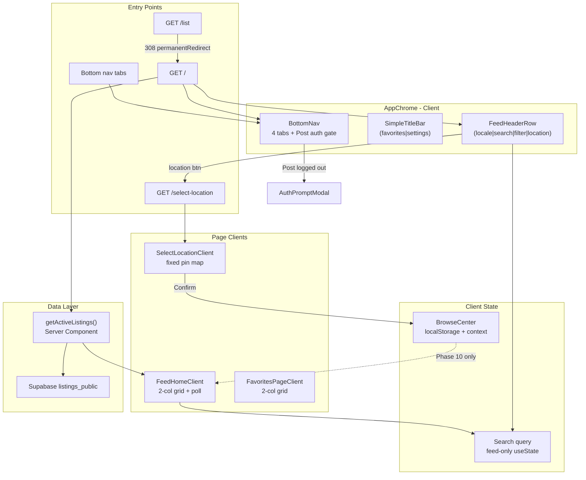

# Phase 9: Feed-First Home & Navigation IA - Research

**Researched:** 2026-08-09
**Domain:** Next.js App Router shell refactor, route migration, Stitch feed chrome, MapLibre select-location
**Confidence:** HIGH

## Summary

Phase 9 is a **consumer-shell IA pivot**, not a greenfield feature. The implementation path is well-defined: swap `app/page.tsx` from `MapHomeClient` to a new `FeedHomeClient` (ported from `ListPageClient`), add `/select-location` by extracting map primitives from `MapExplorer`, and refactor `AppChrome` + `BottomNav` for route-conditional chrome. **No new npm packages** are required — the stack already has Next.js 16 App Router, MapLibre/react-map-gl, Radix toast, Vitest, and the Stitch token layer.

The highest-risk work is **cross-cutting shell coordination**: scroll-away feed header lives in `AppChrome` while scroll containers live inside page clients; retiring `Header`/`NavMenuDrawer`/`map-search-ui` without breaking layout chunk size; and the **description search gap** — `listings_public` and `ACTIVE_LISTING_COLUMNS` do not expose description fields today, yet D-06 requires title + description + location-label search.

**Primary recommendation:** Implement as a **route-conditional shell refactor** with three new client surfaces (`FeedHomeClient`, `FeedHeaderRow`, `SelectLocationClient`), one new browse-center module mirroring `lib/settings/preferences.ts`, and colocated `permanentRedirect('/')` on `/list` — defer MapExplorer bottom-sheet retirement to unused-code cleanup after select-location ships.

---

<user_constraints>
## User Constraints (from CONTEXT.md)

### Locked Decisions

- **D-01:** **Bottom nav is 4 tabs: Home · Post · Favorites · Settings** — supersedes milestone-locked NAV-02 ("Post via drawer only"). Post is a primary bottom tab with `add_box` icon. — **Reversibility:** costly — nav IA touches routes, i18n, E2E, and AppChrome.
- **D-02:** **Location button opens `/select-location`** (fixed center pin + bottom Confirm), not a browse-all-listings map. This satisfies NAV-03's "map secondary" intent via location-setting UX; browse-on-map pins are **not** Phase 9. — **Reversibility:** reversible — route and component choice.
- **D-03:** **Filter button visible but stubbed** — tap shows trilingual toast ("Filters coming soon"); no filter sheet until Phase 10 (HOME-02 filter control present, FILT-* deferred).

#### Unified Feed Header (HOME-02)

- **D-04:** Replace consumer **Header** with a unified **HOME-02 search row** on feed home: `[locale chip] [search field] [filter icon] [location icon]` left-to-right.
- **D-05:** **Compact locale chip** at row start (中 / EN / IT); tap opens full language picker (reuse `HeaderLanguageDropdown` behavior).
- **D-06:** **Always-visible inline search** field (not icon-only toggle). Phase 9 search matches **title + description** (and location label if present on listing).
- **D-07:** **Remove hamburger menu** — retire `NavMenuDrawer` from consumer shell; no overflow drawer in Phase 9.
- **D-08:** **Scroll-away header** on feed — search row hides on scroll down, reappears on scroll up; bottom nav stays fixed.
- **D-09:** **Desktop:** search row uses `max-w-container-max` centered layout (same controls as mobile).
- **D-10:** **No app title in feed header** — branding only on Settings tab (see Settings chrome).
- **D-11:** **Remove inline category chips** from feed (`SubitoCategoryFilterChips` off home); category selection waits for Phase 10 filter sheet.
- **D-12:** **No active filter pills** on feed in Phase 9 (FILT-03 deferred).
- **D-13:** **Zone filters map-only** — Venice zone / Padova chips appear on `/select-location` only; feed shows all zones until Phase 10.

#### Bottom Navigation (NAV-01)

- **D-14:** Tab order: **Home · Post · Favorites · Settings** with hrefs `/`, `/post`, `/favorites`, `/settings`.
- **D-15:** Home tab icon: **`grid_view`** (grid feed, not house).
- **D-16:** Active tab: **filled Material icon + bold `text-primary`** (Stitch accent — not Snag red pill).
- **D-17:** **UnreadMatchBadge stays on Settings tab** (current behavior).
- **D-18:** **Post tab:** navigate to full-page `/post`; **auth gate on tap** — logged-out users see sign-in prompt before post flow.

#### Select Location Secondary Flow (`/select-location`)

- **D-19:** Route **`/select-location`** (not `/map`). Location (📍) button in header navigates here.
- **D-20:** **Fixed center pin** on MapLibre map; user pans map to position pin (select-location pattern). Bottom primary button **「Confirm location」** (zh: 确认位置 / en: Confirm location / it: Conferma posizione) returns to feed `/`.
- **D-21:** **Locate Me** control retained (recenter on browser geolocation).
- **D-22:** **Zone chips on select-location view** (Centro / Mestre / Lido + Padova filter).
- **D-23:** **Minimal chrome:** hide HOME-02 search row and **hide bottom nav** on `/select-location`.
- **D-24:** **Exit paths:** top-left back chevron **and** location button toggles off (returns to feed).
- **D-25:** **No bottom tab highlighted** while on `/select-location`.
- **D-26:** **Feed search does not apply** to select-location map (search is feed-only).
- **D-27:** **Confirm persists `{ lat, lng, label? }`** to browse-center state (React context + `localStorage` hydrate); **does not filter or sort feed** until Phase 10 radius/distance.
- **D-28:** **Refactor `MapExplorer`** — strip bottom sheet; reuse MapLibre pin rendering + zone chip patterns for select-location (planner discretion on file split).

#### Route Migration (HOME-03, NAV-04)

- **D-29:** **`/` renders two-column mobile grid feed** (new feed home client — port from `ListPageClient` patterns).
- **D-30:** **`/list` → `/` permanent redirect** (Next.js redirect); remove List from all nav surfaces.
- **D-31:** **`/post`, `/favorites`, `/settings`, `/listing/[id]`, `/admin/*` unchanged** in routing shape; admin keeps separate chrome (no bottom nav).
- **D-32:** Accept v2 pivot: users who bookmarked map-first **`/`** now land on feed grid.

#### Favorites Tab (interim — Phase 12 deferred)

- **D-33:** Favorites tab shows **restyled flat favorites** in **two-column grid** (not category folders yet).
- **D-34:** **Login gate** for anonymous users (current auth-gated favorites behavior).
- **D-35:** Favorites uses **simple title bar** (not HOME-02 search row).
- **D-36:** **No "folders coming soon" teaser**; Phase 12 adds folders silently.
- **D-37:** **Unfavorite toggle** on favorites grid cards (reuse `FavoriteButton`).

#### Feed Grid Shell (HOME-01)

- **D-38:** Mobile **two-column grid** (`grid-cols-2` from default mobile breakpoint).
- **D-39:** Reuse **`ListListingCard`** as-is; Phase 11 polishes FREE badge / heart / distance metadata.
- **D-40:** Grid gap **`gap-space-md`** (16px).
- **D-41:** Sort **newest first** (`posted_at` descending — current query order).
- **D-42:** **Load all active listings** (no pagination/infinite scroll); reuse **`useListingsPoll`** + pull-to-refresh.
- **D-43:** **Stitch empty state** — bordered panel + icon + title/description (current `ListPageClient` pattern).

#### Settings Chrome (Phase 14 content deferred)

- **D-44:** Phase 9 **nav chrome only** for Settings — page content restyle (DND, delete account) stays Phase 14.
- **D-45:** Settings shows **centered app title 「手慢无」** in title bar (only consumer screen with app name in header).
- **D-46:** **「Manage my posts」** link moves to Settings screen (replacing drawer entry).

#### Internationalization (I18N-01 partial)

- **D-47:** New nav labels in **zh / en / it**: Home / Post / Favorites / Settings (zh: 首页 / 发布 / 收藏 / 设置).
- **D-48:** Trilingual **filter stub toast**, **Confirm location** button, and all new header chrome strings.

### Claude's Discretion

- Bottom nav active-state micro-interactions (within D-16 Stitch filled + bold constraint).
- Exact `localStorage` key name for browse center (e.g. `shoumanwu_browse_center`).
- Pull-to-refresh vs poll-only emphasis (prefer keeping both if already wired on list).
- `MapExplorer` refactor file layout (`SelectLocationClient` vs trimmed explorer).
- Post tab `add_box` icon sizing to match Stitch density.

### Deferred Ideas (OUT OF SCOPE)

- **Filter bottom sheet + radius slider + active pills** — Phase 10 (FILT-01–05)
- **Apply browse center to feed filtering/sorting** — Phase 10 haversine + radius
- **Grid card polish (FREE badge, distance metadata)** — Phase 11
- **Favorites category folder grid** — Phase 12
- **Full Select Location for UGC post coordinates** — Phase 13 (Phase 9 establishes route + confirm pattern)
- **Settings content restyle, DND, delete account** — Phase 14
- **Hamburger overflow menu** — removed; manage-post link moved to Settings
- **Browse-all-listings map view** — not requested; could be backlog if users want pin browsing later

</user_constraints>

<phase_requirements>
## Phase Requirements

| ID | Description | Research Support |
|----|-------------|------------------|
| NAV-01 | Bottom nav Home · Favorites · Settings (Stitch-styled) | **Override D-01:** 4 tabs incl. Post + Favorites; `BottomNav.tsx` restructure; filled icon active state (D-16) |
| NAV-02 | Post via menu/drawer only | **Superseded by D-01** — Post is bottom tab; document override in plan traceability |
| NAV-03 | Map secondary via location button | **Override D-02:** `/select-location` fixed-pin flow, not browse-all-pins map |
| NAV-04 | Default `/` is grid feed | `app/page.tsx` swap; retire `MapHomeClient` at home |
| HOME-01 | Two-column mobile grid | Port `ListPageClient` → `FeedHomeClient` with `grid-cols-2 gap-space-md` |
| HOME-02 | Unified search row (locale, search, filter, location) | New `FeedHeaderRow`; filter stub toast; scroll-away (D-08) |
| HOME-03 | `/list` merges into feed home | `permanentRedirect('/')` on `app/list/page.tsx` [CITED: next.js redirects docs] |
| I18N-01 | New strings in zh/en/it | Keys in `09-UI-SPEC.md` Copywriting Contract; `messages/key-parity.test.ts` gates parity |

</phase_requirements>

## Architectural Responsibility Map

| Capability | Primary Tier | Secondary Tier | Rationale |
|------------|-------------|----------------|-----------|
| Feed grid + client search | Browser / Client | Frontend Server (SSR initial fetch) | Search/filter-on-feed is client-side over SSR-hydrated listing array; no new API |
| Route `/` feed home | Frontend Server | Browser | `app/page.tsx` Server Component fetches `getActiveListings()` then passes to client |
| `/list` → `/` redirect | Frontend Server | CDN (308 cache) | Server redirect in page or `next.config.ts` `redirects()` |
| Bottom nav + tab auth gate | Browser / Client | — | `BottomNav` intercepts Post tap; `useAuthSession` + `AuthPromptModal` |
| Feed header row + scroll-away | Browser / Client | — | Header chrome is client; scroll container is inside `FeedHomeClient` |
| Browse center persistence | Browser / Client | — | `localStorage` + React context; consumed Phase 10 for radius |
| Select-location map | Browser / Client | — | MapLibre dynamic import; geolocation via `GeolocateControl` |
| Settings manage-posts link | Browser / Client | — | Link in settings body; route unchanged `/post/manage` |
| Listing data fetch/order | API / Backend (Supabase) | Frontend Server | Existing `listings_public` view + `posted_at desc` |
| Admin chrome | Frontend Server | — | `AppChrome` already bypasses nav for `/admin/*` |

## Standard Stack

### Core

| Library | Version | Purpose | Why Standard |
|---------|---------|---------|--------------|
| next | ^16.2.12 (installed) | App Router, redirects, RSC fetch | Project stack; redirect APIs verified [CITED: /vercel/next.js/v16.2.9] |
| react / react-dom | ^19.2.8 | Client shell components | Existing app |
| maplibre-gl + react-map-gl | ^6.0.0 / ^8.1.2 | Select-location map | Phase 2 pattern; reuse `maplibreWorker` shim |
| @radix-ui/react-toast | ^1.2.23 | Filter stub toast | Existing `toast()` in `components/ui/toaster.tsx` |
| vitest | ^3.2.4 | Unit tests for new lib modules | Existing `npm test` |

### Supporting

| Library | Version | Purpose | When to Use |
|---------|---------|---------|-------------|
| vaul Drawer | ^1.1.2 | MapExplorer bottom sheet | **Retire from consumer `/`**; keep import if MapExplorer kept for reference |
| @radix-ui/react-dropdown-menu | ^2.1.24 | Locale picker | Wrap in `CompactLocaleChip` from `HeaderLanguageDropdown` logic |

### Alternatives Considered

| Instead of | Could Use | Tradeoff |
|------------|-----------|----------|
| `permanentRedirect` in `app/list/page.tsx` | `next.config.ts` `redirects()` | Config redirect runs earlier (before page bundle); page redirect is colocated and simpler |
| New scroll library | CSS transform + scroll listener | No dependency; matches Stitch minimal stack |
| Extend `MapExplorer` in place | New `SelectLocationClient` | Cleaner separation; MapExplorer stays map-browse legacy |

**Installation:** None — phase uses existing dependencies only.

**Version verification:** `next@16.2.12` in `package.json`; redirect behavior from Next.js 16.2.9 docs [CITED: /vercel/next.js/v16.2.9].

## Package Legitimacy Audit

> Phase 9 installs **no external packages**. Audit skipped — nothing to approve.

| Package | Registry | Verdict | Disposition |
|---------|----------|---------|-------------|
| — | — | — | No new installs |

**Packages removed due to [SLOP] verdict:** none  
**Packages flagged as suspicious [SUS]:** none

## Technical Approach

### 1. Route migration

**`/` → feed home**

```typescript
// app/page.tsx — after change
import { FeedHomeClient } from '@/components/listings/FeedHomeClient';
import { getActiveListings } from '@/lib/listings/queries';

export const dynamic = 'force-dynamic';

export default async function FeedHomePage() {
  let listings = [];
  try {
    listings = await getActiveListings();
  } catch (error) {
    console.error('Failed to load listings for feed home:', error);
  }
  return <FeedHomeClient initialListings={listings} />;
}
```

**`/list` → `/` permanent redirect (D-30)**

Prefer colocated server redirect in `app/list/page.tsx`:

```typescript
// Source: https://github.com/vercel/next.js/blob/v16.2.9/docs/01-app/03-api-reference/04-functions/permanentRedirect.mdx
import { permanentRedirect } from 'next/navigation';

export default function ListPage() {
  permanentRedirect('/');
}
```

Alternative (planner choice): add to `next.config.ts` for edge-level 308:

```typescript
async redirects() {
  return [{ source: '/list', destination: '/', permanent: true }];
}
```

Use **one** mechanism, not both — duplicate redirects confuse debugging.

**New `/select-location`**

- `app/select-location/page.tsx` — minimal server wrapper; dynamic-import map client (mirror `MapHomeClient` pattern).
- `AppChrome`: hide `FeedHeaderRow` + `BottomNav` when `pathname === '/select-location'`.

### 2. Shell refactor (`AppChrome`)

Replace global `Header` with **route-conditional chrome**:

| Route | Top chrome | Bottom nav |
|-------|------------|------------|
| `/` | `FeedHeaderRow` | 4-tab `BottomNav` |
| `/favorites` | `SimpleTitleBar` (page title) | yes |
| `/settings` | `SimpleTitleBar` (`messages.app.title`) | yes |
| `/select-location` | minimal back bar inside client | **hidden** |
| `/listing/[id]` | `DetailTopBar` (existing) | hidden (existing) |
| `/admin/*` | none | none (existing) |
| `/post`, `/post/manage` | none or minimal | yes |

Retire consumer usage of `Header.tsx` + `NavMenuDrawer` — file can remain until dead-code cleanup.

### 3. Feed home client (port from `ListPageClient`)

| Keep from `ListPageClient` | Drop / change |
|---------------------------|---------------|
| `useListingsPoll`, `excludeReportedIds`, reported IDs listener | `SubitoCategoryFilterChips` (D-11) |
| `ListListingCard`, Stitch empty state | Single-column responsive grid → **`grid-cols-2 gap-space-md`** (D-38/D-40) |
| Search state | Expand search: title + location label + description (see gap below) |
| — | Inline search UI moves to `FeedHeaderRow` in AppChrome |

**Search filter (extract pure function for tests):**

```typescript
// lib/listings/feed-search.ts (recommended)
export function matchesFeedSearch(
  listing: ListingRow,
  query: string,
  locale: AppLanguage,
  zoneLabel: (z: VeniceZone) => string,
): boolean {
  const q = query.trim().toLowerCase();
  if (!q) return true;
  const title = resolveListingTitle(listing, locale).toLowerCase();
  const location = listingLocationLabel(listing, zoneLabel).toLowerCase();
  const description = (resolveListingDescription(listing, locale) ?? '').toLowerCase();
  return title.includes(q) || location.includes(q) || description.includes(q);
}
```

### 4. Browse center module (D-27)

Mirror `lib/settings/preferences.ts` pattern:

| Piece | Recommendation |
|-------|----------------|
| Key | `shoumanwu_browse_center` (matches `shoumanwu_*` convention) |
| Shape | `{ lat: number; lng: number; label?: string }` |
| API | `readBrowseCenter()`, `writeBrowseCenter()`, `subscribeBrowseCenter`, React context provider in `components/providers/` |
| Provider mount | `app/layout.tsx` alongside `AppThemeProvider` |
| Phase 9 behavior | Persist on Confirm; **do not** filter feed |

Optional label: derive via `nearestVeniceZone()` + `zoneLabel()` or reverse-geocode deferred.

### 5. Select-location client (D-19–D-28)

**Fixed center pin pattern** (different from `PinMap` draggable marker):

- Full-viewport `Map` from react-map-gl/maplibre
- **CSS-fixed center pin** overlay (`absolute inset-0 pointer-events-none flex center`)
- On `onMoveEnd`, read `mapRef.getMap().getCenter()` for `{ lat, lng }`
- Reuse `LocateMeButton` (`GeolocateControl`)
- Extend zone chips for **Padova** (D-22) — current `ZoneFilterChips` is Venice-only; add Padova chip that `flyTo` Padova bbox center (see `lib/listings/filters.test.ts` Padova fixture)
- Bottom fixed Confirm bar → `writeBrowseCenter` + `router.push('/')`
- **No** listing pins, **no** vaul Drawer, **no** `ListingFeed`

Dynamic import with SSR false (same as `MapHomeClient`):

```typescript
const SelectLocationClient = dynamic(
  () => import('@/components/map/SelectLocationClient').then(m => m.SelectLocationClient),
  { ssr: false, loading: () => /* post.mapLoading */ },
);
```

### 6. Bottom nav (D-14–D-18)

```typescript
const navItems = [
  { href: '/', icon: 'grid_view', label: messages.nav.home, exact: true },
  { href: '/post', icon: 'add_box', label: messages.nav.post, authGate: true },
  { href: '/favorites', icon: 'favorite', label: messages.nav.favorites },
  { href: '/settings', icon: 'settings', label: messages.nav.settings, showBadge: true },
];
```

- Active icon: `fontVariationSettings: "'FILL' 1, 'wght' 400"` when active (D-16)
- Post tab: if `!user`, `preventDefault` + open `AuthPromptModal` with `redirectTo="/post"`
- Hide entire `<nav>` when `pathname === '/select-location'` (D-23)
- No tab active on `/select-location` (D-25)

### 7. Scroll-away header (D-08)

**Problem:** `FeedHeaderRow` renders in `AppChrome` above `.app-main`, but feed scroll happens inside `FeedHomeClient`'s inner `overflow-y-auto` div (same structure as `ListPageClient`).

**Recommended pattern:** lightweight `FeedScrollContext`

1. `FeedHomeClient` registers scroll container ref + attaches `scroll` listener (threshold ~8px, direction delta).
2. `FeedHeaderRow` consumes context → applies `-translate-y-full opacity-0` with `transition-transform` when `hidden`.
3. Bottom nav unaffected (sibling in `.app-shell` flex column).

No third-party scroll library [ASSUMED: sufficient for mobile feed velocity].

### 8. Retire map-first artifacts

| Artifact | Action |
|----------|--------|
| `lib/ui/map-search-ui.ts` | Remove imports from retired `Header`; delete if unused |
| `MapHomeClient` / `MapExplorer` at `/` | Unhook from home; keep files until Phase 13 or delete if unreferenced |
| `NavMenuDrawer` | Remove from shell; manage-post link → Settings (D-46) |
| `app/layout.tsx` metadata | Update title from "Map Explorer" to feed-appropriate string |
| `messages.nav.map` / `nav.list` | Retire from bottom nav; keys may remain for cleanup |

## File-by-File Change Inventory

### Routes (`app/`)

| File | Action | Details |
|------|--------|---------|
| `app/page.tsx` | **Modify** | Replace `MapHomeClient` → `FeedHomeClient` |
| `app/list/page.tsx` | **Modify** | Replace render with `permanentRedirect('/')` |
| `app/select-location/page.tsx` | **Create** | SSR shell + dynamic `SelectLocationClient` |
| `app/layout.tsx` | **Modify** | Add `BrowseCenterProvider`; update metadata title/description |
| `next.config.ts` | **Optional** | `/list` redirect if not using page-level redirect |

### Shell (`components/shell/`)

| File | Action | Details |
|------|--------|---------|
| `AppChrome.tsx` | **Modify** | Route-conditional chrome; remove global `Header` |
| `BottomNav.tsx` | **Modify** | 4-tab IA, FILL active icons, Post auth gate, hide on select-location |
| `FeedHeaderRow.tsx` | **Create** | HOME-02 row; filter toast; location link; scroll-away |
| `CompactLocaleChip.tsx` | **Create** | Chip UI wrapping dropdown logic from `HeaderLanguageDropdown` |
| `SimpleTitleBar.tsx` | **Create** | Centered title for favorites/settings |
| `Header.tsx` | **Deprecate** | Remove from consumer shell (keep file short-term) |
| `NavMenuDrawer.tsx` | **Deprecate** | No consumer imports |

### Listings (`components/listings/`)

| File | Action | Details |
|------|--------|---------|
| `FeedHomeClient.tsx` | **Create** | Port from `ListPageClient`; 2-col grid; feed scroll context |
| `ListPageClient.tsx` | **Remove or stub** | Replaced by redirect at route level |
| `FavoritesPageClient.tsx` | **Modify** | 2-col `ListListingCard` grid; remove `ZoneFilterChips`; update empty CTA to `feed.browseFeed` |
| `ListListingCard.tsx` | **Reuse as-is** | D-39 |

### Map (`components/map/`)

| File | Action | Details |
|------|--------|---------|
| `SelectLocationClient.tsx` | **Create** | Fixed pin, zone+Padova chips, Confirm bar, back chevron |
| `MapExplorer.tsx` | **Modify or freeze** | Strip sheet if reused; otherwise leave unused |
| `MapHomeClient.tsx` | **Deprecate** | No longer imported by `/` |
| `ZoneFilterChips.tsx` | **Extend** | Padova chip for select-location (D-22) |
| `LocateMeButton.tsx` | **Reuse** | Unchanged |

### Settings (`components/settings/`)

| File | Action | Details |
|------|--------|---------|
| `SettingsPageClient.tsx` or `GeneralSection.tsx` | **Modify** | Add link to `/post/manage` (D-46); title bar moves to `AppChrome` |

### Lib (`lib/`)

| File | Action | Details |
|------|--------|---------|
| `lib/browse-center/storage.ts` | **Create** | localStorage + types (mirror favorites/preferences) |
| `lib/browse-center/context.tsx` | **Create** | Provider + hooks |
| `lib/listings/feed-search.ts` | **Create** | Pure search matcher for tests |
| `lib/listings/client-queries.ts` | **Maybe modify** | Add description columns if migration done |
| `lib/listings/queries.ts` | **Maybe modify** | Same |
| `lib/ui/map-search-ui.ts` | **Remove** | Orphan after Header retirement |

### Messages (`messages/`)

| File | Action | Details |
|------|--------|---------|
| `zh.ts`, `en.ts`, `it.ts` | **Modify** | Add keys from `09-UI-SPEC.md` Copywriting Contract |
| `index.ts` | **Modify** | Type exports if new message namespaces added |

### Database (conditional)

| File | Action | Details |
|------|--------|---------|
| `supabase/migrations/0xx_listings_public_description.sql` | **Maybe create** | Expose `description`, `description_en`, `description_zh` on `listings_public` for D-06 |

### Tests

| File | Action | Details |
|------|--------|---------|
| `lib/browse-center/storage.test.ts` | **Create** | Round-trip, invalid JSON, SSR guard |
| `lib/listings/feed-search.test.ts` | **Create** | Title, location, description matching |
| `messages/key-parity.test.ts` | **Auto gate** | Fails if new keys missing in zh/en/it |

## Architecture Patterns

### System Architecture Diagram



### Recommended Project Structure

```
components/
├── shell/
│   ├── AppChrome.tsx          # route-conditional chrome
│   ├── FeedHeaderRow.tsx      # NEW — HOME-02
│   ├── SimpleTitleBar.tsx     # NEW
│   ├── BottomNav.tsx          # 4-tab IA
│   └── CompactLocaleChip.tsx  # NEW
├── listings/
│   ├── FeedHomeClient.tsx     # NEW — feed at /
│   └── FavoritesPageClient.tsx
├── map/
│   └── SelectLocationClient.tsx  # NEW
lib/
├── browse-center/
│   ├── storage.ts             # NEW
│   └── context.tsx            # NEW
└── listings/
    └── feed-search.ts           # NEW — testable search
app/
├── page.tsx                   # feed home
├── list/page.tsx              # permanentRedirect
└── select-location/page.tsx   # NEW
```

### Pattern 1: Route-conditional AppChrome

**What:** Single layout wrapper inspects `usePathname()` and renders matching chrome.  
**When to use:** Any time top/bottom shell differs per route (already started for admin + listing detail).  
**Example:**

```typescript
// Extend existing AppChrome pattern
const pathname = usePathname();
const showFeedHeader = pathname === '/';
const showBottomNav = !pathname.startsWith('/admin')
  && !pathname.startsWith('/listing/')
  && pathname !== '/select-location';
```

### Pattern 2: Colocated permanent redirect

**What:** `permanentRedirect('/')` in `app/list/page.tsx` issues HTTP 308.  
**When to use:** Legacy route retirement with bookmark preservation (HOME-03).  
**Example:** See Technical Approach §1 [CITED: /vercel/next.js/v16.2.9].

### Pattern 3: Browse-center storage (from Phase 2 favorites/preferences)

**What:** `shoumanwu_*` localStorage key + parse/write helpers + custom event for cross-tab sync.  
**When to use:** Any persisted client preference not yet on Supabase.  
**Example:** Copy structure from `lib/favorites/storage.ts` and `lib/settings/preferences.ts`.

### Pattern 4: Dynamic map import (from v1 Phase 2)

**What:** `next/dynamic` with `ssr: false` + `maplibreWorker` side-effect import.  
**When to use:** All MapLibre routes — avoids SSR canvas/worker failures.  
**Example:** `components/map/MapHomeClient.tsx` (existing).

### Anti-Patterns to Avoid

- **Putting feed scroll on `window`:** `.app-shell` uses `overflow-hidden`; scroll must stay in page client inner container.
- **Keeping MapExplorer bottom sheet at `/`:** Violates D-02/D-29; browse-all-pins is out of scope.
- **Default shadcn nav styling:** Snag red capsule / saturated pills blocked by Stitch rule.
- **Duplicating listing fetch in header:** Search filters client array from `FeedHomeClient`; header holds query state via context or lifted props.

## Patterns to Reuse from v1 Phase 2

| Phase 2 asset | Phase 9 reuse | Retire |
|---------------|---------------|--------|
| `ListPageClient` grid/search/poll/empty | Port → `FeedHomeClient` | Category chips, 1-col default grid |
| `MapExplorer` + `ListingMap` MapLibre setup | Extract map canvas + zone chips → `SelectLocationClient` | Bottom sheet Drawer, listing pins, `FloatingMapSearch` |
| `ZoneFilterChips` Stitch chip variants | Select-location zone row (+ Padova extension) | On favorites feed |
| `useListingsPoll` 5-min poll | Feed home refresh | — |
| `HeaderLanguageDropdown` Radix dropdown | Logic in `CompactLocaleChip` | Hamburger + map search toggle |
| `BottomNav` dynamic `UnreadMatchBadge` | Settings tab badge (D-17) | Map/List tab entries |
| `PinMap` draggable marker | **Do not reuse** for select-location | Fixed center pin is different UX |
| `LocateMeButton` | Select-location geolocation | — |
| `lib/settings/preferences.ts` localStorage | Template for `browse-center` module | — |
| Phase 2 Stitch tokens in `app/globals.css` | All new chrome | — |

## Don't Hand-Roll

| Problem | Don't Build | Use Instead | Why |
|---------|-------------|-------------|-----|
| Permanent redirect | Custom middleware rewrite | `permanentRedirect()` or `next.config` redirects | Correct 308 semantics, Next.js cache behavior [CITED: next.js] |
| Toast notifications | alert() / custom div | Existing `toast()` + Radix Toaster | Already restyled to Stitch |
| Map tile rendering | Custom canvas | MapLibre + OpenFreeMap style URL | Worker bundling already solved |
| Auth session check on Post tab | New auth API | `useAuthSession` + `AuthPromptModal` | Established gate pattern |
| i18n | Hardcoded strings | `messages/{zh,en,it}.ts` + `useMessages()` | `key-parity.test.ts` enforcement |
| Language picker | New menu | Radix dropdown from `HeaderLanguageDropdown` | Proven a11y |

**Key insight:** Phase 9 is composition of existing primitives — the planner should minimize new abstractions beyond browse-center and feed-search extract.

## Risks and Integration Points

| Risk | Severity | Mitigation |
|------|----------|------------|
| **Description search without DB columns** — `listings_public` lacks `description*` (verified in `020_subito_location_category.sql`) | HIGH | Either add migration exposing description columns to public view, or Phase 9 search title+location only and document partial D-06 |
| **Scroll-away header / scroll container split** | MEDIUM | `FeedScrollContext` bridging AppChrome header and FeedHomeClient scroller |
| **Layout chunk 2 MiB dev truncation** — Header currently dynamic-imports heavy overlays | MEDIUM | Keep `HeaderLanguageDropdown` / auth modals dynamically imported in new chrome |
| **MapLibre worker blank canvas** — documented in `next.config.ts` comments | MEDIUM | Never add `maplibre-gl` to `transpilePackages`; always import `@/lib/map/maplibreWorker` first |
| **Bookmarked `/` map users** | LOW | Accepted product decision D-32; no redirect needed |
| **`/list` links in codebase** | MEDIUM | Grep `href="/list"` and drawer items; update tests/messages |
| **Padova zone chip not in `ZoneFilterChips`** | MEDIUM | Extend chip row or add parallel Padova toggle on select-location only |
| **Favorites empty CTA still says browseMap** | LOW | Switch to `feed.browseFeed` key per UI-SPEC |
| **Manage posts only in NavMenuDrawer today** | LOW | Add to Settings (`messages.post.manageLink` exists) |
| **Requirement traceability NAV-02 conflict** | LOW | Plan must note D-01 override explicitly |

**Integration points:**

- `AppChrome` ↔ all consumer routes
- `FeedHeaderRow` ↔ `FeedHomeClient` (search query state)
- `SelectLocationClient` ↔ `BrowseCenterProvider`
- `BottomNav` ↔ Supabase session (Post gate)
- `messages/*` ↔ `key-parity.test.ts`
- Optional: Supabase view ↔ feed search breadth

## Common Pitfalls

### Pitfall 1: Description search silently no-op

**What goes wrong:** Search never matches body text because columns aren't fetched.  
**Why it happens:** `ACTIVE_LISTING_COLUMNS` omits description fields; public view excludes them.  
**How to avoid:** Migration + column extend, or scope search to title+location with explicit partial compliance.  
**Warning signs:** D-06 acceptance tests pass on title only.

### Pitfall 2: Scroll-away never triggers

**What goes wrong:** Header stays fixed while grid scrolls inside nested container.  
**Why it happens:** Listener attached to `.app-main` but scroll happens in child `overflow-y-auto`.  
**How to avoid:** Register scroll on the inner feed scroller via context.  
**Warning signs:** Manual QA on mobile — header never hides.

### Pitfall 3: Bottom nav shows on select-location

**What goes wrong:** Violates D-23 minimal chrome.  
**Why it happens:** `BottomNav` rendered unconditionally in `AppChrome`.  
**How to avoid:** `pathname !== '/select-location'` guard.  
**Warning signs:** E2E/manual: Confirm bar overlaps nav.

### Pitfall 4: Post tab navigates before auth check

**What goes wrong:** Logged-out user lands on `/post` then sees form gate.  
**Why it happens:** Plain `<Link href="/post">` without intercept.  
**How to avoid:** `onClick` preventDefault + modal when `!user`.  
**Warning signs:** `/post` loads without session.

### Pitfall 5: Material icon active state missing FILL

**What goes wrong:** Active tab looks identical to inactive — Stitch violation.  
**Why it happens:** Outlined icons default `FILL 0`.  
**How to avoid:** Inline `fontVariationSettings` toggle per D-16.  
**Warning signs:** UI checker Dimension 2/3 fail.

## Code Examples

### Permanent redirect `/list` → `/`

```typescript
// Source: https://github.com/vercel/next.js/blob/v16.2.9/docs/01-app/03-api-reference/04-functions/permanentRedirect.mdx
import { permanentRedirect } from 'next/navigation';

export default function ListPage() {
  permanentRedirect('/');
}
```

### next.config permanent redirect (alternative)

```typescript
// Source: https://github.com/vercel/next.js/blob/v16.2.9/docs/01-app/03-api-reference/05-config/01-next-config-js/redirects.mdx
async redirects() {
  return [{ source: '/list', destination: '/', permanent: true }];
}
```

### Filter stub toast

```typescript
// Reuse existing pattern from FavoriteButton.tsx
import { toast } from '@/components/ui/toaster';

function onFilterClick() {
  toast(messages.feed.filterComingSoon);
}
```

### Fixed center pin map center read

```typescript
// Source: react-map-gl MapRef pattern (project uses same in ListingMap)
const onMoveEnd = useCallback(() => {
  const map = mapRef.current?.getMap();
  if (!map) return;
  const { lat, lng } = map.getCenter();
  setCenter({ lat, lng });
}, []);
```

### Bottom nav active Material icon

```typescript
<span
  className="material-symbols-outlined text-[20px]"
  style={{ fontVariationSettings: isActive ? "'FILL' 1, 'wght' 400" : "'FILL' 0, 'wght' 400" }}
>
  {item.icon}
</span>
```

## State of the Art

| Old Approach | Current Approach | When Changed | Impact |
|--------------|------------------|--------------|--------|
| Map-first `/` + bottom sheet | Feed grid at `/` | Phase 9 (v2.0) | Bookmarks to `/` change behavior |
| Map / List / Post / Settings nav | Home / Post / Favorites / Settings | Phase 9 D-01 | NAV-02 superseded |
| Hamburger `NavMenuDrawer` | Retired; Settings holds manage link | Phase 9 D-07/D-46 | Fewer overlay chunks in layout |
| Icon-only map search in Header | Always-visible inline search row | Phase 9 HOME-02 | Retire `map-search-ui` module |

**Deprecated/outdated:**
- `lib/ui/map-search-ui.ts` — tied to retired map-first Header search toggle
- `MapHomeClient` as default home — replaced by `FeedHomeClient`

## Project Constraints (from .cursor/rules/)

- All user-facing UI MUST follow `.planning/google-stitch-ui-design/` — read `DESIGN.md` + screen `code.html` before UI work
- Monochrome document-first; thin `#e5e5e5` borders; no card drop shadows
- Inter typography + Material Symbols Outlined; 4px spacing grid
- Use `@theme` tokens from `app/globals.css` — not default shadcn/Tailwind themes
- shadcn/Radix OK only when restyled to Stitch tokens
- **Blocking:** Snag red capsule nav, saturated nav accents, hamburger on consumer feed, category chips on home, filter sheet in Phase 9

## Assumptions Log

| # | Claim | Section | Risk if Wrong |
|---|-------|---------|---------------|
| A1 | Scroll-away via context + CSS transform is sufficient (no scroll library) | Technical Approach §7 | Janky header on iOS; may need `position: sticky` fallback |
| A2 | Phase 9 can ship description search only if migration adds public description columns | Risks | D-06 partial compliance |
| A3 | Padova chip on select-location can reuse city-based flyTo without new enum type | Select-location | Chip behavior mismatches Phase 10 filter model |
| A4 | No pull-to-refresh exists today — poll-only is acceptable (D-42 "if wired") | Feed home | Verified: no pull-to-refresh in codebase grep |
| A5 | `MapExplorer` can remain in repo unused without bundle cost if not imported | Retire artifacts | Tree-shaking should exclude; verify bundle if kept imported elsewhere |

## Open Questions

1. **Description columns on `listings_public`**
   - What we know: View definition in `020_subito_location_category.sql` excludes all description fields; D-06 requires description search.
   - What's unclear: Is a Supabase migration in Phase 9 scope or defer description to title-only?
   - Recommendation: Add thin migration + extend `ACTIVE_LISTING_COLUMNS` if low cost; otherwise document NAV/HOME partial and fix in Phase 10 with filters.

2. **Padova chip UX on select-location**
   - What we know: D-22 requires Padova alongside Venice zone chips; `ZoneFilterChips` is Venice enum only.
   - What's unclear: Padova as separate chip vs extended `ZoneChip` union.
   - Recommendation: Add `Padova` chip that flies map to Padova center; store lat/lng in browse center regardless.

3. **Redirect placement**
   - What we know: Both page-level and config redirects work [CITED: next.js].
   - Recommendation: Page-level `permanentRedirect` in `app/list/page.tsx` for colocation; skip config duplicate.

## Environment Availability

| Dependency | Required By | Available | Version | Fallback |
|------------|------------|-----------|---------|----------|
| Node.js | build/test/dev | ✓ | v23.10.0 | — |
| npm | scripts | ✓ | 11.4.2 | — |
| Next.js dev server | manual QA | ✓ | 16.2.12 | — |
| Supabase env | listing fetch | ✓/✗ | — | Empty feed (existing graceful degrade) |
| MapLibre / OpenFreeMap tiles | select-location | ✓ (network) | maplibre-gl 6.0.0 | Loading label |
| Browser geolocation | Locate Me | ✓ (permission) | — | Silent no-op / existing control behavior |

**Missing dependencies with no fallback:** none for Phase 9 core scope.

**Missing dependencies with fallback:** Supabase unset → empty feed (existing pattern in `app/page.tsx`).

## Validation Architecture

### Test Framework

| Property | Value |
|----------|-------|
| Framework | Vitest 3.2.4 + jsdom |
| Config file | `vitest.config.ts` |
| Quick run command | `npm run test:lib` |
| Full suite command | `npm test` |

### Phase Requirements → Test Map

| Req ID | Behavior | Test Type | Automated Command | File Exists? |
|--------|----------|-----------|-------------------|-------------|
| HOME-01 | 2-col grid renders listings | manual / future component | — | ❌ Wave 0 |
| HOME-02 | Search filters title+location(+desc) | unit | `npx vitest run lib/listings/feed-search.test.ts -x` | ❌ Wave 0 |
| HOME-03 | `/list` redirects to `/` | manual / smoke | curl -I localhost:3000/list | ❌ Wave 0 |
| NAV-01 | 4 tabs present with correct labels | manual | — | ❌ |
| NAV-04 | `/` is feed not map | manual | — | ❌ |
| D-27 | Browse center persist round-trip | unit | `npx vitest run lib/browse-center/storage.test.ts -x` | ❌ Wave 0 |
| I18N-01 | Key parity zh/en/it | unit | `npx vitest run messages/key-parity.test.ts -x` | ✅ |
| D-03 | Filter stub toast copy | unit | covered by key-parity when keys added | ✅ (after keys) |

### Sampling Rate

- **Per task commit:** `npm run test:lib`
- **Per wave merge:** `npm test`
- **Phase gate:** Full suite green before `/gsd-verify-work`

### Wave 0 Gaps

- [ ] `lib/browse-center/storage.test.ts` — browse center persist (D-27)
- [ ] `lib/listings/feed-search.test.ts` — HOME-02 search matcher (D-06)
- [ ] `lib/browse-center/storage.ts` + provider — implementation prerequisite for tests
- [ ] Optional: redirect smoke script or Playwright (none in repo today)

## Security Domain

### Applicable ASVS Categories

| ASVS Category | Applies | Standard Control |
|---------------|---------|-----------------|
| V2 Authentication | yes (Post tab gate) | Reuse `AuthPromptModal` + Supabase session — no new auth path |
| V3 Session Management | no change | Existing Supabase client |
| V4 Access Control | no change | Public listings RLS unchanged |
| V5 Input Validation | yes | Client search: trim/lowercase only; validate lat/lng finite ranges before localStorage write |
| V6 Cryptography | no | No new crypto |

### Known Threat Patterns

| Pattern | STRIDE | Standard Mitigation |
|---------|--------|---------------------|
| XSS via search query | Tampering/Spoofing | React text nodes; no `dangerouslySetInnerHTML` in feed search |
| localStorage poisoned browse center | Tampering | Zod or numeric bounds check on read (mirror `parsePreferences`) |
| Open redirect via Post auth | Spoofing | Reuse `safe-next-path` pattern if redirectTo is parameterized |

## Sources

### Primary (HIGH confidence)

- Codebase inspection — `AppChrome.tsx`, `BottomNav.tsx`, `ListPageClient.tsx`, `MapExplorer.tsx`, `listings_public` migration
- `/vercel/next.js/v16.2.9` — `permanentRedirect`, `next.config` redirects (Context7)

### Secondary (MEDIUM confidence)

- `.planning/phases/09-feed-first-home-navigation-ia/09-UI-SPEC.md` — component contracts
- `.planning/milestones/v1.0-phases/02-map-list-core-browsing/02-CONTEXT.md` — Phase 2 patterns to port/invert

### Tertiary (LOW confidence)

- Scroll-away implementation without dedicated library — marked [ASSUMED] in Assumptions Log

## Metadata

**Confidence breakdown:**
- Standard stack: **HIGH** — no new packages; verified installed versions and Next.js redirect docs
- Architecture: **HIGH** — concrete file inventory from live codebase; Phase 2 port path clear
- Pitfalls: **MEDIUM** — description-column gap and scroll-away coordination need planner decisions

**Research date:** 2026-08-09  
**Valid until:** 2026-09-08 (stable shell refactor; Next.js APIs stable)
