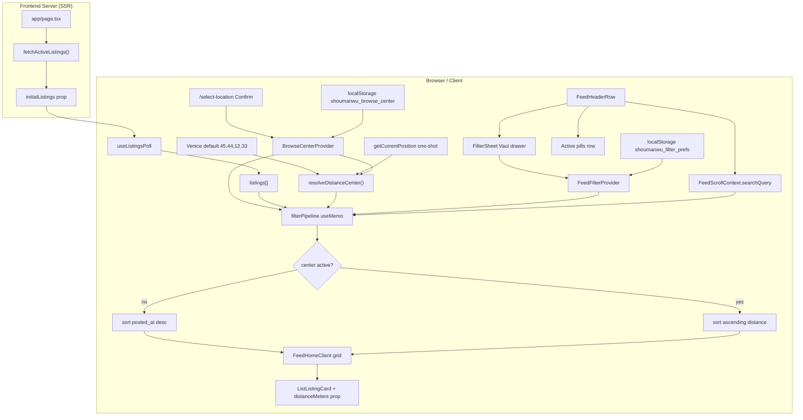

# Phase 10: Search, Filter Sheet & Distance - Research

**Researched:** 2026-08-10
**Domain:** Client-side feed filtering (Vaul bottom sheet, haversine distance, localStorage prefs, Stitch pills)
**Confidence:** HIGH

## Summary

Phase 10 activates deferred Phase 9 behavior: browse center and geolocation become the **distance reference** for client-side haversine filtering, sorting, and card metadata. The work is almost entirely **Browser / Client tier** — no new npm packages, no PostGIS, no API changes. Existing primitives are ready: `vaul@1.1.2` drawer (`components/ui/drawer.tsx`), `BrowseCenterProvider` + `lib/browse-center/storage.ts`, `FeedHomeClient` filter `useMemo`, and `AlertCreateSheet` as a controlled-drawer reference.

The highest-complexity slice is **state architecture**: split filter state out of `FeedScrollContext` into new `FeedFilterContext` (applied vs draft), wire a `FilterSheet` with draft-then-Apply semantics (D-51–55), and implement the **center resolution chain** (browse center → one-shot GPS → Venice default) independently from sheet Apply. Secondary work: **city-only consumer UX** (D-01) — retire zone names/chips from feed, cards, and `/select-location`; map Venice zone enums → city labels in filter logic only.

**Primary recommendation:** Add `lib/geo/haversine.ts` + `lib/filter-prefs/storage.ts`, introduce `FeedFilterProvider` alongside `FeedScrollProvider` in the feed branch of `AppChrome`, and extend `FeedHomeClient` filter pipeline in locked order (search → radius → city → categories → sort) — reuse Vaul drawer and browse-center localStorage patterns; do not add distance npm packages.

---

<user_constraints>
## User Constraints (from CONTEXT.md)

### Locked Decisions

#### Requirement Overrides (user-directed)

- **D-01:** **City-only consumer filter** — Replace Venice zone chips (Centro / Mestre / Lido) with **All · Venice · Padova** in filter sheet and pills. **Never show zone names** in consumer UI again; show **city name only**. — **Reversibility:** costly — supersedes FILT-04 zone-chip UX and Phase 9 D-22; touches filter sheet, pills, cards, select-location, i18n.
- **D-02:** **Data layer retains zone enum** — Map `centro_storico` / `mestre_marghera` / `lido_murano` → Venice, `padova` → Padova for city filter logic; do not migrate schema this phase. — **Reversibility:** reversible — consumer-only hide.
- **D-03:** **Keyword alerts unchanged** — Settings alert zone picker keeps existing zone granularity; city-only browse filter does not migrate alerts in Phase 10.

#### Radius Center & Distance Reference

- **D-04:** **Browse center primary** — Haversine center = user-confirmed pin from `/select-location` when saved.
- **D-05:** **GPS fallback** — When no browse center, use one-shot device geolocation for center.
- **D-06:** **Radius without saved center** — If user adjusts radius slider before confirming a pin, auto-use GPS as temporary center (or Venice default per D-08 if GPS unavailable).
- **D-07:** **Immediate re-filter on center change** — Confirm location on map updates feed filter/sort immediately (not gated by filter sheet Apply).
- **D-08:** **GPS denied fallback** — Use Venice default center `(45.44, 12.33)` when browse center unset and GPS unavailable.
- **D-09:** **Browse center wins over GPS** — Once user confirms a pin, ignore GPS for filtering/distance until center cleared.
- **D-10:** **One-shot GPS only** — No `watchPosition`; read GPS once on load / when needed.
- **D-11:** **Nearest-first sort** — When any center is active, sort feed by ascending distance (replaces Phase 9 newest-first D-41 while center active).
- **D-12:** **Clear center chain** — Dismissing center pill clears browse center → revert to GPS → Venice default.
- **D-13:** **Center indicator pill** — Show trilingual label (pin label, or "My location" for GPS); tap opens `/select-location`; × clears center per D-12.
- **D-14:** **Default radius 10 km** — When user first enables radius (FILT-01 range 1–50 km).
- **D-15:** **Smart distance units** — `"350 m"` under 1 km; `"2.3 km"` at 1 km+; always metric.
- **D-16:** **Radius off = no radius filter** — Separate toggle/checkbox off slider; off shows all listings (city/category/search still apply).
- **D-17:** **Persist radius** — Save to `localStorage` in `shoumanwu_filter_prefs` (FILT-01).
- **D-18:** **GPS center pill copy** — zh: 我的位置 / en: My location / it: La mia posizione.
- **D-19:** **Distance on cards when radius off** — Still show distance labels whenever a center exists, even if radius filter disabled.
- **D-20:** **Confirm location sync** — `/select-location` Confirm updates active center immediately without opening filter sheet.
- **D-21:** **Pure geographic radius** — Haversine circle not constrained by city filter; city filter is separate AND composition.
- **D-22:** **Client-side haversine** — Compute in browser on listing lat/lng per FILT-05; no PostGIS query changes.

#### Listings Without Coordinates (FILT-05)

- **D-23:** **Exclude when radius ON** — Listings missing lat or lng hidden from results when radius filter active.
- **D-24:** **Show when radius OFF** — No-coord listings appear normally in feed.
- **D-25:** **Card metadata** — Omit distance segment; show time-only (or city per D-38) for no-coord listings.
- **D-26:** **Empty state** — Reuse existing `feed.emptySearchTitle` / `emptySearchDescription`; no radius-specific copy.
- **D-27:** **Both coordinates required** — Treat as no-coord if either lat or lng is null.
- **D-28:** **Same rule for UGC and scraped** — No special casing by source type.
- **D-29:** **Filter composition order** — Text search → radius → city → categories (all AND together).
- **D-30:** **No hidden-count hint** — Do not surface "listings hidden due to missing location" in UI.

#### City Filter (replaces zone chips)

- **D-31:** **Filter sheet city options** — All · Venice · Padova (single-select).
- **D-32:** **Remove zone chips from `/select-location`** — Map pan-only for center pin; city filter lives in filter sheet only.
- **D-33:** **Dismissible city pill** — When Venice or Padova selected, show pill (e.g. "Venice ×"); dismiss resets to All.
- **D-34:** **City from data field** — Derive city from listing zone enum, not geo boundary inference.
- **D-35:** **AND with radius/search/categories** — All active filters compose together.
- **D-36:** **Trilingual city names** — zh: 威尼斯/帕多瓦 · en: Venice/Padova · it: Venezia/Padova.
- **D-37:** **City filter independent of pin** — Confirm location sets center only; does not auto-set city filter.
- **D-38:** **City on cards without distance** — When no center for distance, show city name (Venice/Padova) in card metadata; never zone subdivisions.

#### Category Multi-Select (FILT-01)

- **D-40:** **OR logic** — Multiple selected categories = union (match ANY).
- **D-41:** **One pill per category** — Each selected category gets its own dismissible pill.
- **D-42:** **Checkbox list in sheet** — Vertical checklist using existing `SUBITO_CATEGORY_SLUGS` + trilingual labels.
- **D-43:** **None selected = All** — Empty category selection shows all categories; include "Clear selection" link.
- **D-44:** **Uncategorized listings** — Visible when no category filter active; excluded when specific categories selected.
- **D-45:** **AND with search** — Must match search text AND category filter.
- **D-46:** **Dismiss one category** — Removing a category pill removes only that slug; last removal → All.
- **D-47:** **Persist categories** — Save selected category slugs in `shoumanwu_filter_prefs`.
- **D-48:** **Sheet section order** — Radius → City → Categories (top to bottom).
- **D-49:** **No live result count** — Apply button text only; no `"Apply (24 results)"` preview.
- **D-50:** **Migrate to multi-select array** — Replace `FeedScrollContext.selectedCategory: string` with `FeedFilterContext.selectedCategories: string[]`.

#### Filter Sheet Apply Flow (FILT-02)

- **D-51:** **Draft then Apply** — Sheet edits are draft until Apply; closing without Apply discards draft.
- **D-52:** **Reset scope** — Reset clears radius (off), city (All), categories (none/all); does **NOT** clear browse center or search query.
- **D-53:** **Close discards draft** — Swipe down / tap overlay closes without applying pending changes.
- **D-54:** **Footer buttons** — Reset (secondary text) + Apply (primary black) sticky footer; Stitch primary pattern.
- **D-55:** **Prefill on open** — Draft controls initialize from currently applied filter state.
- **D-56:** **Filter icon dot badge** — Small indicator when any filter active (radius on, city not All, or categories selected).
- **D-57:** **Reuse Vaul Drawer** — `components/ui/drawer.tsx` restyled to Stitch tokens; new `FilterSheet` wrapper acceptable.
- **D-58:** **Radius control** — Slider 1–50 km when enabled; separate Off toggle disables radius filter.
- **D-59:** **Replace filter stub** — Filter button opens bottom sheet; remove Phase 9 `filterComingSoon` toast (D-03 Phase 9).

#### Distance on Cards (Phase 10 vs 11 split)

- **D-60:** **Basic distance in Phase 10** — Add distance + time metadata line to `ListListingCard` now; Phase 11 polishes FREE badge / heart / layout only.
- **D-61:** **Metadata format** — `"{distance} · {time}"` when both available (smart units per D-15).
- **D-62:** **Placement** — Secondary line below truncated title on `ListListingCard`.
- **D-63:** **No center fallback** — Show city name or time-only when distance unavailable.
- **D-64:** **Live recompute** — Card distances update immediately when center changes.
- **D-65:** **Phase 11 reuses pipeline** — Phase 11 does not rework haversine/distance logic.

#### Active Pills & Search Row

- **D-66:** **Pill order** — Search → Center → Radius → City → Categories (left to right).
- **D-67:** **Radius pill label** — Trilingual "Within X km" (zh: X公里内 · en: Within X km · it: Entro X km).
- **D-68:** **Pill wrapping** — `flex-wrap` multiline; no horizontal scroll on pills row.
- **D-69:** **Search pill** — Show dismissible pill when search query non-empty; dismiss clears input immediately.
- **D-70:** **Live search** — Search filters as user types; not part of filter sheet draft/Apply flow.

#### Filter Sheet Chrome & State

- **D-71:** **Sheet title** — Trilingual "Filters" (zh: 筛选 · en: Filters · it: Filtri).
- **D-72:** **Sheet height** — Auto height capped ~85vh; scroll inside for long category list.
- **D-73:** **Dismiss affordances** — Swipe down + tap overlay; no X button.
- **D-74:** **Stitch monochrome** — Thin borders, no drop shadow on sheet; per DESIGN.md.
- **D-75:** **FeedFilterContext** — New context holding `appliedFilters` + `draftFilters`; keep scroll/search in `FeedScrollContext`.
- **D-76:** **localStorage key** — Single `shoumanwu_filter_prefs` JSON: `{ radiusKm, radiusEnabled, city, categories[] }`.
- **D-77:** **Draft in memory only** — Applied filters persisted; draft lost on refresh until Apply.
- **D-78:** **Hydrate on client mount** — SSR unfiltered; client reads localStorage (same pattern as browse center).

#### Internationalization (I18N-01 partial)

- **D-79:** **messages.feed.*** namespace — All new filter strings in `messages/{zh,en,it}.ts` feed section.
- **D-80:** **Trilingual section labels** — Radius / City / Categories headings, Apply / Reset / Clear selection, pill templates.
- **D-81:** **Remove stub strings** — Delete `filterComingSoon` keys once sheet ships.
- **D-82:** **Empty state** — Reuse `feed.emptySearch*` strings; no new radius-empty copy.

### Claude's Discretion

- `FeedFilterContext` vs `FilterSheet` file layout and provider wiring in `AppChrome`.
- Haversine util location (e.g. `lib/geo/haversine.ts`) and unit-formatting helper.
- Exact search pill truncation length for long queries.
- Radius slider step size (default 1 km).
- Drawer height/snap tuning within 85vh constraint.
- Whether center pill shows browse-center `label` from Confirm or computed nearest city name.

### Deferred Ideas (OUT OF SCOPE)

- **Migrate keyword alerts to city-only** — Alerts settings keep zone picker; city migration is a later phase (D-03).
- **Live result count in filter sheet** — User rejected `"Apply (N results)"` preview (D-49).
- **Radius-specific empty state copy** — Use generic empty search strings (D-26, D-82).
- **Grid card FREE badge / heart polish** — Phase 11 (CARD-01–05).
- **Full Select Location for UGC post coordinates** — Phase 13.
- **Server-side PostGIS radius queries** — Out of scope; client haversine only (D-22).
- **Browse-all-pins map view** — Still not requested (from Phase 9 deferred).

</user_constraints>

<phase_requirements>
## Phase Requirements

| ID | Description | Research Support |
|----|-------------|------------------|
| FILT-01 | Filter bottom sheet: km radius slider (1–50 km, persisted) + category multi-select | `FilterSheet` + `shoumanwu_filter_prefs`; `SUBITO_CATEGORY_SLUGS` checklist; slider 1–50 km default 10 (D-14) |
| FILT-02 | Apply/Reset; radius + categories compose with filters | Draft-then-Apply in `FeedFilterContext`; Vaul controlled drawer; Reset scope D-52 |
| FILT-03 | Active filter pills below search bar, dismissible | Expand `FeedActiveFilterPills` in `FeedHeaderRow`; pill order D-66; flex-wrap D-68 |
| FILT-04 | Zone/city filters available *(overridden)* | **City-only** All/Venice/Padova per D-01; zone enum mapped in `lib/listings/filters.ts` only |
| FILT-05 | Client-side haversine; no-coord listings excluded when radius on | New `lib/geo/haversine.ts`; pipeline order D-29; exclude rules D-23–28 |
| I18N-01 | New strings in zh/en/it | `messages.feed.*` keys; remove `filterComingSoon`; `key-parity.test.ts` |
</phase_requirements>

## Architectural Responsibility Map

| Capability | Primary Tier | Secondary Tier | Rationale |
|------------|-------------|----------------|-----------|
| Filter bottom sheet UI (radius/city/categories) | Browser / Client | — | Pure React + Vaul; no SSR |
| Draft vs applied filter state | Browser / Client | — | `FeedFilterContext`; draft memory-only (D-77) |
| Filter prefs persistence | Browser / Client | — | `localStorage` `shoumanwu_filter_prefs` (D-76) |
| Browse center / GPS center resolution | Browser / Client | — | `useBrowseCenter` + one-shot `getCurrentPosition` (D-04–10) |
| Haversine distance compute + sort | Browser / Client | — | Client-side on fetched `ListingRow[]` (D-22) |
| Feed filter pipeline composition | Browser / Client | — | `FeedHomeClient` `useMemo` (existing pattern) |
| Active filter pills + search pill | Browser / Client | — | `FeedHeaderRow` renders; search stays live (D-70) |
| Card distance/city metadata | Browser / Client | — | `ListListingCard` receives precomputed distance |
| Listing fetch / SSR | Frontend Server (SSR) | Database | Unchanged — full list hydrated; filter client-side |
| Zone enum in DB | Database | — | Retained; mapped to city in client helpers (D-02) |
| Keyword alert zone picker | Browser / Client | API | Unchanged in Settings — out of phase scope (D-03) |

## Standard Stack

### Core

| Library | Version | Purpose | Why Standard |
|---------|---------|---------|--------------|
| `vaul` | 1.1.2 `[VERIFIED: npm registry]` | Bottom sheet drawer | Already installed; used by `AlertCreateSheet`, `MapExplorer`, `DmDrawer` |
| React `useSyncExternalStore` | 19.2.8 `[VERIFIED: package.json]` | Browse center + filter prefs hydration | Matches `BrowseCenterProvider` pattern |
| Browser Geolocation API | — `[CITED: MDN]` | One-shot GPS center (D-05, D-10) | Established in `PostForm.tsx` / `StreetDumpForm.tsx` |
| Vitest + jsdom | 3.2.4 `[VERIFIED: package.json]` | Unit tests for haversine, filters, storage | Existing test harness |

### Supporting

| Library | Version | Purpose | When to Use |
|---------|---------|---------|-------------|
| `@turf/boolean-point-in-polygon` | 7.3.5 | Zone tagging (scraper/admin) | **Not** for feed distance — already used in `lib/geo/zone-tag.ts` |
| Radix Toast | existing | Remove stub toast | Delete filter stub only |
| `zod` | 4.4.3 | Optional prefs parse validation | If extending storage parse beyond manual guards |

### Alternatives Considered

| Instead of | Could Use | Tradeoff |
|------------|-----------|----------|
| Hand-rolled haversine (~15 LOC) | `@turf/distance` | Turf distance not in deps; adding package for one function violates minimal-scope; D-22 explicitly client haversine |
| New filter state in `FeedScrollContext` | Separate `FeedFilterContext` | Locked D-75 — scroll/search separate from applied/draft filters |
| Zone chips on select-location | City filter in sheet only | Locked D-32 — retire `SelectLocationZoneChips` on map |

**Installation:** No new packages required for Phase 10.

**Version verification:**
```bash
npm view vaul version          # → 1.1.2 (published 2024-12-14)
npm view vaul scripts.postinstall  # → (empty)
```

## Package Legitimacy Audit

> Phase 10 adds **no new packages**. Audit covers the existing drawer dependency only.

| Package | Registry | Age | Downloads | Source Repo | Verdict | Disposition |
|---------|----------|-----|-----------|-------------|---------|-------------|
| `vaul` | npm | ~8 mo (1.1.2) | ~38.7M/wk | github.com/emilkowalski/vaul | OK | Approved (pre-installed) |

**Packages removed due to [SLOP] verdict:** none
**Packages flagged as suspicious [SUS]:** none

## Project Constraints (from .cursor/rules/)

- All user-facing UI MUST follow `.planning/google-stitch-ui-design/DESIGN.md` and screen prototypes before editing UI.
- Monochrome document-first aesthetic; thin `#e5e5e5` / `border-outline-variant` borders; **no card drop shadows** on sheet (D-74).
- Inter typography + Material Symbols Outlined icons.
- 4px spacing grid; primary button black on white; chips/tags light gray `#f1f1f0` / `bg-surface-container-lowest`.
- shadcn/Radix/Vaul primitives OK only when restyled to Stitch `@theme` tokens from `app/globals.css`.
- **Blocking:** default shadcn saturated themes, rounded-xl/2xl card inflation, glassmorphism, unauthorized hex drift.
- Reference prototype: `.planning/google-stitch-ui-design/listing_feed_notion_style/code.html` for pills row + filter affordances.

## Architecture Patterns

### System Architecture Diagram



### Current Codebase State (verified)

| File | Current behavior | Phase 10 change |
|------|------------------|-----------------|
| `FeedHeaderRow.tsx` | Filter button → `toast(filterComingSoon)`; single category pill from `FeedScrollContext` | Open `FilterSheet`; full pills row; dot badge (D-56) |
| `FeedScrollContext.tsx` | Holds `selectedCategory: SubitoCategoryFilter` | Remove category; keep scroll + search only (D-50, D-75) |
| `FeedHomeClient.tsx` | Filters: reported → category → search; newest-first implicit | Full pipeline D-29; nearest-first when center (D-11); pass distance to cards |
| `ListListingCard.tsx` | Metadata: `zoneLabel(zone)` or raw `city` + time | City-only labels (D-38); `{distance} · {time}` when center + coords (D-60–61) |
| `SelectLocationClient.tsx` | Zone chips + confirm writes browse center | Remove `SelectLocationZoneChips` (D-32); confirm still writes center (D-20) |
| `lib/listings/filters.ts` | `filterByZone`, `excludeReportedIds`, `filterMapListings` | Add `listingConsumerCity`, `filterByCity`, `filterByRadiusKm`, `hasValidCoords` |
| `lib/listings/subito-categories.ts` | `matchesSubitoCategory` single slug | Add `matchesAnySubitoCategories(slugs[])` OR logic (D-40) |
| `lib/browse-center/storage.ts` | read/write/subscribe | Add `clearBrowseCenter()` for center pill dismiss (D-12) — **not present today** |
| `components/ui/drawer.tsx` | Vaul wrapper; `bottom-16` for nav clearance; map-specific handle hint props | FilterSheet passes `className="max-h-[85vh]"`; standard dismissible overlay (D-73) |

### Recommended Project Structure

```
lib/
├── geo/
│   ├── haversine.ts           # haversineKm(lat1,lng1,lat2,lng2)
│   └── format-distance.ts     # formatDistanceMeters(m) → "350 m" | "2.3 km"
├── filter-prefs/
│   ├── storage.ts             # shoumanwu_filter_prefs read/write/subscribe
│   └── storage.test.ts
├── listings/
│   └── filters.ts             # + city map, radius filter, sortByDistance
components/
├── shell/
│   ├── FeedFilterContext.tsx  # applied + draft + sheet open state
│   └── FeedHeaderRow.tsx      # pills + filter trigger
├── listings/
│   ├── FilterSheet.tsx        # Radius / City / Categories + footer
│   └── FeedHomeClient.tsx     # pipeline + distance map
hooks/
└── useDistanceCenter.ts       # browse → GPS → Venice chain (optional extract)
```

### Pattern 1: Controlled Vaul Drawer with Draft Discard

**What:** Sheet open state controlled externally; dismiss via swipe/overlay calls `onOpenChange(false)` without applying draft.

**When to use:** Filter sheet (D-51, D-53).

**Example:**
```tsx
// Pattern from AlertCreateSheet + Vaul controlled API [CITED: context7 /emilkowalski/vaul]
const [open, setOpen] = useState(false);

const handleOpenChange = (next: boolean) => {
  if (!next) {
    resetDraftFromApplied(); // D-53 — discard pending edits
  }
  setOpen(next);
};

return (
  <Drawer open={open} onOpenChange={handleOpenChange}>
    <DrawerContent className="max-h-[85vh] pb-safe">
      {/* sections */}
      <footer className="sticky bottom-0 border-t border-outline-variant">
        <button type="button" onClick={resetDraft}>Reset</button>
        <button type="button" onClick={applyDraft}>Apply</button>
      </footer>
    </DrawerContent>
  </Drawer>
);
```

### Pattern 2: localStorage Module (mirror browse-center)

**What:** Parse JSON with coordinate/range validation; cache raw string; dispatch custom event for cross-tab sync.

**When to use:** `shoumanwu_filter_prefs` (D-76–78).

**Example:** Copy structure from `lib/browse-center/storage.ts` — `readFilterPrefs`, `writeFilterPrefs`, `subscribeFilterPrefs`, SSR guard returning defaults.

### Pattern 3: Filter Pipeline in useMemo

**What:** Single memo composes filters in locked order; precompute distances once per listing batch.

**When to use:** `FeedHomeClient` (D-29).

**Example:**
```typescript
// Composition order: search → radius → city → categories → sort
const filteredListings = useMemo(() => {
  let rows = excludeReportedIds(listings, reportedIds);
  rows = rows.filter((l) => matchesFeedSearch(l, searchQuery, language, cityLabelForSearch));
  if (applied.radiusEnabled) {
    rows = rows.filter((l) => hasValidCoords(l) && haversineKm(center, l) <= applied.radiusKm);
  }
  rows = rows.filter((l) => matchesConsumerCity(l, applied.city));
  if (applied.categories.length > 0) {
    rows = rows.filter((l) => matchesAnySubitoCategories(l, applied.categories));
  }
  if (center) {
    return sortByDistance(rows, center);
  }
  return sortByPostedAtDesc(rows);
}, [listings, reportedIds, searchQuery, applied, center, language]);
```

### Pattern 4: Consumer City Mapping (D-02, D-34)

**What:** Map DB zone enum → Venice/Padova for filter + card display; never expose zone subdivisions in consumer UI.

```typescript
export type ConsumerCity = 'all' | 'venice' | 'padova';

export function listingConsumerCity(listing: ListingRow): 'venice' | 'padova' | null {
  if (listing.zone === 'centro_storico' || listing.zone === 'mestre_marghera' || listing.zone === 'lido_murano') {
    return 'venice';
  }
  if (listing.city?.toLowerCase() === 'padova') return 'padova';
  return null; // zone-null non-Padova — treat per filter rules
}
```

**Padova rows today:** `zone: null, city: 'padova'` (verified in `filters.test.ts`).

### Pattern 5: Distance Center Hook

**What:** Resolve active center independently of filter sheet Apply.

**Priority:** browse center (D-09) → GPS one-shot (D-05) → Venice default (D-08).

**GPS reference:** Reuse options from `PostForm.tsx`: `{ enableHighAccuracy: true, timeout: 10000 }` `[VERIFIED: codebase]`.

**Trigger GPS when:** feed mount without browse center; user enables radius without center (D-06); center pill cleared (D-12).

### Anti-Patterns to Avoid

- **Putting filter draft in URL/searchParams:** Locked localStorage + memory draft — avoid SSR mismatch.
- **Using `filterByZone` with zone chips in consumer feed:** Superseded by city filter (D-01).
- **Showing `zoneLabel()` on cards:** Replace with trilingual city names (D-38).
- **Gating browse-center re-filter on Apply:** Center changes apply immediately (D-07, D-20).
- **Adding `@turf/distance` for one function:** Hand-roll haversine per D-22 and minimal-deps principle.
- **Using `watchPosition`:** Explicitly forbidden (D-10).
- **Drawer `nonModal` on filter sheet:** That mode is for map overlay; filter sheet needs overlay dismiss (D-73).

## Don't Hand-Roll

| Problem | Don't Build | Use Instead | Why |
|---------|-------------|-------------|-----|
| Bottom sheet gestures/a11y | Custom modal | Vaul `Drawer` (`components/ui/drawer.tsx`) | Focus trap, swipe, overlay — already integrated |
| Toast for filter stub | Keep stub | `FilterSheet` open | D-59 removes stub |
| Geolocation polling | `watchPosition` loop | `getCurrentPosition` once | D-10; battery + permission UX |
| Filter prefs sync | Custom event bus | localStorage + `CustomEvent` pattern | Matches browse-center + preferences modules |
| Category label lookup | Hardcoded slug map | `getSubitoCategoryLabel` + `SUBITO_CATEGORY_SLUGS` | Trilingual DB columns already wired |
| Server radius query | PostGIS / RPC | Client haversine on full poll set | Locked D-22; listing count fits in-memory |
| Zone name i18n on cards | `zoneLabel(zone)` | New `feed.cityVenice` / `feed.cityPadova` keys | D-38 city-only |

**Key insight:** Phase 10 composes existing modules (Vaul, browse-center storage, subito categories, feed search) — new code should be thin helpers + one context + one sheet component.

## Common Pitfalls

### Pitfall 1: Draft applied on overlay dismiss

**What goes wrong:** User swipes sheet closed; radius/city changes stick without tapping Apply.

**Why it happens:** Applying draft in `onOpenChange` regardless of Apply click.

**How to avoid:** Only commit draft in explicit Apply handler; `onOpenChange(false)` resets draft from applied (D-53).

**Warning signs:** Manual QA — change slider, swipe down, reopen — slider should show applied value not abandoned edit.

### Pitfall 2: Category state split across two contexts

**What goes wrong:** Feed still reads `FeedScrollContext.selectedCategory` while sheet writes `FeedFilterContext`.

**Why it happens:** Partial migration of D-50.

**How to avoid:** Remove `selectedCategory` from `FeedScrollContext` entirely; update `FeedHomeClient` imports in same commit.

**Warning signs:** TypeScript unused + pills show stale category.

### Pitfall 3: Zone names leak in consumer UI

**What goes wrong:** Cards or search still show "Centro Storico" via `zoneLabel`.

**Why it happens:** `ListListingCard.listingLocationLabel` and `feed-search.ts` still call `zoneLabel`.

**How to avoid:** Centralize `consumerCityDisplay(listing, locale)` returning Venice/Padova only (D-36, D-38).

**Warning signs:** Grep `zoneLabel` under `components/listings/` and feed header.

### Pitfall 4: Drawer hidden behind bottom nav

**What goes wrong:** Apply button obscured by floating nav.

**Why it happens:** Default `DrawerContent` uses `bottom-16` — verify still correct after nav capsule polish.

**How to avoid:** Keep sticky footer inside scroll area; test on mobile with bottom nav visible; override max-height to 85vh (D-72).

**Warning signs:** Manual QA — footer not tappable on iPhone safe area.

### Pitfall 5: SSR hydration mismatch on filtered feed

**What goes wrong:** Server renders all listings; client immediately filters — layout shift or flash.

**Why it happens:** localStorage prefs read on mount (D-78).

**How to avoid:** Accept brief unfiltered flash OR suppress grid until hydrated flag (match browse-center pattern — SSR returns null center, no crash).

**Warning signs:** React hydration warnings on feed count.

### Pitfall 6: Radius excludes listings but empty state wrong

**What goes wrong:** Radius hides all no-coord listings; user sees generic empty without understanding.

**Why it happens:** Empty state only checks search/category flags.

**How to avoid:** Treat any active filter (radius on, city, categories) as `emptySearch*` path (extend `hasCategoryFilter` check).

**Warning signs:** Empty state copy mismatch when radius-only active.

### Pitfall 7: Select-location label still uses zone names

**What goes wrong:** Confirm saves label like "Centro Storico" from `resolveLabel()` / `nearestVeniceZone`.

**Why it happens:** Phase 9 label logic unchanged.

**How to avoid:** When saving browse center label, prefer city-level trilingual name or user-facing pin label without zone subdivision (planner discretion D-138).

**Warning signs:** Center pill shows zone name — violates D-01 spirit.

## Code Examples

### Haversine distance (km)

```typescript
// lib/geo/haversine.ts — standard great-circle formula [ASSUMED formula; verify in unit test against known pair]
const EARTH_RADIUS_KM = 6371;

export function haversineKm(
  a: { lat: number; lng: number },
  b: { lat: number; lng: number },
): number {
  const toRad = (deg: number) => (deg * Math.PI) / 180;
  const dLat = toRad(b.lat - a.lat);
  const dLng = toRad(b.lng - a.lng);
  const lat1 = toRad(a.lat);
  const lat2 = toRad(b.lat);
  const h =
    Math.sin(dLat / 2) ** 2 +
    Math.cos(lat1) * Math.cos(lat2) * Math.sin(dLng / 2) ** 2;
  return 2 * EARTH_RADIUS_KM * Math.asin(Math.min(1, Math.sqrt(h)));
}
```

### Smart distance formatting (D-15)

```typescript
export function formatDistance(meters: number): string {
  if (meters < 1000) return `${Math.round(meters)} m`;
  return `${(meters / 1000).toFixed(1)} km`;
}
```

### One-shot geolocation

```typescript
// [CITED: MDN Geolocation.getCurrentPosition]
navigator.geolocation.getCurrentPosition(
  (position) => setGpsCenter({
    lat: position.coords.latitude,
    lng: position.coords.longitude,
  }),
  () => setGpsCenter(null), // fall through to Venice default
  { enableHighAccuracy: true, timeout: 10000, maximumAge: 0 },
);
```

### Multi-category OR match (D-40)

```typescript
export function matchesAnySubitoCategories(
  listing: SubitoListingFilterInput,
  selected: string[],
): boolean {
  if (selected.length === 0) return true;
  return selected.some((slug) => matchesSubitoCategory(listing, slug));
}
```

### Filter prefs type (D-76)

```typescript
export type FilterPrefs = {
  radiusKm: number;       // 1–50, default 10
  radiusEnabled: boolean;
  city: 'all' | 'venice' | 'padova';
  categories: string[];   // SUBITO slugs; empty = all
};
```

## State of the Art

| Old Approach | Current Approach | When Changed | Impact |
|--------------|------------------|--------------|--------|
| Filter toast stub (Phase 9 D-03) | Real Vaul filter sheet | Phase 10 | Remove `filterComingSoon` |
| Single `selectedCategory` in scroll context | `selectedCategories[]` in filter context | Phase 10 D-50 | Breaking internal API |
| Zone chips on select-location (Phase 9 D-22) | Map pan-only; city in sheet | Phase 10 D-32 | Remove `SelectLocationZoneChips` import |
| Newest-first always (Phase 9 D-41) | Nearest-first when center active | Phase 10 D-11 | Sort branch in pipeline |
| Card shows zone subdivision | City name only | Phase 10 D-38 | i18n city keys |
| Browse center stored but inert | Drives distance + optional radius | Phase 10 | Activate Phase 9 deferral |

**Deprecated/outdated:**
- `messages.feed.filterComingSoon` — delete on sheet ship (D-81)
- `FeedScrollContext.selectedCategory` — migrate to `FeedFilterContext` (D-50)
- Consumer use of `zoneLabel()` on feed cards — replace with city display (D-38)

## Assumptions Log

| # | Claim | Section | Risk if Wrong |
|---|-------|---------|---------------|
| A1 | Haversine formula with R=6371 km is sufficient accuracy for 1–50 km consumer radius | Code Examples | Sub-km errors at Mestre–Padova boundary — unlikely to matter for free-item browse |
| A2 | `DrawerContent` default `bottom-16` clears floating bottom nav on feed | Pitfall 4 | Footer obscured — needs manual QA / class override |
| A3 | Listing count from `useListingsPoll` remains small enough for client-side filter+sort | Summary | Performance degrade if catalog grows 10× — defer server filter to v3 |
| A4 | Center pill label should prefer saved `browseCenter.label` over recomputed zone | Claude's discretion | Minor UX inconsistency if label still contains zone name from Phase 9 saves |
| A5 | Venice filter includes all three zone enums; excludes Padova `city:'padova'` rows | Pattern 4 | Edge-case listings with zone null + non-Padova city may be invisible in city filter |

## Open Questions (RESOLVED)

1. **Center pill label source (planner discretion)** — **RESOLVED**
   - What we know: Phase 9 saves zone-derived labels from `resolveLabel()` in `SelectLocationClient`.
   - Resolution: Display layer maps any zone substring to city name; new confirms save city-level label only (Plan 04 center pill task).

2. **Empty-state predicate with radius-only active** — **RESOLVED**
   - What we know: D-26 reuses generic empty search strings.
   - Resolution: Extend to `hasActiveFilters` including radius enabled, city ≠ all, categories.length > 0 (Plan 03 FeedHomeClient pipeline + Plan 05 gate).

3. **Hydration flash on filter prefs** — **RESOLVED**
   - What we know: D-78 accepts client hydrate pattern (same as browse center).
   - Resolution: Ship with hydrate-on-mount unless UAT flags visible flash — then add `hydrated` gate (Plan 02 FeedFilterContext).

## Environment Availability

| Dependency | Required By | Available | Version | Fallback |
|------------|------------|-----------|---------|----------|
| Node.js | build/test | ✓ | v23.10.0 | — |
| npm | package scripts | ✓ | — | — |
| Browser Geolocation API | GPS center (D-05) | ✓ (secure context) | — | Venice default (D-08) |
| localStorage | filter prefs + browse center | ✓ | — | In-memory defaults per session |
| vaul | FilterSheet | ✓ (installed) | 1.1.2 | — |
| Vitest | unit tests | ✓ | 3.2.4 | — |

**Missing dependencies with no fallback:** none

**Missing dependencies with fallback:** Geolocation denied/unsupported → Venice `(45.44, 12.33)` per D-08

## Validation Architecture

### Test Framework

| Property | Value |
|----------|-------|
| Framework | Vitest 3.2.4 + jsdom |
| Config file | `vitest.config.ts` |
| Quick run command | `npm run test:lib -- lib/geo/haversine.test.ts lib/filter-prefs/storage.test.ts lib/listings/filters.test.ts -x` |
| Full suite command | `npm run test:lib` |

### Phase Requirements → Test Map

| Req ID | Behavior | Test Type | Automated Command | File Exists? |
|--------|----------|-----------|-------------------|-------------|
| FILT-05 | Haversine known distance | unit | `npm run test:lib -- lib/geo/haversine.test.ts -x` | ❌ Wave 0 |
| FILT-05 | Exclude no-coord when radius on | unit | `npm run test:lib -- lib/listings/filters.test.ts -x` | ❌ Wave 0 (extend) |
| FILT-04 | City map Venice zones → venice | unit | `npm run test:lib -- lib/listings/filters.test.ts -x` | ❌ Wave 0 |
| FILT-01 | Filter prefs round-trip | unit | `npm run test:lib -- lib/filter-prefs/storage.test.ts -x` | ❌ Wave 0 |
| FILT-01 | Multi-category OR match | unit | `npm run test:lib -- lib/listings/subito-categories.test.ts -x` | ❌ Wave 0 |
| FILT-05 | formatDistance smart units | unit | `npm run test:lib -- lib/geo/format-distance.test.ts -x` | ❌ Wave 0 |
| I18N-01 | Key parity zh/en/it | unit | `npm run test:lib -- messages/key-parity.test.ts -x` | ✅ (extend keys) |
| FILT-02/03 | Sheet Apply/discard draft | manual / E2E | Human verify at phase gate | ❌ deferred |

### Sampling Rate

- **Per task commit:** `npm run test:lib -- lib/geo lib/filter-prefs lib/listings/filters.test.ts lib/listings/subito-categories.test.ts -x`
- **Per wave merge:** `npm run test:lib`
- **Phase gate:** Full lib suite green + `messages/key-parity.test.ts` before `/gsd-verify-work`

### Wave 0 Gaps

- [ ] `lib/geo/haversine.test.ts` — covers FILT-05 distance math
- [ ] `lib/geo/format-distance.test.ts` — covers D-15 unit formatting
- [ ] `lib/filter-prefs/storage.test.ts` — covers FILT-01 persistence + corrupt JSON
- [ ] Extend `lib/listings/filters.test.ts` — city filter, radius filter, sortByDistance
- [ ] Extend `lib/listings/subito-categories.test.ts` — `matchesAnySubitoCategories` OR logic
- [ ] Extend `lib/browse-center/storage.test.ts` — `clearBrowseCenter` (D-12)
- [ ] Extend `messages/key-parity.test.ts` — new `feed.*` keys; remove `filterComingSoon`

## Security Domain

### Applicable ASVS Categories

| ASVS Category | Applies | Standard Control |
|---------------|---------|-----------------|
| V2 Authentication | no | — |
| V3 Session Management | no | — |
| V4 Access Control | no | Client-side filter only; no privileged data exposure |
| V5 Input Validation | yes | Validate `FilterPrefs` JSON parse (ranges 1–50 km, enum city, slug array) |
| V6 Cryptography | no | — |

### Known Threat Patterns for {stack}

| Pattern | STRIDE | Standard Mitigation |
|---------|--------|---------------------|
| Malformed localStorage JSON | Tampering | try/catch + defaults (browse-center pattern) |
| Geolocation permission abuse | Information disclosure | One-shot only; no background tracking (D-10) |
| XSS via filter pill labels | Spoofing | React text nodes; search query rendered as input value only |
| Prototype pollution via JSON.parse | Tampering | Parse to typed shape; reject unknown keys |

## Sources

### Primary (HIGH confidence)

- Codebase grep/read of Phase 10 touchpoints — `FeedHeaderRow`, `FeedHomeClient`, `SelectLocationClient`, `filters.ts`, `drawer.tsx`, `browse-center/*` (2026-08-10)
- `10-CONTEXT.md` locked decisions D-01–D-82

### Secondary (MEDIUM confidence)

- Context7 `/emilkowalski/vaul` — controlled drawer, dismissible default, Root props [CITED: context7.com/emilkowalski/vaul]
- MDN Geolocation API — `getCurrentPosition`, options, permission [CITED: github.com/mdn/content]
- npm registry — `vaul@1.1.2`, legitimacy OK via gsd-tools
- Phase 9 `09-RESEARCH.md` — browse-center deferral, FeedScrollContext pattern

### Tertiary (LOW confidence)

- Haversine formula constants — standard R=6371 km [ASSUMED]; gate with unit test known point pair

## Metadata

**Confidence breakdown:**
- Standard stack: **HIGH** — no new deps; vaul + patterns verified in repo
- Architecture: **HIGH** — touchpoints read; CONTEXT locks center/filter semantics
- Pitfalls: **MEDIUM** — drawer/nav overlap and hydration flash need manual QA

**Research date:** 2026-08-10
**Valid until:** 2026-09-10 (stable client-side patterns; vaul API stable)
