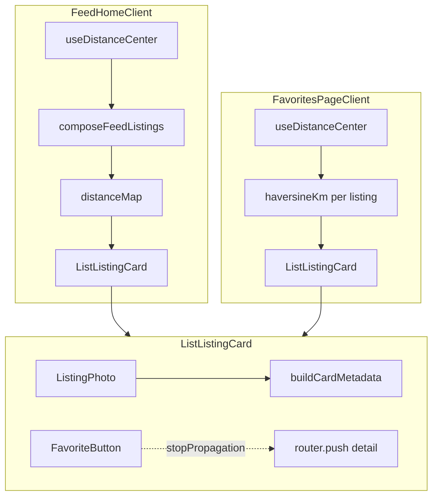

# Phase 11: Grid Listing Cards - Research

**Researched:** 2026-08-10
**Domain:** Client-side grid card polish (React/Next.js, Stitch tokens, i18n metadata, favorites dedupe)
**Confidence:** HIGH

## Summary

Phase 11 is a **UI polish and metadata completion** phase — not a greenfield card build. `ListListingCard` already satisfies most CARD requirements from Phase 9 quick polish and Phase 10 distance wiring: portrait 4:5 image, emerald FREE overlay, glass heart with auth gate, truncated title, distance · time metadata, whole-card navigation, and no Claim CTA. Remaining work is narrow: **claimed-state treatment** (metadata Reserved suffix + image dimming), **favorites double-heart fix**, and **distance wiring on favorites grid**.

The phase is entirely **Browser / Client tier**. No new npm packages, API routes, or database changes. Distance math reuses Phase 10's locked `haversineKm`, `formatDistance`, and `useDistanceCenter` pipeline (D-30). The highest-risk task is D-11 (remove duplicate `FavoriteButton` wrapper in `FavoritesPageClient`) — a layout fix that must preserve heart `stopPropagation` and toast behavior already inside `ListListingCard`.

Stitch DESIGN.md is the authority, but CONTEXT locks **intentional deviations**: emerald FREE pill (not monochrome chip), `rounded-2xl` image (not 8px card radius), glass heart with orange favorited fill. Document these in implementation comments or DESIGN.md supplement — do not "fix" them to strict Stitch during this phase.

**Primary recommendation:** Extend `buildCardMetadata` for claimed suffix + extract to `lib/listings/card-metadata.ts` for unit tests; add claimed image opacity in `ListListingCard`; remove favorites wrapper heart and wire `useDistanceCenter` + per-listing haversine in `FavoritesPageClient`; align favorites grid gap to `gap-3`. No new packages.

---

<user_constraints>
## User Constraints (from CONTEXT.md)

### Locked Decisions

#### FREE Badge (CARD-03)

- **D-01:** **Image overlay top-left** — keep current placement on photo (`left-space-sm top-space-sm`); do not move FREE inline with title. — **Reversibility:** reversible — layout-only.
- **D-02:** **Keep emerald glass FREE pill** — retain `bg-emerald-500/80` + backdrop blur styling (user preference over Stitch monochrome chip). Document as intentional deviation from DESIGN.md chip pattern. — **Reversibility:** reversible — CSS-only.
- **D-03:** **Trilingual FREE label** — use `messages.listing.free` (zh 免费 / en Free / it equivalent); apply **uppercase CSS** on badge text. — **Reversibility:** reversible.
- **D-04:** **All listings get FREE badge** — both scraped Subito and UGC community posts on grid. — **Reversibility:** reversible.

#### Card Frame & Image

- **D-05:** **Portrait 4:5** — keep `aspect-[4/5]` on card image. — **Reversibility:** reversible.
- **D-06:** **Image-only minimal layout** — no outer Stitch bordered card wrapper (white bg + padding + notion-border); image + text stack below only. — **Reversibility:** reversible.
- **D-07:** **Keep rounded-2xl** on image container (not Stitch 8px card radius). — **Reversibility:** reversible.
- **D-08:** **Hover image zoom** — keep `group-hover:scale-105` on photo. — **Reversibility:** reversible.

#### Heart Overlay (CARD-04)

- **D-09:** **Keep glass heart circle** — `bg-black/30` + `backdrop-blur-md` on heart button (current overlay tone). — **Reversibility:** reversible.
- **D-10:** **Keep orange favorited state** — filled heart uses `text-accent-orange` when favorited. — **Reversibility:** reversible.
- **D-11:** **Single heart per card** — heart lives only inside `ListListingCard`; **remove** absolute `FavoriteButton` wrapper overlay from `FavoritesPageClient`. — **Reversibility:** costly — touches favorites layout but fixes duplicate-heart bug.
- **D-12:** **Heart top-right** on image (`right-space-sm top-space-sm`); FREE badge stays top-left. — **Reversibility:** reversible.

#### Metadata & Status (CARD-01, CARD-02)

- **D-13:** **Hide category on grid** — no category chip or metadata segment on grid cards. — **Reversibility:** reversible.
- **D-14:** **Hide source on grid** — no Subito / Community badge on grid cards. — **Reversibility:** reversible.
- **D-15:** **Claimed listings remain in grid** — do not filter out `status === 'claimed'` from feed query this phase; indicate via metadata + visual dimming (D-21). — **Reversibility:** costly — changes browse semantics if later filtered server-side.
- **D-16:** **Distance + time only when center active** — metadata `{distance} · {time}`; do not append city when distance shown (aligns with Phase 10 D-61). — **Reversibility:** reversible.
- **D-17:** **Reserved suffix on metadata line** — when claimed: append ` · {reserved}` suffix, e.g. `"2.3 km · 3h ago · Reserved"`. — **Reversibility:** reversible.
- **D-18:** **Title single line** — `line-clamp-1` on card title. — **Reversibility:** reversible.
- **D-19:** **No-coord / no-center fallback** — when distance unavailable, show **city · time** per Phase 10 D-38/D-63 (planner discretion: user deferred). — **Reversibility:** reversible.
- **D-20:** **Metadata typography** — keep `text-xs text-on-surface-variant` on metadata line. — **Reversibility:** reversible.
- **D-21:** **Dim claimed card image** — reduce photo opacity (e.g. `opacity-60`) when listing is claimed, in addition to Reserved suffix (D-17). — **Reversibility:** reversible.

#### Card Reuse & Behavior (CARD-05)

- **D-22:** **Single `ListListingCard` component** — same polished card on home feed (`FeedHomeClient`), favorites (`FavoritesPageClient`), and legacy `ListPageClient` if still rendered. — **Reversibility:** reversible.
- **D-23:** **Distance on favorites when center active** — pass `distanceMeters` prop on favorites grid same as feed (reuse browse center + haversine pipeline). — **Reversibility:** reversible.
- **D-24:** **Whole card navigates to detail** — keep `article` with `role="link"` + keyboard activation; heart uses `stopPropagation`. No Claim button on grid. — **Reversibility:** reversible.
- **D-25:** **Missing photo placeholder** — keep `ListingPhoto` gray surface placeholder behavior. — **Reversibility:** reversible.
- **D-26:** **Keep current grid gap** — preserve existing gap between cards (`gap-3` in `FeedHomeClient`; match on favorites). — **Reversibility:** reversible.
- **D-27:** **Keep favorite toast** — retain toast on favorite add/remove from grid. — **Reversibility:** reversible.
- **D-28:** **No card skeleton loading** — page-level loading/empty only; no per-card skeleton placeholders. — **Reversibility:** reversible.

#### Internationalization (I18N-01 partial)

- **D-29:** **Reserved grid suffix i18n** — add or wire trilingual Reserved label for grid metadata suffix (zh/en/it). Prefer `messages.listing.reserved` if copy fits; add `messages.feed.cardReserved` only if grid needs shorter distinct copy. — **Reversibility:** reversible.

#### Inherited from Phase 10 (do not rework)

- **D-30:** **Distance pipeline locked** — Phase 11 does not change haversine, `useDistanceCenter`, filter composition, or `formatDistance` (Phase 10 D-65). Cards consume `distanceMeters` prop only.

### Claude's Discretion

- Exact opacity value for claimed image dimming (D-21).
- Whether to reuse `messages.listing.reserved` vs new `messages.feed.cardReserved` key (D-29).
- No-coord metadata edge cases when claimed + no city (compose suffix without breaking line-clamp).
- Minor heart/FREE badge spacing tweaks on smallest mobile widths.
- Favorites grid gap class alignment with feed if `gap-space-md` vs `gap-3` drift exists.

### Deferred Ideas (OUT OF SCOPE)

- **Filter claimed listings from feed query** — user chose show-with-suffix over hide-from-grid (D-15).
- **Card skeleton loading placeholders** — user declined (D-28).
- **Stitch monochrome FREE/heart restyle** — user rejected in favor of current emerald/glass/orange (D-02, D-09, D-10).
- **Category/source on grid cards** — deferred; detail + filters suffice (D-13, D-14).
</user_constraints>

<phase_requirements>
## Phase Requirements

| ID | Description | Research Support |
|----|-------------|------------------|
| CARD-01 | Grid cards show listing image, truncated title, and relative posted time | Already implemented: `ListingPhoto`, `line-clamp-1` title, `formatRelativeTime` in metadata via `buildCardMetadata`. Extend for claimed suffix (D-17). |
| CARD-02 | When browser geolocation is granted, metadata shows `{distance} · {relative time}` via haversine | Phase 10 pipeline wired in `FeedHomeClient` via `distanceMap`. Favorites needs same wiring (D-23). `formatDistance` + `haversineKm` read-only reuse (D-30). |
| CARD-03 | FREE badge overlays scraped and UGC listing images on the grid | Already implemented: emerald pill top-left, `messages.listing.free`, all listings (D-01–04). |
| CARD-04 | Favorite heart on each card reuses FavoriteButton with existing login gate | Already in `ListListingCard`; fix duplicate in `FavoritesPageClient` (D-11). Auth gate + toast unchanged in `FavoriteButton`. |
| CARD-05 | Grid cards omit Claim CTA; detail page retains deep-link/claim | Satisfied: `ListListingCard` has no Claim button. Stitch prototype has Claim — explicitly not ported per D-24. |
| I18N-01 | All new user-facing strings in zh, en, it | Reuse `messages.listing.reserved` for D-17 suffix unless copy too long (D-29). Keys already exist in all three locales. `key-parity.test.ts` covers parity. |
</phase_requirements>

## Architectural Responsibility Map

| Capability | Primary Tier | Secondary Tier | Rationale |
|------------|-------------|----------------|-----------|
| Grid card layout (image, badges, metadata) | Browser / Client | — | Pure React presentation in `ListListingCard` |
| FREE badge + heart overlay | Browser / Client | — | CSS + `FavoriteButton` client component |
| Metadata string composition (distance · time · reserved) | Browser / Client | — | Pure function; extract to `lib/listings/` for tests |
| Distance computation per listing | Browser / Client | — | Client haversine via `useDistanceCenter` + `haversineKm` (Phase 10 locked) |
| Favorite toggle + auth gate | Browser / Client | API / Backend | Client UI; server sync via `/api/favorites` when authed |
| Claimed status display | Browser / Client | Database / Storage | Reads `listing.status` from existing query; no schema change |
| i18n strings | Browser / Client | — | `messages/{zh,en,it}.ts` via `useMessages()` |
| Claim / reserve actions | — | Detail page only | Explicitly excluded from grid (CARD-05, D-24) |

## Standard Stack

### Core

| Library | Version | Purpose | Why Standard |
|---------|---------|---------|--------------|
| React | 19.2.8 [VERIFIED: npm registry] | Client components | Project baseline |
| Next.js | 16.2.12 [VERIFIED: npm registry] | App router, Image | Project baseline |
| Tailwind CSS | 4.1.14 [VERIFIED: npm registry] | Stitch token styling | `@theme` in `app/globals.css` |
| Vitest | 3.2.4 [VERIFIED: npm registry] | Unit tests for extracted metadata helper | Existing test infra |

### Supporting (existing — no install)

| Library | Version | Purpose | When to Use |
|---------|---------|---------|-------------|
| `haversineKm` (`lib/geo/haversine.ts`) | in-repo | Distance meters for favorites grid | D-23 wiring in `FavoritesPageClient` |
| `formatDistance` (`lib/geo/format-distance.ts`) | in-repo | Smart metric units | Metadata line via `buildCardMetadata` |
| `useDistanceCenter` (`hooks/useDistanceCenter.ts`) | in-repo | Browse → GPS → Venice center chain | Favorites distance prop |
| `FavoriteButton` | in-repo | Heart + auth + toast | Inside `ListListingCard` only (D-11) |
| `ListingPhoto` | in-repo | Image + placeholder | Missing photo fallback (D-25) |

### Alternatives Considered

| Instead of | Could Use | Tradeoff |
|------------|-----------|----------|
| Inline `buildCardMetadata` in component | Extract to `lib/listings/card-metadata.ts` | Extraction enables Vitest coverage without component test harness — **recommended** |
| `ReservedBadge` overlay on grid | Metadata suffix only (D-17) | User chose suffix + dim, not badge overlay — differs from map `ListingCard` |
| New i18n key `feed.cardReserved` | Reuse `listing.reserved` | Existing keys sufficient: zh 已预订 / en Reserved / it Riservato |

**Installation:** None — no new packages for Phase 11.

**Version verification:** All dependencies already in `package.json`; no additions required.

## Package Legitimacy Audit

> **Required** whenever this phase installs external packages. This phase installs **zero** new packages.

| Package | Registry | Verdict | Disposition |
|---------|----------|---------|-------------|
| *(none)* | — | — | No install step |

**Packages removed due to [SLOP] verdict:** none
**Packages flagged as suspicious [SUS]:** none

## Project Constraints (from `.cursor/rules/`)

From `stitch-ui-design.mdc` — planner must verify UI tasks comply:

1. Read `.planning/google-stitch-ui-design/DESIGN.md` before UI edits
2. Read matching screen prototype (`listing_feed_notion_style/code.html`) — adapt per CONTEXT overrides (no Claim on grid, portrait 4:5)
3. Use `@theme` tokens from `app/globals.css` — not default shadcn themes
4. Monochrome document-first aesthetic; thin borders; no card drop shadows
5. Inter typography; Material Symbols Outlined; 4px spacing grid
6. **Blocking anti-patterns:** default shadcn colors, rounded-xl/2xl cards, saturated accents, glassmorphism — **EXCEPT** user-locked emerald FREE pill, glass heart, orange favorited heart (D-02, D-09, D-10) and `rounded-2xl` image (D-07) documented as intentional deviations

## Codebase Analysis

### Current `ListListingCard` State (CARD baseline ~90% complete)

```18:27:components/listings/ListListingCard.tsx
function buildCardMetadata(
  distanceMeters: number | null | undefined,
  cityLabel: string,
  postedLabel: string,
): string {
  if (distanceMeters != null) {
    return `${formatDistance(distanceMeters)} · ${postedLabel}`;
  }
  return [cityLabel, postedLabel].filter(Boolean).join(' · ');
}
```

**Already satisfies:** CARD-01 (image, title, time), CARD-03 (FREE badge all listings), CARD-04 (heart with overlay tone), CARD-05 (no Claim), D-05–08, D-12–14, D-16, D-18, D-20, D-24–25.

**Missing for Phase 11:**
- D-17: Append ` · {messages.listing.reserved}` when `listing.status === 'claimed'`
- D-21: Apply `opacity-60` (or discretion value) to image container when claimed
- D-19 edge case: claimed + no city + no distance — suffix must not break `line-clamp-1`

### Favorites Double-Heart Bug (D-11)

`FavoritesPageClient` renders **two hearts** per card:

```164:174:components/listings/FavoritesPageClient.tsx
            {listings.map((listing) => (
              <div key={listing.id} className="relative">
                <div className="absolute right-space-sm top-space-sm z-10">
                  <FavoriteButton
                    listingId={listing.id}
                    size="sm"
                    className="rounded-full bg-surface/90 backdrop-blur-sm"
                  />
                </div>
                <ListListingCard listing={listing} />
              </div>
            ))}
```

`ListListingCard` already embeds `FavoriteButton` with correct overlay styling (D-09). The outer wrapper uses **different styling** (`bg-surface/90` vs glass `bg-black/30`) and lacks `tone="overlay"`.

**Fix:** Remove wrapper `div.relative` + absolute `FavoriteButton`; render `<ListListingCard listing={listing} distanceMeters={...} />` directly.

### Favorites Distance Gap (D-23)

`FeedHomeClient` passes distance:

```89:95:components/listings/FeedHomeClient.tsx
          <section className="grid grid-cols-2 gap-3">
            {filteredListings.map((listing) => (
              <ListListingCard
                key={listing.id}
                listing={listing}
                distanceMeters={distanceMap.get(listing.id) ?? null}
              />
```

`FavoritesPageClient` omits `distanceMeters` entirely. Wire via:

1. `const { center } = useDistanceCenter(false)` — radius off on favorites; center chain still resolves (Phase 10 D-19)
2. Per listing: `listing.lat != null && listing.lng != null ? haversineKm(center, { lat, lng }) * 1000 : null`

Do **not** import `composeFeedListings` — favorites are not filtered/sorted by feed pipeline.

### Grid Gap Drift (D-26)

| Surface | Current gap | Target |
|---------|-------------|--------|
| `FeedHomeClient` | `gap-3` (12px) | Keep |
| `FavoritesPageClient` | `gap-space-md` (16px) | Change to `gap-3` per D-26 |

### Legacy `ListPageClient`

Still uses `ListListingCard` without `distanceMeters` — acceptable; legacy route not primary feed. Card polish inherits automatically (D-22).

### Stitch Prototype vs Implementation

`listing_feed_notion_style/code.html` shows bordered cards with **Claim Item** buttons and 16:9 aspect — **do not port**. Implementation correctly diverges: portrait 4:5, no bordered wrapper (D-06), no Claim (CARD-05), emerald FREE overlay instead of inline "Free" text (D-02).

### i18n Keys (D-29)

Existing keys verified in codebase:

| Key | zh | en | it |
|-----|----|----|-----|
| `listing.free` | 免费 | Free | Gratis |
| `listing.reserved` | 已预订 | Reserved | Riservato |

Recommend reusing `listing.reserved` for metadata suffix — copy length fits `line-clamp-1` metadata line.

## Architecture Patterns

### System Architecture Diagram



### Recommended Project Structure

```
components/listings/
├── ListListingCard.tsx      # Polish: claimed dim + reserved suffix
├── FavoritesPageClient.tsx  # Remove duplicate heart; wire distance
├── FeedHomeClient.tsx       # Unchanged (gap-3 reference)
├── FavoriteButton.tsx       # Unchanged
└── ListingPhoto.tsx         # Unchanged

lib/listings/
└── card-metadata.ts         # NEW: extract buildCardMetadata for tests

lib/geo/
├── haversine.ts             # Read-only reuse
└── format-distance.ts       # Read-only reuse

hooks/
└── useDistanceCenter.ts     # Read-only reuse
```

### Pattern 1: Pure Metadata Builder (testable)

**What:** Extract `buildCardMetadata` to accept `isClaimed` + `reservedLabel`; return composed string.
**When to use:** Any metadata line change; enables Vitest without jsdom component mount.
**Example:**

```typescript
// lib/listings/card-metadata.ts
export function buildCardMetadata(input: {
  distanceMeters: number | null | undefined;
  cityLabel: string;
  postedLabel: string;
  isClaimed: boolean;
  reservedLabel: string;
}): string {
  const { distanceMeters, cityLabel, postedLabel, isClaimed, reservedLabel } = input;
  let base: string;
  if (distanceMeters != null) {
    base = `${formatDistance(distanceMeters)} · ${postedLabel}`;
  } else {
    base = [cityLabel, postedLabel].filter(Boolean).join(' · ');
  }
  if (isClaimed && reservedLabel) {
    return `${base} · ${reservedLabel}`;
  }
  return base;
}
```

### Pattern 2: Claimed Visual Treatment

**What:** Conditional opacity on image wrapper, not on overlays (FREE/heart stay full opacity).
**When to use:** `listing.status === 'claimed'` (D-15, D-21).
**Example:**

```tsx
<div className={cn(
  'relative mb-space-sm aspect-[4/5] overflow-hidden rounded-2xl bg-surface-container-high',
  listing.status === 'claimed' && 'opacity-60',
)}>
  <ListingPhoto ... />
  {/* FREE + heart overlays inside — full opacity relative to dimmed container */}
</div>
```

**Alternative:** Apply opacity only to `ListingPhoto` via `className` prop — keeps badge/heart at full brightness. Prefer photo-only dim if container dim makes badges appear faded.

### Pattern 3: Favorites Distance Wiring

**What:** Mirror feed distance prop without full filter pipeline.
**When to use:** D-23 on favorites grid only.

```typescript
const { center } = useDistanceCenter(false);

function distanceForListing(listing: ListingRow): number | null {
  if (listing.lat == null || listing.lng == null) return null;
  return haversineKm(center, { lat: listing.lat, lng: listing.lng }) * 1000;
}
```

### Anti-Patterns to Avoid

- **Duplicate FavoriteButton wrappers:** Causes double hearts, inconsistent overlay styling, double toast risk — remove outer wrapper (D-11)
- **ReservedBadge overlay on grid:** Map/list `ListingCard` uses badge; grid uses metadata suffix only (D-17) — do not import `ReservedBadge` into `ListListingCard`
- **Filtering claimed from feed query:** User locked show-with-suffix (D-15) — no server/query changes
- **Restyling to strict Stitch monochrome:** User rejected for FREE/heart (D-02, D-09, D-10)
- **Adding Claim button to match prototype:** CARD-05 forbids; detail page owns claim flow
- **Reworking haversine/formatDistance:** Phase 10 locked (D-30)

## Don't Hand-Roll

| Problem | Don't Build | Use Instead | Why |
|---------|-------------|-------------|-----|
| Distance calculation | Custom geo formula | `haversineKm` (Phase 10) | Tested, locked pipeline |
| Distance formatting | Ad-hoc string concat | `formatDistance` | Smart units D-15 |
| Favorite state | Local card state | `useFavorites` via `FavoriteButton` | Auth sync, storage merge |
| Relative time | Manual date math | `formatRelativeTime` from `useMessages` | i18n + locale |
| Image loading/errors | Raw `` | `ListingPhoto` | Next Image + placeholder |
| Reserved i18n | Hardcoded strings | `messages.listing.reserved` | I18N-01 parity |

**Key insight:** Phase 11 composes existing primitives — the only new logic is claimed suffix + favorites layout fix.

## Common Pitfalls

### Pitfall 1: Double Heart on Favorites

**What goes wrong:** Two clickable hearts stacked; outer heart uses wrong styling (`bg-surface/90` vs glass overlay).
**Why it happens:** `FavoritesPageClient` predates card-internal heart from waterfall polish.
**How to avoid:** Delete lines 165–172 wrapper; single heart inside `ListListingCard` only.
**Warning signs:** Two heart icons visible on `/favorites`; z-index fighting on tap.

### Pitfall 2: Badge Dimming with Container Opacity

**What goes wrong:** Applying `opacity-60` on image container dims FREE badge and heart too.
**Why it happens:** CSS opacity inherits to absolutely positioned children.
**How to avoid:** Dim `ListingPhoto` only, or use separate overlay layer with `opacity` on photo wrapper only.
**Warning signs:** FREE badge and heart look washed out on claimed cards.

### Pitfall 3: Metadata Line Overflow

**What goes wrong:** `"Venice · 3h ago · Reserved"` or long distance + suffix exceeds single line.
**Why it happens:** `line-clamp-1` truncates; claimed suffix adds length.
**How to avoid:** Keep suffix short via `listing.reserved`; test zh/en/it; truncate gracefully.
**Warning signs:** Metadata wraps to second line on narrow cards.

### Pitfall 4: Heart Click Navigates to Detail

**What goes wrong:** Card navigation fires when tapping heart.
**Why it happens:** Missing `stopPropagation` on favorite click.
**How to avoid:** `FavoriteButton` already calls `event.stopPropagation()` — do not wrap card in extra click handlers that bypass this.
**Warning signs:** Detail page opens when favoriting from grid.

### Pitfall 5: Vitest Scope Mismatch

**What goes wrong:** Component tests fail or aren't discovered — `vitest.config.ts` only includes `lib/**`, `hooks/**`, `messages/**`.
**Why it happens:** No `components/**/*.test.tsx` in config.
**How to avoid:** Extract metadata logic to `lib/listings/card-metadata.ts`; UI verified manually at phase gate.
**Warning signs:** Planner adds `ListListingCard.test.tsx` that never runs.

## Code Examples

### Claimed metadata suffix

```typescript
// Source: Phase 11 CONTEXT D-17; reuse lib/geo/format-distance.ts
const metadata = buildCardMetadata({
  distanceMeters,
  cityLabel,
  postedLabel,
  isClaimed: listing.status === 'claimed',
  reservedLabel: messages.listing.reserved,
});
// → "2.3 km · 3h ago · Reserved"
```

### Favorites grid after fix

```tsx
// Source: pattern from FeedHomeClient + FavoritesPageClient merge
const { center } = useDistanceCenter(false);

<section className="grid grid-cols-2 gap-3">
  {listings.map((listing) => (
    <ListListingCard
      key={listing.id}
      listing={listing}
      distanceMeters={
        listing.lat != null && listing.lng != null
          ? haversineKm(center, { lat: listing.lat, lng: listing.lng }) * 1000
          : null
      }
    />
  ))}
</section>
```

## State of the Art

| Old Approach | Current Approach | When Changed | Impact |
|--------------|------------------|--------------|--------|
| Map-first `ListingCard` (square, source badge, zone) | Grid `ListListingCard` (portrait, minimal metadata) | Phase 9 + quick polish | Grid cards are separate component |
| Reserved as overlay badge only | Grid: metadata suffix + dim (Phase 11) | This phase | Differs from map card pattern |
| Favorites external heart wrapper | Single in-card heart | Phase 11 D-11 | Bug fix |
| Phase 10 basic distance on feed | Same pipeline on favorites | Phase 11 D-23 | Parity across grids |

**Deprecated/outdated:**
- Outer `FavoriteButton` wrapper in `FavoritesPageClient` — remove
- Category/source on grid cards — explicitly deferred (D-13, D-14)

## Assumptions Log

| # | Claim | Section | Risk if Wrong |
|---|-------|---------|---------------|
| A1 | `messages.listing.reserved` copy fits grid metadata suffix in all locales | i18n | Truncation or need for shorter `feed.cardReserved` key |
| A2 | Photo-only opacity (not container) preserves badge/heart visibility | Pattern 2 | Visual QA may require opacity tweak |
| A3 | `useDistanceCenter(false)` provides same center as feed for distance labels | Favorites wiring | Distance mismatch between feed and favorites if center resolution differs |
| A4 | `listing.reserved` uppercase not required on grid (suffix is inline, not badge) | Metadata | Minor style inconsistency vs `ReservedBadge` |

## Open Questions

1. **Photo vs container opacity for claimed dimming**
   - What we know: D-21 says reduce photo opacity; container opacity dims overlays.
   - What's unclear: Exact implementation for badge/heart brightness.
   - Recommendation: Apply opacity to `ListingPhoto` wrapper only; default `opacity-60`; human verify at phase gate.

2. **Reuse `listing.reserved` vs new key**
   - What we know: Keys exist in zh/en/it; badge uses same string.
   - What's unclear: Whether Italian "Riservato" is too long on narrow cards.
   - Recommendation: Reuse `listing.reserved` (D-29 preference); add `feed.cardReserved` only if UAT fails.

## Environment Availability

| Dependency | Required By | Available | Version | Fallback |
|------------|------------|-----------|---------|----------|
| Node.js | build/test | ✓ | v23.10.0 | — |
| npm | scripts | ✓ | 11.4.2 | — |
| Vitest | unit tests | ✓ | 3.2.4 | — |
| Browser Geolocation | distance center (inherited) | ✓ (secure context) | — | Venice default |
| Next.js dev server | manual UI verify | ✓ | 16.2.12 | — |

**Missing dependencies with no fallback:** none

**Missing dependencies with fallback:** none

## Validation Architecture

### Test Framework

| Property | Value |
|----------|-------|
| Framework | Vitest 3.2.4 + jsdom |
| Config file | `vitest.config.ts` |
| Quick run command | `npm run test:lib -- lib/listings/card-metadata.test.ts -x` |
| Full suite command | `npm run test:lib` |

### Phase Requirements → Test Map

| Req ID | Behavior | Test Type | Automated Command | File Exists? |
|--------|----------|-----------|-------------------|-------------|
| CARD-01 | Metadata includes posted time | unit | `npm run test:lib -- lib/listings/card-metadata.test.ts -x` | ❌ Wave 0 |
| CARD-02 | Distance · time when meters present | unit | `npm run test:lib -- lib/listings/card-metadata.test.ts -x` | ❌ Wave 0 |
| CARD-01/02 | City · time fallback when no distance | unit | `npm run test:lib -- lib/listings/card-metadata.test.ts -x` | ❌ Wave 0 |
| D-17 | Reserved suffix when claimed | unit | `npm run test:lib -- lib/listings/card-metadata.test.ts -x` | ❌ Wave 0 |
| D-19 | Claimed + no city + no distance → time · reserved | unit | `npm run test:lib -- lib/listings/card-metadata.test.ts -x` | ❌ Wave 0 |
| I18N-01 | Key parity if new keys added | unit | `npm run test:lib -- messages/key-parity.test.ts -x` | ✅ |
| CARD-03–05 | FREE badge, heart, no Claim | manual | Human verify at phase gate | — |
| CARD-04 | Single heart on favorites | manual | Visual check `/favorites` | — |
| D-11 | No duplicate FavoriteButton wrapper | grep/static | `rg 'FavoriteButton' components/listings/FavoritesPageClient.tsx` expects 0 matches | ❌ Wave 0 |

### Sampling Rate

- **Per task commit:** `npm run test:lib -- lib/listings/card-metadata.test.ts -x`
- **Per wave merge:** `npm run test:lib`
- **Phase gate:** Full lib suite + manual grid/favorites visual check before `/gsd-verify-work`

### Wave 0 Gaps

- [ ] `lib/listings/card-metadata.ts` — extract from `ListListingCard.tsx`
- [ ] `lib/listings/card-metadata.test.ts` — covers CARD-01, CARD-02, D-17, D-19 edge cases
- [ ] `vitest.config.ts` — already includes `lib/**/*.test.ts`; no config change needed

## Security Domain

Phase 11 is presentation-only — no new auth surfaces, inputs, or API endpoints.

### Applicable ASVS Categories

| ASVS Category | Applies | Standard Control |
|---------------|---------|-----------------|
| V2 Authentication | no | — |
| V3 Session Management | no | — |
| V4 Access Control | no | — |
| V5 Input Validation | no | — |
| V6 Cryptography | no | — |

### Known Threat Patterns

| Pattern | STRIDE | Standard Mitigation |
|---------|--------|---------------------|
| XSS via listing title in card | Spoofing | React auto-escapes text nodes; existing |
| Unauthorized favorite toggle | Elevation | `FavoriteButton` auth gate unchanged |

## Sources

### Primary (HIGH confidence)

- `.planning/phases/11-grid-listing-cards/11-CONTEXT.md` — locked decisions D-01–30
- `components/listings/ListListingCard.tsx` — current implementation baseline
- `components/listings/FavoritesPageClient.tsx` — duplicate heart bug
- `components/listings/FeedHomeClient.tsx` — distance wiring reference
- `.planning/phases/10-search-filter-sheet-distance/10-RESEARCH.md` — distance pipeline patterns

### Secondary (MEDIUM confidence)

- `.planning/google-stitch-ui-design/DESIGN.md` — tokens (with documented overrides)
- `.planning/google-stitch-ui-design/listing_feed_notion_style/code.html` — feed prototype (Claim omitted)
- `.planning/quick/20260810-waterfall-feed-polish/SUMMARY.md` — emerald FREE, glass heart baseline

### Tertiary (LOW confidence)

- None — all recommendations grounded in codebase inspection

## Metadata

**Confidence breakdown:**
- Standard stack: HIGH — no new packages; existing components cover all requirements
- Architecture: HIGH — clear component ownership; Phase 10 distance pipeline locked
- Pitfalls: HIGH — duplicate heart bug reproduced in source; opacity inheritance is known CSS behavior

**Research date:** 2026-08-10
**Valid until:** 2026-09-10 (stable UI polish domain)
