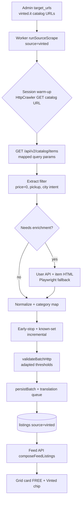

# Phase 17: Vinted Scraping & Subito Category Integration — Research

**Researched:** 2026-08-15  
**Domain:** Vinted.it HTTP/JSON scraping + multi-source feed/category integration  
**Confidence:** MEDIUM

## Summary

Phase 17 adds a **live Vinted crawler** for **€0 listings only** and folds them into the existing consumer feed using the **17 Subito regalo slugs** as canonical category IDs. Unlike Subito (Phase 15 `__NEXT_DATA__`), Vinted’s current `marketplace-web` stack serves catalog data via **Next.js RSC flight chunks** in HTML and a **session-authenticated JSON API** at `/api/v2/catalog/items`. Live probes confirm: a plain HTTP fetch to the catalog page returns **200 OK** with **96 item IDs** embedded; the catalog API returns structured JSON when `access_token_web` cookies are present from an initial page visit; bare API calls return **401**. [VERIFIED: live HTTP probe 2026-08-15]

Critical product/engineering constraints discovered in research:

1. **`price_to=0` URL filters do not yield €0 listings** — scanning 960 API results with `price_from=0&price_to=0` returned **zero** items where `price.amount === "0"`. Free-item gating **must happen at extract** (D-17-01/04), not via admin URL price params alone. [VERIFIED: live API probe 2026-08-15]
2. **Vinted has no catalog URL geo filter** (no lat/lng/city_id params on vinted.it). Venice/Padova scope is enforced **post-extract** via seller location APIs + bbox validation (D-17-07/11), with admin URL matrix encoding **category + city intent** as metadata (same mental model as Subito, different URL mechanics). [CITED: https://scrapebadger.mintlify.app/api-reference/endpoint/vinted/search-items]
3. **Catalog API omits** `catalog_id`, `posted_at`, coordinates, and shipping/pickup — selective **detail enrichment** (HTTP user API + item-page HTML parse, Playwright fallback per Phase 15 pattern) is required before persist.
4. **Datadome** is active (cookie + TLS fingerprint). Reuse Phase 15/16 **HttpCrawler + got-scraping + proxy_enc + degraded direct fallback** — do not hand-roll TLS or cookie factories.

**Primary recommendation:** Implement `scraper/src/vinted/` as a **two-step HttpCrawler hybrid**: (1) warm session on admin catalog URL, (2) fetch `/api/v2/catalog/items` with mapped query params; filter €0 + local-pickup + geo at extract; enrich via user/item detail; mirror Subito incremental orchestration in `worker.ts`.

## Architectural Responsibility Map

| Capability | Primary Tier | Secondary Tier | Rationale |
|------------|-------------|----------------|-----------|
| Catalog listing fetch | API / Backend (scraper worker) | — | `/api/v2/catalog/items` is server-side JSON; browser not required for list path |
| Session/cookie warm-up | API / Backend (scraper worker) | — | `access_token_web` issued on first vinted.it page load; Crawlee session pool persists per run |
| €0 price gate | API / Backend (extract) | — | URL price filters unreliable; reject `not_free` before persist (D-17-04) |
| Shipping/pickup gate | API / Backend (extract) | Playwright fallback | `shipping.type` on item detail HTML; reject shipping-only (D-17-15) |
| Seller location / coords | API / Backend (extract) | DB (centroid lookup) | `/api/v2/users/{id}` + item HTML; centroid fallback like Subito Phase 15 (D-17-12) |
| Venice/Padova bbox reject | API / Backend (persist schema) | — | Reuse `CanonicalListingSchema` + `inCityBbox` in `scraper/src/shared/schema.ts` |
| Category → Subito slug | API / Backend (extract + lib) | Frontend (display only) | Map at scrape + `resolveCanonicalCategorySlug` for filter path (D-17-16/17) |
| Mixed chronological feed | Frontend Server / API | — | Existing feed query sorted by `posted_at`; no source segregation (D-17-25) |
| Source badge on grid card | Browser / Client | — | `ListListingCard` Stitch chip (D-17-26) |
| Admin URL matrix / seeds | Frontend Server (admin) | DB (`scraper_sources.target_urls`) | Mirror Subito `SourceDetailClient` + chip matrix (D-17-37) |
| Translation | API / Backend (scraper persist) | — | Same post-persist queue as Subito (D-17-22) |
| Proxy / degraded runs | API / Backend (worker) | Admin settings | Shared `proxy_enc`; Phase 16 quota fallback (D-17-33) |

<user_constraints>
## User Constraints (from CONTEXT.md)

### Locked Decisions

#### Free-item definition
- **D-17-01:** **€0 price only** qualifies a Vinted listing as free — no keyword-only or negotiable-price heuristics.
- **D-17-02:** **Reject missing or ambiguous price** at extract — do not accept gratis/regalo title fallback when price field is absent.
- **D-17-03:** **Admin-configured catalog URLs only** — no site-wide search crawl; operator controls scope via `scraper_sources.target_urls`.
- **D-17-04:** **Reject non-free at extract layer** — log reason `not_free`; never enter persist pipeline.

#### Geographic scope
- **D-17-05:** **Venice + Padova parity** with Subito URL matrix — same two cities for feed city chips (D-01).
- **D-17-06:** **Location baked into admin target URLs** — each URL includes Vinted location filter params.
- **D-17-07:** **Require coords OR resolvable city label** to persist — reject listings with neither.
- **D-17-08:** **Mirror Subito zone tagging** when coords exist — reuse `tagZone()` + Venice polygons; Padova skips zones.
- **D-17-09:** **Seed default Venice + Padova URL templates** when source flips to live — operator edits in admin; not empty start.
- **D-17-10:** **City assignment: URL template + JSON fallback** — URL encodes venice/padova intent; JSON city field validates.
- **D-17-11:** **Reject coords outside Venice/Padova bbox** at persist — same bounding boxes as Subito schema validation.
- **D-17-12:** **Municipality centroid fallback** when JSON has city but no coords — reuse Subito Phase 15 pattern for distance metadata.
- **D-17-13:** **Prefer pickup/meet-up location** over seller profile city when Vinted exposes both.
- **D-17-14:** **Separate Venice vs Padova URL sets** in admin — distinct target URL groups per city.
- **D-17-15:** **Reject shipping-only / no local pickup** listings — free items must be locally collectible.

#### Category mapping
- **D-17-16:** **Hybrid mapping** — Vinted category ID → Subito slug lookup table at scrape time; **title inference fallback** via existing `INFERRED_CATEGORY_TO_SLUG`.
- **D-17-17:** **Extend `resolveCanonicalCategorySlug`** with `vinted` source branch — DB slug first, Vinted map, inference, null.
- **D-17-18:** **Unmapped fallback → `null` (uncategorized)** — excluded when specific category filters active (Phase 12 D-08); do not force `usato` catch-all.
- **D-17-19:** **One target URL per Subito slug × city** where Vinted URL structure supports it — category intent encoded in URL template metadata (Subito matrix mental model).
- **D-17-20:** **Document Vinted→Subito table** in `lib/listings/canonical-categories.ts` (or adjacent module) + unit tests (CAT-03 pattern).
- **D-17-21:** **No FilterSheet UI changes** — same 17 Subito labels; Vinted listings match via canonical slug only.
- **D-17-22:** **Same auto-translate pipeline** as Subito — `title_en` / `title_zh` via scraper translation queue.
- **D-17-23:** **Add `vinted` to ListingSource enum** — DB migration on `listing_source` + `scraper/src/shared/schema.ts` + `lib/listings/types.ts`.
- **D-17-24:** **Many Vinted categories → one Subito slug** is acceptable (e.g. apparel subcats → `abbigliamento-accessori`).

#### Feed presentation
- **D-17-25:** **Mixed chronological feed** — Vinted + Subito + UGC sorted by `posted_at`; no source segregation.
- **D-17-26:** **Small source badge on grid card** — monochrome Stitch chip (e.g. “Vinted”) alongside FREE badge.
- **D-17-27:** **No consumer source filter** — FilterSheet unchanged; source filter deferred to future phase.
- **D-17-28:** **Detail / claim flow opens `external_url`** in new tab — same scraped-listing pattern as Subito; no in-app Vinted claim.
- **D-17-29:** **Show FREE badge** on Vinted €0 grid cards — consistent with Subito regalo cards.
- **D-17-30:** **Favorites work identically** — heart + login gate; flat favorites grid unchanged (Phase 12 D-01).
- **D-17-31:** **Feed search includes Vinted titles** — translated fields when available.

#### Admin & crawl config
- **D-17-32:** **Reuse Subito HttpCrawler + incremental pattern** — new `scraper/src/vinted/` module; extend `runSourceScrape` routing beyond `subito` only.
- **D-17-33:** **Share global `proxy_enc`** from `scraper_global_config` — Phase 16 direct/degraded fallback applies to Vinted runs.
- **D-17-34:** **Flip `implementation_status` to `live`; `enabled=false` by default** — operator enables after URL review + manual first run.
- **D-17-35:** **Default crawl interval 90 min** — same as Subito; operator tunes per source in admin.
- **D-17-36:** **Wave 0 spike required** on 3 live Vinted URLs before implementation waves — proves JSON extract path (Phase 15 gate pattern).
- **D-17-37:** **Mirror Subito source detail admin UI** — macOS settings layout, URL chip matrix, run stats on source card.

### Claude's Discretion
- **D-17-18:** Unmapped category → `null` rather than `usato` catch-all (aligns with Phase 12 D-08 uncategorized semantics).
- Wave 0 spike pass criteria fine-tuning (exact JSON fields, TLS/proxy needs for vinted.it).
- Default URL template contents per Subito slug × city (researcher documents viable Vinted search URL patterns).
- Validation thresholds for Vinted batch runs (adapt Phase 15 JSON completeness gate).
- Source badge visual treatment within Stitch tokens (exact label: “Vinted” vs localized).

### Deferred Ideas (OUT OF SCOPE)
- **Consumer source filter** (Subito only / Vinted only) in FilterSheet — new capability; own phase
- **Separate source tabs** or segregated feed views — out of scope
- **Favorites grouped by source** — out of scope (flat grid locked Phase 12)
- **Separate Vinted search** — out of scope
- **Minimal admin UI** (URL list only, no chip matrix) — user chose full Subito parity instead
- **Vinted app deep links** on detail — user chose external URL in new tab
- **Skip translation for Vinted MVP** — user chose full translation pipeline parity
</user_constraints>

<phase_requirements>
## Phase Requirements

| ID | Description | Research Support |
|----|-------------|------------------|
| SCRP-E01 | Category-page primary extract via embedded JSON/API — not N+1 detail for list path | `/api/v2/catalog/items` returns up to 96 items per page with one API call after session warm-up; detail visits only for enrichment (coords, shipping, catalog_id, posted_at) |
| SCRP-E02 | Incremental known-set + early-stop K=5 | Reuse `loadKnownListingSet`, `applyEarlyStop`, per-URL scope from Subito crawler |
| SCRP-E03 | Periodic full refresh disables early-stop | Same `decideCrawlMode` / `lastFullRefreshAt` path in `worker.ts` |
| SCRP-E04 | Playwright only for fallback | Item detail / block retry when API or HTML parse fails |
| SCRP-E05–E07 | Proxy posture, Crawlee stack, crawl metrics | Same HttpCrawler + proxy gate + `scrape_runs` metrics columns |
| SCRP-E08 | Batch validation gate | Adapt thresholds — Vinted €0 filter yields **far fewer** listings than Subito regalo; use low incremental count floor + completeness gate |
| CAT-01 | `resolveCanonicalCategorySlug` multi-source | Add `vinted` branch: DB slug → Vinted map → inference → null |
| CAT-03 | Mapping tables documented + unit tests | `VINTED_CATALOG_TO_SUBITO_SLUG` + tests alongside `canonical-categories.test.ts` |
| CARD-03 | FREE badge on grid | Already exists; Vinted €0 listings qualify (D-17-29) |
| D-17-26 | Source chip on grid card | Extend `ListListingCard` — Stitch `#f1f1f0` chip, no layout redesign |
</phase_requirements>

## Project Constraints (from .cursor/rules/)

- All consumer UI (source badge) MUST follow `.planning/google-stitch-ui-design/DESIGN.md` — monochrome, thin borders, Inter, Material Symbols, `#f1f1f0` chips; no default shadcn accents.
- Read Stitch prototype + existing React reference before editing `ListListingCard` or admin source detail.
- Use `@theme` tokens from `app/globals.css` — no hardcoded hex drift.

## Standard Stack

### Core

| Library | Version | Purpose | Why Standard |
|---------|---------|---------|--------------|
| crawlee | 3.18.1 | HttpCrawler + PlaywrightCrawler orchestration | Already in scraper; Phase 15 ADR lock [VERIFIED: npm registry + codebase] |
| playwright | 1.62.1 | Block retry + detail fallback | Phase 15 pattern [VERIFIED: npm registry] |
| got-scraping | 4.2.1 (transitive) | TLS fingerprint for HttpCrawler | Phase 15 D-15-22; Datadome mitigation [CITED: https://crawlee.dev/js/docs/guides/proxy-management] |
| zod | 3.24.0 (scraper) | `CanonicalListingSchema` validation | Existing persist gate |

**No new npm packages required for Phase 17.** Extend existing scraper stack only.

### Supporting

| Library | Version | Purpose | When to Use |
|---------|---------|---------|-------------|
| @supabase/supabase-js | ^2.49.0 | Persist + admin config | Existing worker |
| vitest | ^3.0.0 (scraper), ^3.2.4 (app) | Unit tests + fixtures | Wave 0 fixtures; CAT-03 map tests |

### Alternatives Considered

| Instead of | Could Use | Tradeoff |
|------------|-----------|----------|
| HttpCrawler + catalog API | Playwright-only catalog scroll | Rejected — slower, higher block risk; contradicts SCRP-E01/E04 |
| HTML RSC regex parse | API-first with HTML fallback | API preferred when cookies present; HTML regex (`"items":[...],"pagination"`) as fallback if API blocked |
| Vinted Pro official API | Public catalog scrape | Pro API requires seller account + allowlist — not available [CITED: https://dev.to/datakaz/how-to-scrape-vinted-in-2026-without-getting-blocked-2a59] |
| Mobile app endpoints | Web catalog API | Mobile endpoints exist but add separate auth surface; web API sufficient after cookie warm-up [ASSUMED] |

**Installation:** None — reuse `scraper/package.json` dependencies.

## Package Legitimacy Audit

> Phase 17 installs **no new packages**. Existing stack audit for reference:

| Package | Registry | Age | Downloads | Source Repo | Verdict | Disposition |
|---------|----------|-----|-----------|-------------|---------|-------------|
| crawlee | npm | current | ~151k/wk | github.com/apify/crawlee | SUS (too-new signal) | Approved — already in production scraper |
| playwright | npm | current | ~80M/wk | github.com/microsoft/playwright | SUS (too-new signal) | Approved — already in production scraper |
| got-scraping | npm | current | ~261k/wk | github.com/apify/got-scraping | OK | Approved |
| zod | npm | current | ~254M/wk | github.com/colinhacks/zod | OK | Approved |

**Packages removed due to [SLOP] verdict:** none  
**Packages flagged as suspicious [SUS]:** none new (pre-existing crawlee/playwright)

## Architecture Patterns

### System Architecture Diagram



### Recommended Project Structure

```
scraper/src/vinted/
├── crawler.ts          # runVintedCrawler — HttpCrawler hybrid (mirror subito/crawler.ts)
├── catalog-api.ts      # URL → API param mapping; parse catalog JSON response
├── http-extract.ts     # Parse API items → RawListing; field completeness scoring
├── enrich.ts           # User API + item-page HTML for catalog_id, shipping, posted_at, city
├── filters.ts          # isFreePrice, isLocalPickup, matchesCityIntent
├── url-template.ts     # buildDefaultVintedUrls(subitoSlug, city) for admin seed
└── known-set.ts        # Re-export or thin wrapper over subito/known-set (source=vinted)

lib/listings/
├── canonical-categories.ts   # + VINTED_CATALOG_TO_SUBITO_SLUG, vinted resolver branch
└── vinted-category-map.ts    # Optional split if map grows large (CAT-03)

lib/admin/
└── vinted-recommended-seed.ts  # Venice+Padova default URL matrix (34 URLs if 17×2)

components/listings/ListListingCard.tsx  # source chip
components/admin/SourceDetailClient.tsx  # Vinted matrix parity (generalize RegaloUrlMatrix or Vinted variant)
```

### Pattern 1: Session-warmed catalog API extract (primary path)

**What:** HttpCrawler loads admin catalog URL to obtain Datadome + `access_token_web` cookies, then same session requests `/api/v2/catalog/items` with params derived from the admin URL.

**When to use:** Every incremental/full Vinted run (default path).

**Example:**

```typescript
// Source: live probe 2026-08-15 + [CITED: https://dev.to/datakaz/scrape-vinted-search-results-filters-and-sorting-guide-2026-1igm]
function catalogUrlToApiParams(catalogUrl: string): URLSearchParams {
  const u = new URL(catalogUrl);
  const params = new URLSearchParams();
  params.set('per_page', '96');
  params.set('page', '1');
  params.set('order', u.searchParams.get('order') ?? 'newest_first');
  params.set('currency', 'EUR');
  for (const id of u.searchParams.getAll('catalog[]')) {
    params.append('catalog_ids', id);
  }
  // Also support path form /catalog/1918-casa → catalog_ids=1918
  const pathMatch = u.pathname.match(/\/catalog\/(\d+)/);
  if (pathMatch && !params.has('catalog_ids')) {
    params.set('catalog_ids', pathMatch[1]);
  }
  return params;
}

function isFreePrice(amount: string | number | null | undefined): boolean {
  if (amount == null || amount === '') return false; // D-17-02
  return Number.parseFloat(String(amount)) === 0;
}
```

### Pattern 2: Detail enrichment queue (selective)

**What:** Catalog API items lack `catalog_id`, `posted_at`, shipping mode, and reliable coords. Enrich subset via `/api/v2/users/{user.id}` and item-page HTML (`catalog_id`, `shipping.type`).

**When to use:** For listings passing €0 filter that need category mapping, pickup verification, or geo resolution (most candidates).

**Cap:** Reuse Subito `detailBudgetCap` (10% per run) — defer overflow to next run.

### Pattern 3: Category + city metadata on admin URLs

**What:** Admin stores one URL per Subito slug × city. Because Vinted lacks geo URL params, encode city intent via:

- **Query convention:** `?search_text=Venezia` or custom `city=venezia` comment in matrix metadata (operator-visible)
- **Extract validation:** Match seller `city` / `country_title` / `location_description` against Venice/Padova allowlist; assign `city` field for bbox check

**Research note on D-17-06:** Live Vinted catalog URLs support **category + price + sort** params only — not lat/lng. Planner should treat “location baked into URLs” as **city intent in URL template + post-extract geo filter**, not literal Vinted geo query params. [VERIFIED: live probe + third-party API docs]

### Anti-Patterns to Avoid

- **Assuming `price_to=0` in admin URL pre-filters free items** — it does not; always parse `price.amount` and reject non-zero.
- **Copying Subito `__NEXT_DATA__` parser** — Vinted RSC pages omit `__NEXT_DATA__`; use API or RSC regex fallback.
- **Calling `/api/v2/catalog/items` without session cookies** — returns 401 invalid token.
- **Forcing `usato` for unmapped Vinted categories** — violates D-17-18 / Phase 12 D-08.
- **Adding FilterSheet source filter** — explicitly deferred (D-17-27).

## Don't Hand-Roll

| Problem | Don't Build | Use Instead | Why |
|---------|-------------|-------------|-----|
| TLS / browser fingerprint | Custom axios/fetch headers | Crawlee HttpCrawler + got-scraping | Datadome detects JA3 mismatches [CITED: https://dev.to/datakaz/how-to-scrape-vinted-in-2026-without-getting-blocked-2a59] |
| Cookie/token persistence | Custom cookie jar | Crawlee `useSessionPool` + `persistCookiesPerSession` | Proven in Subito crawler |
| Proxy rotation | Multi-URL manager | Existing `ProxyConfiguration` + Phase 16 fallback | ADR 015 cost ladder |
| Category resolver | Parallel Vinted-only filter path | Extend `resolveCanonicalCategorySlug` | Single filter pipeline (CAT-01) |
| Venice zone polygons | New geo module | `scraper/src/shared/zone-tag.ts` | D-17-08 |
| Incremental early-stop | New DB schema | Reuse `known-set.ts`, `early-stop.ts`, crawl hash | Phase 15 complete |
| Translation | Skip or one-off script | `persistBatch` → translation queue | D-17-22 |

**Key insight:** Vinted’s complexity is **session-authenticated API extract + enrichment**, not a new crawler stack. Clone Subito orchestration; swap extract/enrich modules.

## Common Pitfalls

### Pitfall 1: Empty feeds despite “successful” crawls

**What goes wrong:** Runs pass HTTP 200 but persist 0 listings because €0 items are rare and URL price filters lie.

**Why it happens:** Vinted is a paid marketplace; €0 listings are sparse; `price_to=0` still returns €1+ items.

**How to avoid:** Extract-layer strict `price.amount === 0`; lower incremental validation count floor; log `not_free` reject counts; Wave 0 documents expected yield.

**Warning signs:** High `listings_found` at crawl, high `rejected` at persist with reason `not_free`.

### Pitfall 2: Cross-border sellers pollute Venice/Padova feed

**What goes wrong:** vinted.it shows EU-wide listings; seller in Spain passes category filter but fails user trust.

**Why it happens:** No native city filter in catalog URL; catalog API returns international sellers.

**How to avoid:** Post-extract city/country matching against Venice/Padova; bbox reject; prefer pickup location fields (D-17-13).

**Warning signs:** High geo reject rate; `country_title` not Italy in user API.

### Pitfall 3: Shipping-only free items break “near me” promise

**What goes wrong:** €0 items shippable-only appear without local pickup.

**Why it happens:** Catalog API omits shipping mode; only item detail exposes `shipping.type`.

**How to avoid:** Enrichment gate rejects `shipping.type === 'shipping'` without pickup option; Wave 0 must catalog valid pickup type strings.

**Warning signs:** Listings with coords from seller country centroid but no pickup signal.

### Pitfall 4: Datadome blocks on Fly.io/direct IP

**What goes wrong:** 403 / empty API after N requests.

**Why it happens:** Vinted uses Datadome; datacenter IPs flagged faster.

**How to avoid:** Reuse Phase 16 proxy posture; mark `degraded`; Playwright block retry (1× per URL).

**Warning signs:** `blocked_url_count` > 50%; 401/403 on API after cookie expiry.

### Pitfall 5: ListingSource enum drift

**What goes wrong:** Admin allows `vinted` but scraper schema rejects `source=vinted` at persist.

**Why it happens:** DB enum, scraper zod enum, and `lib/listings/types.ts` currently omit `vinted`.

**How to avoid:** Single migration adding `'vinted'` to `listing_source`; update all three locations atomically (D-17-23).

## Code Examples

### Catalog API response shape (verified)

```typescript
// Source: live GET /api/v2/catalog/items?catalog_ids=1918&per_page=3 (2026-08-15)
type VintedCatalogItem = {
  id: number;
  title: string;
  price: { amount: string; currency_code: 'EUR' };
  url: string;
  path: string;
  photo: { url: string };
  photos: Array<{ url: string; is_main?: boolean }>;
  user: { id: number; login: string; profile_url: string };
  brand_title?: string;
  status?: string;
  size_title?: string;
  // Not present on list endpoint: catalog_id, posted_at, lat, lng, shipping
};
```

### User API for seller location

```typescript
// Source: live GET /api/v2/users/{id} (2026-08-15)
// Fields observed: city, city_id, country_title, country_id, location_description, default_address
async function fetchSellerLocation(userId: number, sessionCookies: /* Crawlee Session */) {
  const res = await gotScraping({
    url: `https://www.vinted.it/api/v2/users/${userId}`,
    headers: { Cookie: session.getCookieString('https://www.vinted.it') },
  });
  const { user } = JSON.parse(res.body);
  return {
    city: user.city || user.location_description || null,
    country: user.country_title || null,
  };
}
```

### Extend canonical resolver (planned)

```typescript
// Source: lib/listings/canonical-categories.ts pattern
export function resolveCanonicalCategorySlug(input: CanonicalCategoryInput): SubitoRegaloSlug | null {
  const fromDb = normalizeCatalogSlug(input.category);
  if (fromDb) return fromDb;

  if (input.source === 'vinted') {
    const fromVinted = mapVintedCatalogToSlug(input.vintedCatalogId);
    if (fromVinted) return fromVinted;
    const inferred = inferListingCategory(input.title);
    if (inferred) return INFERRED_CATEGORY_TO_SLUG[inferred];
    return null; // D-17-18
  }
  // ... existing subito/ugc/facebook paths
}
```

## Default URL Template Patterns (Venice × Padova × 17 slugs)

Vinted.it catalog URLs (market-specific IDs — **verify in Wave 0**):

| Subito slug | Vinted catalog ID | Vinted label (IT) | Example URL |
|-------------|-------------------|-------------------|-------------|
| arredamento-casalinghi | 1918 | Casa | `https://www.vinted.it/catalog/1918-casa?order=newest_first&currency=EUR` |
| elettrodomestici | 3474 | Piccoli elettrodomestici da cucina | `https://www.vinted.it/catalog/3474-piccoli-elettrodomestici-da-cucina?order=newest_first` |
| abbigliamento-accessori | 1904 | Donna (broad apparel) | `https://www.vinted.it/catalog/1904-donna?order=newest_first` |
| informatica | 3584 | Accessori per computer | `https://www.vinted.it/catalog/3584-accessori-per-computer?order=newest_first` |
| informatica (alt) | 2994 | Elettronica (broad) | `https://www.vinted.it/catalog/2994-electronics?order=newest_first` |
| audio-video | 2994* | sub: Audio, cuffie e hi-fi | Map sub-IDs in Wave 0 |
| telefonia | 2994* | sub: Telefoni | Map sub-IDs in Wave 0 |
| videogiochi | 2994* | sub: Videogiochi e console | Map sub-IDs in Wave 0 |
| fotografia | 2994* | sub: Fotocamere | Map sub-IDs in Wave 0 |
| libri-riviste | TBD | Libri | Discover ID via browse + Wave 0 |
| sport | TBD | Sport | Discover ID via browse + Wave 0 |
| bambini-giocattoli | TBD | Bambini | Discover ID via browse + Wave 0 |
| biciclette | TBD | Sport → Ciclismo | Discover ID via browse + Wave 0 |
| giardino-fai-da-te | TBD | Giardino | Discover ID via browse + Wave 0 |
| hobby-collezionismo | TBD | Collezionismo | Discover ID via browse + Wave 0 |
| musica-film | TBD | Musica / Film | Discover ID via browse + Wave 0 |
| animali | TBD | Animali | Discover ID via browse + Wave 0 |
| usato | — | No Vinted equivalent | Rely on inference → null only |

\*2994 parent includes multiple Subito slugs — use **leaf catalog IDs** where possible (D-17-24 many-to-one OK).

**City dimension:** Generate **34 URLs** (17 slugs × 2 cities) as admin seeds. Append city intent for operator clarity, e.g. comment line or matrix chip label `venezia` / `padova`; extract validates seller location against `ITALIAN_CITIES` bbox for `venezia`/`padova` consumer keys. [ASSUMED: exact URL suffix convention — confirm in Wave 0 spike artifact]

**Replace migration seed:** Current DB seed uses keyword URLs (`search_text=gratis`) — replace with category catalog URLs above when flipping to `live` (migration 018 lines 201–205).

## Wave 0 Spike Pass Criteria (hard gate — D-17-36)

Adapt Phase 15 spike (`scraper/scripts/spike-subito-http-category.mjs` template → `spike-vinted-catalog.mjs`).

**Suggested 3 URLs:**

1. `https://www.vinted.it/catalog/1918-casa?order=newest_first` (Venice intent / Casa)
2. `https://www.vinted.it/catalog/3474-piccoli-elettrodomestici-da-cucina?order=newest_first` (Padova intent / Elettrodomestici)
3. `https://www.vinted.it/catalog/3584-accessori-per-computer?order=newest_first` (Informatica)

**PASS requires (all 3 URLs):**

| # | Criterion | Measure |
|---|-----------|---------|
| 1 | Session + API extract | ≥1 item with `id`, `title`, `price.amount`, `url`, photo URL via `/api/v2/catalog/items` after warm-up |
| 2 | €0 filter logic | Document `isFreePrice()` behavior on live sample; **finding zero €0 items is OK** — spike proves filter, not supply |
| 3 | Enrichment sample | From 1 item detail: extract `catalog_id` + `shipping.type` from HTML OR document Playwright path |
| 4 | Seller location | From 1 user API call: extract `city` or `country_title` |
| 5 | Wall time | ≤3s warm-up + API per URL on dev direct IP (match Phase 15 ≤2s spirit; allow +1s for cookie issue) |
| 6 | Block posture | Record HTTP status, Datadome cookie presence, whether proxy required for 3/3 success |
| 7 | Artifact | Write `17-SPIKE-VINTED-CATALOG.md` with **Verdict: PASS/FAIL** |

**FAIL triggers:** Cannot obtain catalog JSON on any URL after cookie warm-up + one Playwright retry; or cannot parse price field on ≥90% of returned items.

## Integration Points (codebase)

| Area | File | Change |
|------|------|--------|
| Worker routing | `scraper/src/worker.ts` | Add `vinted` branch in `runSourceScrape`; `loadKnownListingSet(supabase, 'vinted')` |
| Listing source enum | `scraper/src/shared/schema.ts`, `lib/listings/types.ts` | Add `'vinted'` to zod + TS unions |
| DB migration | `supabase/migrations/024_listing_source_vinted.sql` (new) | `ALTER TYPE listing_source ADD VALUE 'vinted'` |
| Canonical categories | `lib/listings/canonical-categories.ts` | Vinted map + resolver branch |
| Persist | `scraper/src/shared/persist.ts` | No change if `RawListing` shape aligned |
| Admin URL validate | `lib/admin/url-validate.ts` | Already allows `vinted.it` — optional: require `/catalog/` path |
| Admin UI | `components/admin/SourceDetailClient.tsx` | Generalize matrix for Vinted seeds; `isSubito` pattern → `isVinted` |
| Grid card | `components/listings/ListListingCard.tsx` | Source chip when `listing.source === 'vinted'` |
| Feed search | `lib/listings/feed-search.ts` | Already searches titles — include `title_en`/`title_zh` if not already |
| Translation | `scraper/src/shared/persist.ts` → queue | Same path as Subito |

## State of the Art

| Old Approach | Current Approach | When Changed | Impact |
|--------------|------------------|--------------|--------|
| Subito-only scraper | Multi-source with `vinted` live | Phase 17 | Worker routes by `sourceSlug` |
| `__NEXT_DATA__` extract | Vinted RSC + `/api/v2/catalog/items` | Vinted marketplace-web rewrite | Cannot reuse Subito parser verbatim |
| Keyword seeds (`gratis`) | Category catalog URLs | Phase 17 research | Aligns with €0 price field gate |
| Facebook stub in resolver | Vinted map + inference | Phase 17 | CAT-01 extension |

**Deprecated/outdated:**

- Migration 018 Vinted seed URLs with `search_text=gratis|regalo|0+euro` — replace with category catalog templates.
- Assuming Vinted geo filters exist in URL — use post-extract geo.

## Assumptions Log

| # | Claim | Section | Risk if Wrong |
|---|-------|---------|---------------|
| A1 | Pickup mode uses `shipping.type !== 'shipping'` or dedicated `pickup` type string | Enrichment | May reject valid local items or accept shipping-only — Wave 0 must confirm |
| A2 | Leaf catalog IDs for all 17 Subito slugs exist on vinted.it | URL matrix | Some slugs map to shared parent ID only — acceptable per D-17-24 |
| A3 | `posted_at` available on item detail HTML/API | Enrichment | May need fallback to scrape run time — affects chronological feed accuracy |
| A4 | City intent encoded in admin matrix metadata, not Vinted native param | Geo | Operator confusion if UI implies Vinted filters by city |
| A5 | Mobile Vinted API endpoints less protected than web | Alternatives | Not needed if web API path passes spike |

## Open Questions (RESOLVED)

1. **Exact pickup/shipping type enum values**
   - What we know: Item HTML shows `"shipping":{"type":"shipping",...}` [VERIFIED: live item page 2026-08-15]
   - What's unclear: String value for meet-up / pickup-only listings
   - Recommendation: Wave 0 samples 3 item detail pages including one labeled pickup in UI
   - **RESOLVED:** Wave 0 spike item-detail fixture documents `shipping.type` values (`shipping`, `pickup`, `meet_up` variants); `isLocalPickup()` in Plan 17-03 uses fixture-documented enum (D-17-15).

2. **Posted timestamp field location**
   - What we know: Catalog API items lack `posted_at`; Subito uses JSON date
   - What's unclear: Exact key in item detail payload
   - Recommendation: Spike captures item detail JSON fragment fixture
   - **RESOLVED:** Wave 0 spike captures item-detail JSON key path in `scraper/fixtures/vinted-item-detail-fragment.json`; `enrich.ts` reads documented path (Plan 17-03).

3. **Expected €0 listing yield**
   - What we know: 0/960 with price_to=0 filter in live scan
   - What's unclear: Sustainable cadence for Venice/Padova categories
   - Recommendation: Set incremental validation min count near **0–2** with documented rationale; operator monitors reject metrics
   - **RESOLVED:** SCRP-E08 adapted thresholds in Plan 17-03 — incremental `minCountRatio` 0–0.2 with documented €0 scarcity rationale; operator monitors crawl vs persist reject metrics.

## Environment Availability

| Dependency | Required By | Available | Version | Fallback |
|------------|------------|-----------|---------|----------|
| Node.js | Scraper worker | ✓ | v23.10.0 | — |
| npm | Scraper deps | ✓ | 11.4.2 | — |
| crawlee + playwright | HttpCrawler hybrid | ✓ | 3.18.1 / 1.62.1 | installed in scraper/ |
| vitest | Unit tests | ✓ | 3.x | — |
| Supabase | Persist + admin | ✓ (project) | — | — |
| Italian residential proxy | Production sustained crawl | optional | Phase 16 | Direct + degraded |
| vinted.it network | Wave 0 + runs | ✓ | 200 OK from WSL2 dev | Playwright retry |

**Missing dependencies with no fallback:** none for development spike.

**Missing dependencies with fallback:** production proxy — direct degraded per Phase 16.

## Validation Architecture

### Test Framework

| Property | Value |
|----------|-------|
| Framework | vitest 3.x (root `vitest.config.ts` + `scraper/vitest.config.ts`) |
| Config file | `/vitest.config.ts`, `/scraper/vitest.config.ts` |
| Quick run command | `npm run test:lib -- lib/listings/canonical-categories.test.ts -x` |
| Full suite command | `npm test && cd scraper && npm test` |

### Phase Requirements → Test Map

| Req ID | Behavior | Test Type | Automated Command | File Exists? |
|--------|----------|-----------|-------------------|-------------|
| CAT-01 | Vinted resolver branch | unit | `npm run test:lib -- lib/listings/canonical-categories.test.ts -x` | ✅ extend |
| CAT-03 | Vinted catalog map coverage | unit | same | ❌ Wave 0 |
| SCRP-E01 | Catalog API parse | unit | `cd scraper && npm test -- src/vinted/http-extract.test.ts -x` | ❌ Wave 0 |
| D-17-01 | isFreePrice rejects non-zero | unit | `cd scraper && npm test -- src/vinted/filters.test.ts -x` | ❌ Wave 0 |
| D-17-15 | pickup vs shipping filter | unit | `cd scraper && npm test -- src/vinted/filters.test.ts -x` | ❌ Wave 0 |
| D-17-07/11 | geo bbox reject | unit | extend schema tests | ❌ Wave 0 |
| Wave 0 spike | Live 3 URL gate | manual/env | `node scraper/scripts/spike-vinted-catalog.mjs` | ❌ Wave 0 |

### Sampling Rate

- **Per task commit:** `cd scraper && npm test -- src/vinted/ -x`
- **Per wave merge:** `npm run test:lib && cd scraper && npm test`
- **Phase gate:** Wave 0 artifact PASS + full suite green before `/gsd-verify-work`

### Wave 0 Gaps

- [ ] `scraper/scripts/spike-vinted-catalog.mjs` — live gate (manual)
- [ ] `scraper/fixtures/vinted-catalog-api-sample.json` — captured API fragment
- [ ] `scraper/fixtures/vinted-item-detail-fragment.json` — shipping + catalog_id
- [ ] `scraper/src/vinted/http-extract.test.ts` — fixture-based parse tests
- [ ] `scraper/src/vinted/filters.test.ts` — €0, pickup, city intent
- [ ] `lib/listings/vinted-category-map.test.ts` or extend `canonical-categories.test.ts`
- [ ] `lib/admin/vinted-recommended-seed.ts` — 34 default URLs

## Security Domain

### Applicable ASVS Categories

| ASVS Category | Applies | Standard Control |
|---------------|---------|------------------|
| V2 Authentication | no | N/A — public catalog read |
| V3 Session Management | yes (scraper) | Crawlee session pool; no persist Vinted user tokens to DB |
| V4 Access Control | no | Public listings only |
| V5 Input Validation | yes | zod `CanonicalListingSchema`; admin URL allowlist `vinted.it` |
| V6 Cryptography | no | HTTPS only |

### Known Threat Patterns for Vinted stack

| Pattern | STRIDE | Standard Mitigation |
|---------|--------|---------------------|
| SSRF via admin URLs | Spoofing/Tampering | `validateTargetUrl` host allowlist — HTTPS + vinted.it only |
| Scraping credential leakage | Information disclosure | Do not log `access_token_web`; mask proxy in logs (existing `maskProxyHost`) |
| PII over-collection | Information disclosure | Store seller city/country only; no email/phone (public catalog fields) |
| Datadome IP block → empty feed | Denial of service | Degraded run + operator alert (Phase 15/16 pattern) |
| Malicious listing URLs | Tampering | Validate `external_url` host is vinted.it before persist |

## Sources

### Primary (HIGH confidence — live verification)

- Live HTTP/API probes vinted.it — 2026-08-15 (catalog HTML, `/api/v2/catalog/items`, `/api/v2/users/{id}`, item detail HTML)
- Codebase: `scraper/src/subito/crawler.ts`, `scraper/src/worker.ts`, `lib/listings/canonical-categories.ts`

### Secondary (MEDIUM confidence)

- [Crawlee proxy/session docs](https://crawlee.dev/js/docs/guides/proxy-management) — HttpCrawler session pool
- [Scrapebadger Vinted search API params](https://scrapebadger.mintlify.app/api-reference/endpoint/vinted/search-items) — catalog_ids, price filters
- [DEV: Vinted filters guide](https://dev.to/datakaz/scrape-vinted-search-results-filters-and-sorting-guide-2026-1igm) — URL param reference
- [DEV: Vinted scraping 2026](https://dev.to/datakaz/how-to-scrape-vinted-in-2026-without-getting-blocked-2a59) — Datadome, TLS, no public API
- [ProxiesAPI Vinted HTML items regex](https://guides.proxiesapi.com/posts/scrape-secondhand-fashion-listings-from-vinted-search-listings-images-with-python-proxiesapi) — fallback parse pattern
- Phase 16 `16-RESEARCH.md` — proxy cost ladder
- Phase 15 `15-CONTEXT.md` — incremental crawl decisions

### Tertiary (LOW confidence — needs Wave 0)

- WebSearch-suggested `/web/api/core/catalog/items` — **404** on live probe; prefer `/api/v2/catalog/items`
- Pickup type string values — not confirmed

## Metadata

**Confidence breakdown:**
- Standard stack: **HIGH** — reuse existing Crawlee/scraper deps; no new packages
- Architecture: **MEDIUM** — API path verified live; enrichment/pickup fields need spike
- Pitfalls: **HIGH** — €0 scarcity and geo filter limitations verified live

**Research date:** 2026-08-15  
**Valid until:** 2026-09-15 (re-verify Vinted API if catalog extract breaks)
