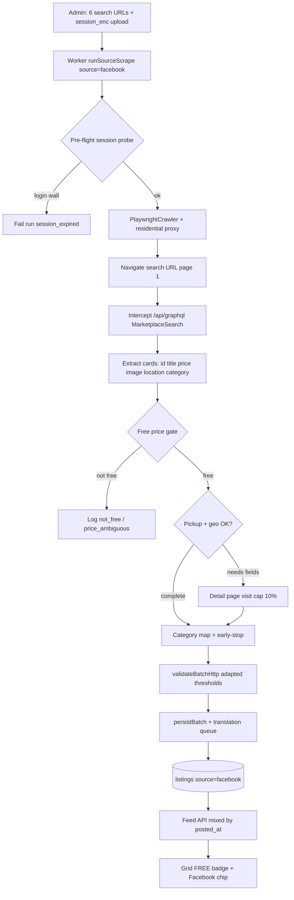

# Phase 18: Facebook Marketplace Scraping — Research

**Researched:** 2026-08-15  
**Domain:** Facebook Marketplace Playwright scraping + multi-source feed/category integration  
**Confidence:** MEDIUM

## Summary

Phase 18 adds **Facebook Marketplace** as a **Playwright-first**, **logged-in**, **residential-proxy** scraper source — hard-gated by a **Wave 0 spike** on 3 Venice search URLs — and integrates qualifying **free listings** into the existing mixed feed using the **17 Subito regalo slugs** as canonical category IDs (Phase 17 template).

Unlike Subito (`__NEXT_DATA__` HttpCrawler) and Vinted (session-warmed `/api/v2/catalog/items`), Facebook Marketplace is a **login-gated Relay/GraphQL surface**. Search grids at `/marketplace/{city-slug}/search/?query=…` require an authenticated session; anonymous access redirects to `/login/` or serves empty feeds. [CITED: https://www.sparkproxy.io/blog/how-to-scrape-facebook-marketplace] [CITED: https://spyderproxy.com/blog/how-to-scrape-facebook-marketplace]

The durable primary extract path for logged-in search is:

1. **PlaywrightCrawler** with **Italian residential proxy** (shared `proxy_enc`), **concurrency 1**, **conservative** preset (already seeded in `018_scraper_admin.sql`).
2. Inject **operator-managed session cookies** from new per-source `session_enc` column (AES-256-GCM, mirror `proxy_enc`).
3. **Intercept `/api/graphql/` responses** (or parse SSR-embedded Relay bootstrap JSON) for `MarketplaceSearch` feed units — **search result cards first** (D-18-15).
4. Apply **strict free-price gate** on structured price field only (D-18-01/02/03) — search query keywords (`gratis`, `regalo`, `free`) are discovery-only.
5. Selective **detail page visits** when price, location, coords, category, or pickup signal missing — capped ~10% per run (D-18-16).
6. **Incremental early-stop** after Wave 0 once stable `external_id` + crawl hash proven (reuse Phase 15 `loadKnownListingSet` / `applyEarlyStop`).

**Primary recommendation:** Ship Wave 0 spike (`spike-facebook-marketplace.mjs`) before any crawler code. On PASS, implement `scraper/src/facebook/` as PlaywrightCrawler + GraphQL response interception, extend admin with session upload/test + 6-URL matrix UI, add `session_enc` migration, replace D-09 facebook stub in `resolveCanonicalCategorySlug`, and mirror Phase 17 consumer chip/FREE badge patterns.

## Architectural Responsibility Map

| Capability | Primary Tier | Secondary Tier | Rationale |
|------------|-------------|----------------|-----------|
| Marketplace search fetch | API / Backend (scraper worker) | — | Login-gated; must run in worker Playwright context, not browser client |
| Session cookie storage | DB (`scraper_sources.session_enc`) | Admin UI upload | Operator-managed; encrypted at rest like `proxy_enc` (D-18-06/11) |
| Session validity probe | API / Backend (pre-flight) | Admin “Test session” | Fail fast on login wall/checkpoint before crawl (D-18-09/12) |
| GraphQL / SSR listing extract | API / Backend (Playwright) | — | Primary path; DOM selectors break on FB deploys [CITED: Apify leonardparisi/facebook-marketplace-scraper pattern] |
| Free price gate | API / Backend (extract) | — | Price field only; reject ambiguous/missing (D-18-01/02/03) |
| Local pickup gate | API / Backend (extract) | Detail fallback | Reject shipping-only; mirror Vinted D-17-15 / D-18-04 |
| Venice/Padova bbox + city | API / Backend (extract + schema) | DB centroid lookup | URL city intent + JSON location + `inCityBbox` (D-18-25/27) |
| Venice zone tagging | API / Backend (persist) | — | Reuse `tagZone()` when coords exist; Padova skips zones (D-18-28) |
| Category → Subito slug | API / Backend (extract + lib) | — | `FACEBOOK_CATEGORY_TO_SLUG` + title inference at scrape (D-18-49/50) |
| Incremental early-stop | API / Backend (crawl) | DB listings | Reuse Subito known-set after Wave 0 (D-18-18) |
| Residential proxy | API / Backend (worker) | Admin global settings | **Required for FB from day one** — not Subito-style direct default (D-18-08/37) |
| Mixed chronological feed | Frontend Server / API | — | Existing `posted_at` sort; no source segregation (D-18-41) |
| Facebook source chip | Browser / Client | — | Stitch `#f1f1f0` chip on grid card (D-18-43) |
| Admin URL matrix + session | Frontend Server (admin) | DB seeds | Mirror Subito/Vinted source-detail parity + session field (D-18-34) |
| Translation | API / Backend (persist) | — | Same post-persist queue as Subito/Vinted (D-18-48) |

<user_constraints>
## User Constraints (from CONTEXT.md)

### Locked Decisions

#### Free-item definition
- **D-18-01:** **Price field only** qualifies a Facebook listing as free — no keyword-only or search-URL-only acceptance.
- **D-18-02:** **Structured zero only** — accept numeric `0`, `"0"`, `"0.00"`, and localized `"Free"` / `"Gratis"` / `"Gratuito"` from the **price field**; reject `"negotiable"`, `"contact for price"`, or missing price.
- **D-18-03:** **Reject missing or ambiguous price** at extract — log `not_free` or `price_ambiguous`; never enter persist pipeline (Vinted D-17-02 parity).
- **D-18-04:** **Require local pickup / meet-up** — reject shipping-only listings (Vinted D-17-15 parity).

#### Auth, session & crawl stack
- **D-18-05:** **Logged-in Facebook session required** — Wave 0 must prove extract with authenticated session; anonymous crawl out of scope unless spike passes without login.
- **D-18-06:** **Operator-managed session cookies** — no automated FB login in worker; operator exports/pastes cookies via admin.
- **D-18-07:** **Playwright-first** — browser session primary; HTTP reuse only if spike proves embedded JSON path without full navigation.
- **D-18-08:** **Residential proxy required from day one** for Facebook — Italian egress via shared `proxy_enc`; direct/degraded is not the default for FB (unlike Subito).
- **D-18-09:** **On session expiry** — fail run with `session_expired`, admin banner; no silent partial crawl.
- **D-18-10:** **Session upload on `/admin/sources/facebook`** — dedicated field + “Test session” validation before save.
- **D-18-11:** **`session_enc` encrypted JSONB** on `scraper_sources` (same encryption pattern as `proxy_enc`).
- **D-18-12:** **Pre-flight session probe** before each crawl run — lightweight marketplace page check; fail fast on login wall/checkpoint.
- **D-18-13:** **Concurrency 1** — sequential URLs, single browser context.
- **D-18-14:** **Keep `conservative` anti-block preset** — already seeded for `facebook` in `018_scraper_admin.sql`.
- **D-18-15:** **Search result cards first** — detail page only when price, location, coords, or category missing (within fallback cap).
- **D-18-16:** **Cap detail visits per run** — ~10% of listings or spike-tuned absolute cap; overflow deferred to next run (Subito D-15-16 pattern).
- **D-18-17:** **Page 1 only for MVP** — no pagination until post-spike need proven (Phase 15 D-15-23 pattern).
- **D-18-18:** **Incremental early-stop after Wave 0** — reuse `loadKnownListingSet` + crawl hash once stable `external_id` proven.
- **D-18-19:** **Wave 0 pass criteria** — Playwright extract on all 3 Venice seed URLs with session + proxy: title, free price, image, `external_id`, location. Hard gate before implementation.
- **D-18-20:** **Wave 0 fail → hard stop** — keep `coming_soon`, no crawler implementation; document failure artifact in phase dir.

#### URL matrix, geography & admin
- **D-18-21:** **Venice + Padova parity** — separate URL sets per city (Vinted D-17-05).
- **D-18-22:** **Search-query matrix** — 6 default URLs: 2 cities × 3 queries (`gratis`, `regalo`, `free`); no 17-slug × city matrix (FB lacks Subito-style category URLs).
- **D-18-23:** **Migration updates seeds** — replace 3 Venice-only placeholders with full 6-URL matrix.
- **D-18-24:** **FB Marketplace path regex** in `url-validate.ts` — require `/marketplace/` + valid search params (mirror Subito regalo regex pattern).
- **D-18-25:** **City assignment: URL template metadata + JSON fallback** — reject coords outside Venice/Padova bbox (Vinted D-17-10/11).
- **D-18-26:** **Prefer pickup/meet-up location** over seller profile city when FB exposes both (D-17-13).
- **D-18-27:** **Municipality centroid fallback** when city label but no coords (D-17-07/12).
- **D-18-28:** **Mirror Subito `tagZone()`** when coords exist; Padova skips zones (D-17-08).
- **D-18-29:** **Admin-configured URLs only** — no site-wide FB search crawl (D-17-03).
- **D-18-30:** **Wave 0 tests 3 Venice URLs only** — Padova URLs ship in implementation migration; validated on first manual run / phase gate.
- **D-18-31:** **Dedup by `external_id`** at crawl layer across overlapping query URLs per city.
- **D-18-32:** **Flip `implementation_status` to `live`; `enabled=false` by default** (D-17-34).
- **D-18-33:** **Default crawl interval 90 min** — same as Subito/Vinted (D-17-35).
- **D-18-34:** **Full Subito admin source-detail UI parity** — URL chip matrix, city/query metadata, run stats, session field (D-17-37).
- **D-18-35:** **`external_url`** = canonical `https://www.facebook.com/marketplace/item/{id}/` (D-17-28 pattern).
- **D-18-36:** **48h scraped TTL** — same `expires_at` as other scraped sources.
- **D-18-37:** **Shared global `proxy_enc`** — same residential proxy config as Vinted (D-17-33).
- **D-18-38:** **No `listing_source` enum migration** — `facebook` already exists from Phase 1.
- **D-18-39:** **Auto-hide report threshold stays 2** — same as Subito (`lib/reports/auto-hide.ts`).

#### Worker & feed integration
- **D-18-40:** **New `scraper/src/facebook/` module** — extend `runSourceScrape` with `facebook` branch beside `subito`/`vinted` (D-17-32 pattern).
- **D-18-41:** **Mixed chronological feed** — FB + Subito + Vinted + UGC by `posted_at` (D-17-25).
- **D-18-42:** **FREE badge** on Facebook free grid cards (D-17-29).
- **D-18-43:** **Small Facebook source chip** on grid cards — monochrome Stitch chip (D-17-26).
- **D-18-44:** **No consumer source filter** — FilterSheet unchanged (D-17-27).
- **D-18-45:** **Detail opens `external_url` in new tab** — no in-app FB claim (D-17-28).
- **D-18-46:** **Favorites parity** — heart + login gate; flat grid (D-17-30).
- **D-18-47:** **Feed search includes FB titles** — translated fields when available (D-17-31).
- **D-18-48:** **Same auto-translate pipeline** as Subito/Vinted (D-17-22).

#### Category mapping
- **D-18-49:** **Hybrid mapping** — Facebook category ID → Subito slug lookup at scrape time; **title inference fallback** via `INFERRED_CATEGORY_TO_SLUG` (D-17-16).
- **D-18-50:** **Extend `resolveCanonicalCategorySlug`** with `facebook` branch — replace D-09 stub (D-17-17).
- **D-18-51:** **Resolver order:** valid DB slug → `FACEBOOK_CATEGORY_TO_SLUG` → title inference → `null`.
- **D-18-52:** **Unmapped fallback → `null` (uncategorized)** — excluded when specific category filters active (Phase 12 D-08; D-17-18).
- **D-18-53:** **Many FB categories → one Subito slug** acceptable (D-17-24).
- **D-18-54:** **`FACEBOOK_CATEGORY_TO_SLUG` in `canonical-categories.ts`** beside Vinted map + unit tests (CAT-03, D-17-20).
- **D-18-55:** **Persist canonical slug at scrape time** before `persist.ts`.
- **D-18-56:** **Re-resolve category when crawl hash changes** on re-crawl.
- **D-18-57:** **Detail fallback for category** when missing on search card (within detail visit cap).
- **D-18-58:** **Raw FB category ID in scrape logs/metadata only** — not consumer UI; aids map tuning.
- **D-18-59:** **No category intent in search URLs** — mapping from listing JSON/title only; no per-slug URL matrix for FB.
- **D-18-60:** **Best-effort map from Wave 0** — not blocking on all 17 Subito slugs; phase gate requires mapped + null fallback tests.
- **D-18-61:** **Update D-09 stub tests** — `canonical-categories.test.ts` / `subito-categories.test.ts` expect map/inference, not always-null.
- **D-18-62:** **No FilterSheet UI changes** — same 17 Subito labels; Phase 12.1 i18n for display (D-17-21).
- **D-18-63:** **Same filter path as Vinted** — `listingMatchesCategoryFilter` source-aware via canonical slug.

### Claude's Discretion
- Wave 0 spike pass criteria fine-tuning (exact JSON field names, session cookie format).
- Detail visit cap exact percentage or absolute number (default ~10%).
- Source chip exact label (“Facebook” vs localized) within Stitch tokens.
- `FACEBOOK_CATEGORY_TO_SLUG` expansion post-Wave 0 as more category IDs discovered.
- Padova FB city slug strings in migration seed URLs (researcher documents from spike).

### Deferred Ideas (OUT OF SCOPE)
- **Consumer source filter** (Subito / Vinted / Facebook only) in FilterSheet — new capability; own phase (reconfirmed D-18-44)
- **Favorites grouped by source or category folders** — flat grid locked Phase 12; folders v3+
- **FB category-specific search URLs** — add post-launch if FB supports per-category marketplace URLs for Venice/Padova
- **Pagination beyond page 1** — add when spike proves insufficient coverage
- **Automated Facebook login** — rejected; operator-managed cookies only
- **Separate Facebook-only feed views** — out of scope
</user_constraints>

<phase_requirements>
## Phase Requirements

| ID | Description | Research Support |
|----|-------------|------------------|
| SCRP-E01 | Primary extract from embedded JSON/API — not N+1 detail for list path | GraphQL intercept on search navigation yields card-level listings in one page load; detail only on fallback cap (D-18-15/16) |
| SCRP-E02 | Incremental known-set + early-stop K=5 | Reuse `loadKnownListingSet(supabase, 'facebook')`, `applyEarlyStop` from Subito after Wave 0 (D-18-18) |
| SCRP-E03 | Periodic full refresh disables early-stop | Same `decideCrawlMode` / admin full-crawl trigger in `worker.ts` |
| SCRP-E04 | Playwright for fallback | **Inverted for FB:** Playwright is primary; raw GraphQL replay without browser only if Wave 0 proves SSR bootstrap path (D-18-07) |
| SCRP-E05 | Proxy ADR — residential for production | FB **requires** residential from day one via shared `proxy_enc` (D-18-08); fail or block run without proxy in prod |
| SCRP-E06 | Crawlee + Node worker stack | Extend existing `PlaywrightCrawler` — no Python rewrite |
| SCRP-E07 | Crawl vs persist skip metrics | Reuse `scrape_runs` columns + per-URL breakdown logging |
| SCRP-E08 | Batch validation gate | Adapt low incremental floors (sparse free yield, mirror Vinted thresholds) + JSON completeness gate |
| CAT-01 | Multi-source `resolveCanonicalCategorySlug` | Replace D-09 stub with facebook branch (D-18-50/51) |
| CAT-03 | Mapping tables + unit tests | `FACEBOOK_CATEGORY_TO_SLUG` + tests (D-18-54/61) |
| CARD-03 | FREE badge on grid | Already exists; FB free listings qualify (D-18-42) |
| I18N-01 (partial) | New strings in zh/en/it | Add `messages.listing.sourceFacebook` for chip label (D-18-43) |
</phase_requirements>

## Project Constraints (from .cursor/rules/)

- Consumer source chip MUST follow `.planning/google-stitch-ui-design/DESIGN.md` — monochrome, `#f1f1f0` chips, Inter, Material Symbols; no default shadcn accents.
- Read Stitch prototype + existing React reference before editing `ListListingCard` or admin source detail.
- Use `@theme` tokens from `app/globals.css` — no hardcoded hex drift beyond documented Stitch chip `#f1f1f0`.

## Standard Stack

### Core

| Library | Version | Purpose | Why Standard |
|---------|---------|---------|--------------|
| crawlee | 3.18.1 | `PlaywrightCrawler` orchestration | Already in scraper; Phase 15/17 ADR lock [VERIFIED: npm registry + `scraper/package.json`] |
| playwright | 1.62.1 | Primary FB Marketplace browser automation | D-18-07 Playwright-first; login-gated surface [VERIFIED: npm registry] |
| zod | 3.24.0 (scraper) | `CanonicalListingSchema` validation | Existing persist gate |

**No new npm packages required for Phase 18.** Reuse existing scraper stack only.

### Supporting (reuse from Subito/Vinted modules)

| Module | Path | Reuse for FB |
|--------|------|--------------|
| Known-set loader | `scraper/src/subito/known-set.ts` | `loadKnownListingSet(supabase, 'facebook')` |
| Early-stop | `scraper/src/subito/early-stop.ts` | Per-URL K=5 consecutive known |
| Crawl mode | `scraper/src/worker-proxy-gate.ts` | `decideCrawlMode`, full refresh |
| Geo bbox | `scraper/src/geo/italian-cities.ts` | Venice/Padova `inCityBbox`, centroids |
| Zone tag | `scraper/src/shared/zone-tag.ts` | Venice polygons (D-18-28) |
| Persist + translate | `scraper/src/shared/persist.ts` | Same batch persist + queue |
| Session crypto | `lib/admin/crypto.ts` | Extend with `encryptSession` / `decryptSession` mirroring `encryptProxy` |
| Admin source detail | `components/admin/SourceDetailClient.tsx` | Matrix + session field parity |
| Canonical resolver | `lib/listings/canonical-categories.ts` | Add `FACEBOOK_CATEGORY_TO_SLUG` |
| URL validation | `lib/admin/url-validate.ts` | Marketplace search path regex |

### Alternatives Considered

| Instead of | Could Use | Tradeoff |
|------------|-----------|----------|
| Playwright + GraphQL intercept | Direct `/api/graphql/` HTTP replay | Rejected as primary — requires rotating `doc_id`, `fb_dtsg`, `lsd` tokens; breaks within days [CITED: https://github.com/jdcodes1/facebook-marketplace-mcp] |
| Playwright + GraphQL intercept | DOM card scraping | Rejected — FB markup obfuscates; JSON path stable relative to CSS [CITED: Apify leonardparisi/facebook-marketplace-scraper] |
| Operator cookies | Automated FB login in worker | Rejected — D-18-06; checkpoint risk |
| Per-source proxy | Shared `proxy_enc` | Rejected — D-18-37 locks shared global residential config |
| Subito HttpCrawler primary | Playwright primary | Required — FB search is login-gated unlike Subito `__NEXT_DATA__` |

**Installation:** None — reuse `scraper/package.json` dependencies.

## Package Legitimacy Audit

> Phase 18 installs **no new packages**. Existing stack audit:

| Package | Registry | Age | Downloads | Source Repo | Verdict | Disposition |
|---------|----------|-----|-----------|-------------|---------|-------------|
| crawlee | npm | current | ~151k/wk | github.com/apify/crawlee | SUS (too-new signal) | Approved — already in production scraper |
| playwright | npm | current | ~80M/wk | github.com/microsoft/playwright | SUS (too-new signal) | Approved — already in production scraper |
| zod | npm | current | ~254M/wk | github.com/colinhacks/zod | OK | Approved |

**Packages removed due to [SLOP] verdict:** none  
**Packages flagged as suspicious [SUS]:** none new (pre-existing crawlee/playwright in repo)

## Architecture Patterns

### System Architecture Diagram



### Recommended Project Structure

```
scraper/src/facebook/
├── crawler.ts           # runFacebookCrawler — PlaywrightCrawler primary
├── session.ts           # load cookies from session_enc; pre-flight probe; login-wall detect
├── graphql-extract.ts   # Parse MarketplaceSearch responses → RawListing[]
├── filters.ts           # isFacebookFreePrice, isLocalPickup, price_ambiguous
├── enrich.ts            # Detail page fallback: coords, category_id, delivery_types
├── url-template.ts      # buildDefaultFacebookUrls(city, query) for 6-URL seed
└── known-set.ts         # Re-export loadKnownListingSet (source=facebook)

scraper/scripts/
└── spike-facebook-marketplace.mjs   # Wave 0 hard gate (D-18-19/20)

lib/admin/
├── crypto.ts                      # + encryptSession / decryptSession
├── facebook-recommended-seed.ts   # 6-URL Venice+Padova matrix
└── url-validate.ts                # + FACEBOOK_MARKETPLACE_SEARCH_REGEX

lib/listings/
├── canonical-categories.ts        # + FACEBOOK_CATEGORY_TO_SLUG, facebook resolver branch
└── facebook-category-map.ts       # Optional split if map grows (CAT-03)

components/admin/
├── SourceDetailClient.tsx         # facebook session field + FacebookUrlMatrix
└── FacebookUrlMatrix.tsx          # 2 cities × 3 queries chip matrix

supabase/migrations/
└── 029_facebook_session_enc.sql   # session_enc column + 6-URL seed update
```

### Pattern 1: Playwright session injection (operator cookies)

**What:** Decrypt `session_enc` → Playwright `storageState` or `context.addCookies()` before first navigation.

**When to use:** Every FB run; pre-flight probe uses same cookies.

**Example:**

```typescript
// Source: [CITED: https://github.com/microsoft/playwright/blob/main/docs/src/auth.md]
import type { BrowserContext } from 'playwright';

type SessionPayload = {
  cookies: Array<{
    name: string;
    value: string;
    domain: string;
    path: string;
    expires?: number;
    httpOnly?: boolean;
    secure?: boolean;
    sameSite?: 'Strict' | 'Lax' | 'None';
  }>;
  origins?: Array<{ origin: string; localStorage: Array<{ name: string; value: string }> }>;
};

export async function applySessionToContext(
  context: BrowserContext,
  session: SessionPayload,
): Promise<void> {
  if (session.cookies?.length) {
    await context.addCookies(session.cookies);
  }
  // Require auth cookies for probe (Wave 0 must confirm names)
  const hasUser = session.cookies.some((c) => c.name === 'c_user' && c.value);
  if (!hasUser) throw new Error('session_missing_c_user');
}
```

**Admin upload format (discretion):** Accept Playwright `storageState` JSON **or** browser-export cookie array; normalize server-side before encrypt.

### Pattern 2: GraphQL response interception (primary list extract)

**What:** Register `page.on('response')` for `POST …/api/graphql/`; parse JSON bodies containing `marketplace_search` or `viewer.marketplace_feed_units`.

**When to use:** Default path on search URL navigation (D-18-15).

**Example:**

```typescript
// Source: [CITED: https://apify.com/leonardparisi/facebook-marketplace-scraper]
// Field paths observed in community scrapers — Wave 0 must confirm on live Venice HTML
function extractListingsFromGraphqlBody(json: unknown): FacebookCardListing[] {
  const root = json as Record<string, unknown>;
  const data = (root.data ?? root) as Record<string, unknown>;
  const search = data.marketplace_search as Record<string, unknown> | undefined;
  const feedUnits =
    (search?.feed_units as Record<string, unknown> | undefined) ??
    (data.viewer as Record<string, unknown> | undefined)?.marketplace_feed_units;
  const edges = (feedUnits as { edges?: unknown[] })?.edges ?? [];
  return edges
    .map((edge) => {
      const node = (edge as { node?: { listing?: Record<string, unknown> } }).node?.listing;
      if (!node) return null;
      return {
        external_id: String(node.id ?? ''),
        title: String(node.marketplace_listing_title ?? node.custom_title ?? ''),
        price_amount: (node.listing_price as { amount?: string })?.amount ?? null,
        price_formatted: (node.listing_price as { formatted_amount?: string })?.formatted_amount ?? null,
        photo_url: (node.primary_listing_photo as { image?: { uri?: string } })?.image?.uri ?? '',
        location_label: (node.location as { reverse_geocode?: { city?: string } })?.reverse_geocode?.city ?? '',
        category_id: (node.marketplace_listing_category_id as string | number | undefined) ?? null,
        delivery_types: (node.delivery_types as string[] | undefined) ?? [],
      };
    })
    .filter(Boolean) as FacebookCardListing[];
}
```

### Pattern 3: Facebook free-price gate (stricter than Vinted)

**What:** Accept only structured zero / localized free tokens from **price field** — not title keywords.

**When to use:** Immediately after card extract, before persist pipeline (D-18-01/02/03).

**Example:**

```typescript
// D-18-02: extends Vinted isFreePrice with localized formatted_amount tokens
const FREE_FORMATTED = new Set(['free', 'gratis', 'gratuito', '€0', '$0', '0 €']);

export function isFacebookFreePrice(
  amount: string | number | null | undefined,
  formatted?: string | null,
): boolean {
  if (amount != null && amount !== '') {
    if (typeof amount === 'number') return amount === 0;
    const trimmed = String(amount).trim();
    if (/^-?\d+(\.\d+)?$/.test(trimmed)) return Number.parseFloat(trimmed) === 0;
  }
  if (formatted) {
    const norm = formatted.trim().toLowerCase().replace(/\s+/g, ' ');
    if (FREE_FORMATTED.has(norm)) return true;
    if (/^0([.,]00)?(\s*[€$])?$/.test(norm)) return true;
  }
  return false;
}

export type FacebookPriceReject = 'not_free' | 'price_ambiguous';

export function rejectReasonIfNotFacebookFree(
  amount: string | number | null | undefined,
  formatted?: string | null,
): FacebookPriceReject | null {
  if (amount == null && !formatted) return 'price_ambiguous';
  const ambiguous = [formatted, String(amount ?? '')]
    .filter(Boolean)
    .some((v) => /negotiable|contact|da concordare|trattabile/i.test(String(v)));
  if (ambiguous) return 'price_ambiguous';
  return isFacebookFreePrice(amount, formatted) ? null : 'not_free';
}
```

### Pattern 4: `session_enc` migration (mirror `proxy_enc`)

**What:** Add encrypted JSONB on `scraper_sources`; reuse AES-256-GCM helpers in `lib/admin/crypto.ts`.

**When to use:** Migration Wave 1; admin PATCH accepts session blob; worker decrypts at run start.

**Example:**

```typescript
// Source: lib/admin/crypto.ts (existing encryptProxy pattern)
export type EncryptedSessionPayload = EncryptedProxyPayload; // same { iv, tag, data }

export function encryptSession(plaintextJson: string, keyBase64: string): EncryptedSessionPayload {
  return encryptProxy(plaintextJson, keyBase64);
}

export function decryptSession(payload: EncryptedSessionPayload, keyBase64: string): string {
  return decryptProxy(payload, keyBase64);
}
```

```sql
-- supabase/migrations/029_facebook_session_enc.sql
ALTER TABLE public.scraper_sources
  ADD COLUMN IF NOT EXISTS session_enc jsonb;

COMMENT ON COLUMN public.scraper_sources.session_enc IS
  'AES-256-GCM encrypted Playwright storageState or cookie JSON (operator-managed FB session)';
```

### Pattern 5: Login wall / checkpoint detection

**What:** Pre-flight + per-URL guard; fail run with `session_expired` (D-18-09).

**Signals (Wave 0 confirms):**

| Signal | Detection |
|--------|-----------|
| Login redirect | `page.url()` matches `/login/` or `next=` param |
| Checkpoint | Title/body contains `checkpoint` / `Confirm your identity` / `Controlla la tua identità` |
| Missing auth cookie | No `c_user` after navigation |
| Empty feed | GraphQL returns zero edges **and** DOM shows login form |
| HTTP 302 to login | Response chain on search URL |

### Anti-Patterns to Avoid

- **Treating search query as proof of free** — URLs with `query=gratis` still surface paid items; price field gate required (D-18-01).
- **Copying Vinted strict numeric-only price filter** — FB uses localized `formatted_amount` strings (D-18-02).
- **Subito-style direct crawl without proxy** — FB blocks datacenter IPs aggressively; D-18-08 requires residential from day one.
- **Automated login / credential storage** — operator cookies only (D-18-06).
- **Hand-rolling GraphQL HTTP client as primary** — token rotation burden; use browser intercept (D-18-07).
- **Keeping D-09 always-null facebook resolver** — breaks CAT-01 / category filters (D-18-50).
- **Adding FilterSheet source filter** — explicitly deferred (D-18-44).

## Wave 0 Spike Design

> **Hard gate (D-18-19/20):** No implementation waves until artifact shows **Verdict: PASS** on all 3 Venice URLs with **logged-in session + residential proxy**.

### Spike script

- **Path:** `scraper/scripts/spike-facebook-marketplace.mjs` (mirror `spike-vinted-catalog.mjs` structure)
- **Run:** `FB_SESSION_JSON=./fb-session.json PROXY_URL=… node scraper/scripts/spike-facebook-marketplace.mjs`
- **Artifact:** `.planning/phases/18-facebook-marketplace-scraping/18-SPIKE-FACEBOOK-MARKETPLACE.md`
- **Fixtures:** `scraper/fixtures/facebook-search-graphql-sample.json`, `scraper/fixtures/facebook-item-detail-fragment.json`

### Concrete Wave 0 URLs (Venice only — D-18-30)

Use canonical FB city slug `venice` (matches existing migration seed `018_scraper_admin.sql`). Append `sortBy=creation_time_descend` for newest-first (optional but recommended for incremental alignment).

| # | Query | URL |
|---|-------|-----|
| 1 | gratis | `https://www.facebook.com/marketplace/venice/search/?query=gratis&sortBy=creation_time_descend` |
| 2 | regalo | `https://www.facebook.com/marketplace/venice/search/?query=regalo&sortBy=creation_time_descend` |
| 3 | free | `https://www.facebook.com/marketplace/venice/search/?query=free&sortBy=creation_time_descend` |

### Implementation seed matrix (6 URLs — D-18-22/23)

Padova slug **`padova`** [ASSUMED] — Wave 0 does not gate Padova; first manual run validates (D-18-30).

| City | Query | URL |
|------|-------|-----|
| venice | gratis | `https://www.facebook.com/marketplace/venice/search/?query=gratis&sortBy=creation_time_descend` |
| venice | regalo | `https://www.facebook.com/marketplace/venice/search/?query=regalo&sortBy=creation_time_descend` |
| venice | free | `https://www.facebook.com/marketplace/venice/search/?query=free&sortBy=creation_time_descend` |
| padova | gratis | `https://www.facebook.com/marketplace/padova/search/?query=gratis&sortBy=creation_time_descend` |
| padova | regalo | `https://www.facebook.com/marketplace/padova/search/?query=regalo&sortBy=creation_time_descend` |
| padova | free | `https://www.facebook.com/marketplace/padova/search/?query=free&sortBy=creation_time_descend` |

**URL validation regex (D-18-24):**

```typescript
export const FACEBOOK_MARKETPLACE_SEARCH_REGEX =
  /^\/marketplace\/[a-z0-9-]+\/search\/?$/i;

// validateTargetUrl facebook branch:
// pathname matches regex AND searchParams.has('query')
```

### Pass criteria table (D-18-19)

| # | Criterion | Measure | Required |
|---|-----------|---------|----------|
| 1 | Authenticated extract | All 3 URLs load search grid without login redirect | ✅ |
| 2 | GraphQL/SSR parse | ≥1 listing per URL with `external_id`, `title`, `photo_url` via intercept or SSR JSON | ✅ |
| 3 | Price field present | ≥90% of parsed cards expose price field (amount or formatted) | ✅ |
| 4 | Free filter sample | Document `isFacebookFreePrice()` on ≥3 live price samples; **zero free items OK** — proves filter not supply | ✅ |
| 5 | Location field | ≥1 listing per URL exposes city/location label or coords | ✅ |
| 6 | Session probe | Pre-flight function distinguishes valid session vs expired (forced fail on bad cookies) | ✅ |
| 7 | Proxy | Run uses Italian residential `PROXY_URL`; record exit country + block signals | ✅ |
| 8 | Wall time | ≤15s navigation + first GraphQL payload per URL (conservative preset realistic) | ✅ |
| 9 | Pickup signal | Document delivery/pickup field names on ≥1 listing (detail OK) | ⚠️ best-effort |
| 10 | Category ID | Capture ≥1 raw `marketplace_listing_category_id` for map seed | ⚠️ best-effort |
| 11 | Artifact | `18-SPIKE-FACEBOOK-MARKETPLACE.md` ends with **Verdict: PASS/FAIL** | ✅ |

**FAIL triggers (D-18-20):** Any URL hits login wall with valid operator session + proxy; OR cannot parse listing cards on ≥2/3 URLs; OR price field missing on >10% of cards; OR session probe cannot detect expiry.

### Failure artifact template

```markdown
# Phase 18 Wave 0 — Facebook Marketplace Spike (FAILED)

**Date:** YYYY-MM-DD
**Operator session:** present / absent
**Proxy:** {provider} — {country} — {host masked}
**Verdict:** FAIL

## URL results

| URL | HTTP | Final URL | Login wall? | Cards parsed | Notes |
|-----|------|-----------|-------------|--------------|-------|
| venice/gratis | | | | | |
| venice/regalo | | | | | |
| venice/free | | | | | |

## Blocker summary
{one paragraph: checkpoint vs proxy vs cookie format vs GraphQL schema drift}

## Recommended next steps
1. …
2. …

## Raw evidence
- Screenshot paths / HTML snippet paths
- GraphQL sample (redacted cookies)
```

## Don't Hand-Roll

| Problem | Don't Build | Use Instead | Why |
|---------|-------------|-------------|-----|
| Browser automation | Raw puppeteer scripts | Crawlee `PlaywrightCrawler` | Session pool, proxy, retries already integrated |
| Cookie encryption | Custom scheme | Extend `lib/admin/crypto.ts` AES-256-GCM | Proven `proxy_enc` pattern (D-18-11) |
| GraphQL token factory | Standalone FB API client | In-browser intercept | `doc_id` / `fb_dtsg` rotation breaks HTTP replay [CITED: jdcodes1/facebook-marketplace-mcp] |
| Incremental early-stop | New DB tables | `known-set.ts` + `early-stop.ts` | Phase 15 complete |
| Category filter path | Parallel FB-only resolver | `resolveCanonicalCategorySlug` | CAT-01 single pipeline |
| Venice zones | New geo module | `scraper/src/shared/zone-tag.ts` | D-18-28 |
| Translation | Skip for MVP | `persistBatch` queue | D-18-48 |
| Proxy rotation | Multi-manager OSS | Shared `proxy_enc` + provider rotation | Phase 16 ADR |

**Key insight:** Facebook complexity is **authenticated Playwright + GraphQL intercept + strict price gate**, not a new platform stack. Clone Vinted **worker routing / admin / consumer** patterns; swap extract module for Playwright-first; add `session_enc` + session probe.

## Common Pitfalls

### Pitfall 1: Wave 0 skipped → implementation on dead path

**What goes wrong:** Engineers build crawler before proving login+proxy extract; Phase stalls on checkpoint loops.

**Why it happens:** Item pages sometimes work logged-out; search does not.

**How to avoid:** D-18-20 hard stop; planner Wave 0 plan only; no `scraper/src/facebook/crawler.ts` until PASS artifact committed.

**Warning signs:** Spike script missing; `implementation_status` still `coming_soon` but crawler PR open.

### Pitfall 2: Keyword search false positives for “free”

**What goes wrong:** Paid listings persist because query contained `gratis`.

**Why it happens:** FB search is fuzzy; operators assume URL intent equals price.

**How to avoid:** D-18-01 price-only gate; log `not_free` counts; unit tests for `rejectReasonIfNotFacebookFree`.

**Warning signs:** High persist reject rate; user reports non-free items with FREE badge.

### Pitfall 3: Session expiry silent partial feeds

**What goes wrong:** Run “succeeds” with 0 listings; feed looks broken.

**Why it happens:** Missing pre-flight probe.

**How to avoid:** D-18-09/12 fail fast `session_expired`; admin banner on source card.

**Warning signs:** `listings_found=0` but status success; login HTML in logs.

### Pitfall 4: Datacenter IP / missing proxy

**What goes wrong:** Checkpoint or empty GraphQL on Fly.io egress.

**Why it happens:** Subito degraded-direct habit applied to FB.

**How to avoid:** D-18-08 — require `proxy_enc` for facebook prod runs; Wave 0 documents proxy mandatory.

**Warning signs:** `blocked_url_count` 100%; checkpoint URLs.

### Pitfall 5: Category stub leaves FB invisible in filters

**What goes wrong:** FB listings never match FilterSheet categories.

**Why it happens:** D-09 stub returns null for all facebook inputs.

**How to avoid:** D-18-50/61 — implement map + update tests expecting inference/map.

**Warning signs:** `canonical-categories.test.ts` still expects facebook → null.

### Pitfall 6: Invalid city slug in seed URLs

**What goes wrong:** Padova/Venice URLs 302 to generic `/marketplace/category/search/` losing geo filter.

**Why it happens:** FB requires canonical slugs; free-text city names redirect [CITED: https://browse.sh/skills/facebook.com/search-marketplace-m9gyrc].

**How to avoid:** Wave 0 verifies `venice`; manual gate verifies `padova`; log final URL after navigation.

**Warning signs:** Results from wrong region; URL no longer contains city slug.

## Code Examples

### External URL canonical form (D-18-35)

```typescript
export function facebookExternalUrl(listingId: string | number): string {
  return `https://www.facebook.com/marketplace/item/${listingId}/`;
}
```

### Extend canonical resolver (planned — D-18-50)

```typescript
// lib/listings/canonical-categories.ts
export function resolveCanonicalCategorySlug(input: CanonicalCategoryInput): SubitoRegaloSlug | null {
  const fromDb = normalizeCatalogSlug(input.category);
  if (fromDb) return fromDb;

  if (input.source === 'facebook') {
    const fromFacebook = mapFacebookCategoryToSlug(input.facebookCategoryId);
    if (fromFacebook) return fromFacebook;
    const inferred = inferListingCategory(input.title);
    if (inferred) return INFERRED_CATEGORY_TO_SLUG[inferred];
    return null;
  }
  // … vinted / default inference
}
```

### Worker routing extension (D-18-40)

```typescript
// scraper/src/worker.ts — pattern from vinted branch
} else if (sourceSlug === 'facebook') {
  if (!config.proxyUrl && isProductionSoftProxyContext()) {
    throw new Error('Facebook crawl requires residential proxy (D-18-08)');
  }
  const session = await loadFacebookSession(supabase, sourceSlug);
  await probeFacebookSession(session, config.proxyUrl);
  const fallbackResult = await runFacebookCrawlWithProxyFallback(
    runFacebookCrawler,
    config.urls,
    config.preset,
    config.proxyUrl,
    { session, knownMap, earlyStopK: config.earlyStopK, isFullRefresh, mode: crawlMode, runId: run.id },
  );
  crawlResult = fallbackResult.crawlResult;
}
```

### Consumer source chip (D-18-43)

```tsx
// components/listings/ListListingCard.tsx — mirror vinted chip
{listing.source === 'facebook' && (
  <span className="rounded-md border border-outline-variant bg-[#f1f1f0] px-2 py-0.5 text-xs font-medium text-on-surface">
    {messages.listing.sourceFacebook}
  </span>
)}
```

## Facebook Category → Subito Slug Strategy (D-18-49–60)

Facebook exposes marketplace category IDs on listing JSON (exact key confirmed in Wave 0). Mapping approach:

1. **Wave 0 harvest:** Collect distinct `marketplace_listing_category_id` values from Venice free/gratis search samples.
2. **Seed map:** Add known IDs to `FACEBOOK_CATEGORY_TO_SLUG` in `lib/listings/canonical-categories.ts` (beside `VINTED_CATALOG_TO_SUBITO_SLUG`).
3. **Many-to-one OK:** Multiple FB verticals → one Subito slug (D-18-53), e.g. FB `home` + `furniture` → `arredamento-casalinghi`.
4. **Title inference fallback:** `INFERRED_CATEGORY_TO_SLUG` when ID unmapped (D-18-51).
5. **Null fallback:** Unmapped → `null` (uncategorized), excluded by specific category filters (D-18-52).
6. **No URL category matrix:** Unlike Subito 17×2 regalo URLs; FB uses 2×3 query matrix only (D-18-59).

**Starter map (placeholder IDs — replace after Wave 0):**

| FB category label (UI) | Assumed ID | Subito slug |
|------------------------|------------|-------------|
| Home & Garden | TBD | `arredamento-casalinghi` / `giardino-fai-da-te` |
| Electronics | TBD | `informatica` or `audio-video` |
| Apparel | TBD | `abbigliamento-accessori` |
| Free Stuff (vertical) | TBD | `usato` or inference only |

## State of the Art

| Old Approach | Current Approach | When Changed | Impact |
|--------------|------------------|--------------|--------|
| FB stub resolver (D-09) | Map + inference branch | Phase 18 | CAT-01 compliance |
| 3 Venice placeholder URLs | 6-URL city×query matrix | Phase 18 migration | D-18-22/23 |
| `coming_soon` facebook | `live` + `enabled=false` default | Phase 18 | Operator manual enable |
| Subito HttpCrawler-only worker | + Playwright-first FB branch | Phase 18 | `runSourceScrape` tri-source |
| No session storage | `session_enc` per source | Phase 18 | Operator cookie upload |

**Deprecated/outdated:**

- Assuming anonymous FB Marketplace search works for production — rejected by D-18-05.
- Direct GraphQL replay as primary — fragile `doc_id` rotation [CITED: github.com/jdcodes1/facebook-marketplace-mcp].

## Assumptions Log

| # | Claim | Section | Risk if Wrong |
|---|-------|---------|---------------|
| A1 | FB city slug `venice` is canonical for Venice, Italy | Wave 0 URLs | 302 to generic search — verify in spike |
| A2 | FB city slug `padova` works for Padova | 6-URL matrix | Geo filter lost — D-18-30 manual gate |
| A3 | GraphQL intercept yields `marketplace_search.feed_units.edges[].node.listing` | Pattern 2 | Fallback to SSR bootstrap parse or FAIL spike |
| A4 | `marketplace_listing_category_id` present on search cards | Category map | Detail fallback + title inference only |
| A5 | Pickup detectable via `delivery_types` or detail field | D-18-04 | May reject valid local items or accept shipping-only |
| A6 | Playwright `storageState` cookie export from operator browser is upload format | Session upload | Admin UX friction — document export steps |
| A7 | Free listings exist in Venice gratis/regalo/free queries | Supply | Zero yield OK for spike but operator expectations — sparse feed like Vinted €0 |

## Open Questions (RESOLVED)

1. **Exact Padova marketplace slug** — **RESOLVED per D-18-30**
   - What we know: Migration uses `venice`; Subito uses `padova` slug [VERIFIED: codebase]
   - Resolution: Wave 0 gates Venice only (3 URLs). Padova URLs ship in migration 029 with assumed slug `padova`; validated on first manual run / phase gate UAT (D-18-30). Update seed if 302 redirects to generic search.

2. **Pickup / delivery enum strings on FB Italy listings** — **RESOLVED → Wave 0 spike**
   - What we know: URL supports `deliveryMethod=local_pick_up` filter param [CITED: browse.sh marketplace skill]
   - Resolution: Wave 0 spike captures delivery/pickup field names on ≥1 listing (detail OK); `scraper/fixtures/facebook-item-detail-fragment.json` + `isFacebookLocalPickup()` unit tests in Wave 0 (D-18-04). Not blocking implementation start after spike PASS.

3. **SSR-only path without GraphQL intercept** — **RESOLVED → Wave 0 spike**
   - What we know: SparkProxy documents Relay bootstrap in page HTML for some surfaces [CITED: sparkproxy.io]
   - Resolution: Wave 0 spike tries GraphQL intercept first (primary path per D-18-07/15); documents SSR bootstrap fallback in `18-SPIKE-FACEBOOK-MARKETPLACE.md` artifact if intercept insufficient. HTTP replay without browser remains out of scope unless spike proves embedded JSON path.

## Environment Availability

| Dependency | Required By | Available | Version | Fallback |
|------------|------------|-----------|---------|----------|
| Node.js | Scraper worker | ✓ | v23.10.0 | — |
| npm | Scraper deps | ✓ | 11.4.2 | — |
| crawlee + playwright | PlaywrightCrawler | ✓ | 3.18.1 / 1.62.1 | installed in `scraper/` |
| vitest | Unit tests | ✓ | 3.x | — |
| Supabase | Persist + admin | ✓ (project) | — | — |
| Italian residential proxy | FB Wave 0 + prod | ⚠️ operator | shared `proxy_enc` | **No FB fallback** — spike blocked without proxy (D-18-08) |
| Operator FB session | Wave 0 + runs | ⚠️ manual | — | Hard gate — cannot scrape search without login |
| facebook.com network | Wave 0 | ✓ (dev WSL2) | — | Residential proxy if blocked |

**Missing dependencies with no fallback:**
- Valid logged-in Facebook session (operator-provided)
- Residential proxy for Wave 0 and production FB runs

**Missing dependencies with fallback:**
- None for FB-specific path (unlike Subito direct degraded)

## Validation Architecture

### Test Framework

| Property | Value |
|----------|-------|
| Framework | vitest 3.x (root + `scraper/vitest.config.ts`) |
| Config file | `/vitest.config.ts`, `/scraper/vitest.config.ts` |
| Quick run command | `npm run test:lib -- lib/listings/canonical-categories.test.ts -x` |
| Full suite command | `npm test && cd scraper && npm test` |

### Phase Requirements → Test Map

| Req ID | Behavior | Test Type | Automated Command | File Exists? |
|--------|----------|-----------|-------------------|-------------|
| CAT-01 | Facebook resolver branch | unit | `npm run test:lib -- lib/listings/canonical-categories.test.ts -x` | ✅ extend |
| CAT-03 | FB category map | unit | same + `facebook-category-map.test.ts` | ❌ Wave 0 |
| D-18-02 | Free price gate | unit | `cd scraper && npm test -- src/facebook/filters.test.ts -x` | ❌ Wave 0 |
| D-18-04 | Pickup vs shipping | unit | `cd scraper && npm test -- src/facebook/filters.test.ts -x` | ❌ Wave 0 |
| D-18-24 | URL validation regex | unit | `npm run test:lib -- lib/admin/url-validate.test.ts -x` | ✅ extend |
| D-18-11 | Session encrypt roundtrip | unit | `npm run test:lib -- lib/admin/crypto.test.ts -x` | ✅ extend |
| SCRP-E01 | GraphQL card parse | unit | `cd scraper && npm test -- src/facebook/graphql-extract.test.ts -x` | ❌ Wave 0 |
| SCRP-E02 | Early-stop integration | unit | `cd scraper && npm test -- src/subito/early-stop.test.ts -x` | ✅ reuse |
| D-18-09 | Session probe detects expiry | unit | `cd scraper && npm test -- src/facebook/session.test.ts -x` | ❌ Wave 0 |
| Wave 0 spike | Live 3 URL gate | manual/env | `FB_SESSION_JSON=… PROXY_URL=… node scraper/scripts/spike-facebook-marketplace.mjs` | ❌ Wave 0 |
| I18N-01 | sourceFacebook strings | unit/manual | grep `sourceFacebook` messages/*.ts | ❌ impl wave |

### Sampling Rate

- **Per task commit:** `cd scraper && npm test -- src/facebook/ -x` (after Wave 0 fixtures land)
- **Per wave merge:** `npm run test:lib && cd scraper && npm test`
- **Phase gate:** Wave 0 artifact **PASS** + full suite green before `/gsd-verify-work`

### Wave 0 Gaps

- [ ] `scraper/scripts/spike-facebook-marketplace.mjs` — live hard gate
- [ ] `.planning/phases/18-facebook-marketplace-scraping/18-SPIKE-FACEBOOK-MARKETPLACE.md` — verdict artifact
- [ ] `scraper/fixtures/facebook-search-graphql-sample.json`
- [ ] `scraper/fixtures/facebook-item-detail-fragment.json`
- [ ] `scraper/src/facebook/graphql-extract.test.ts`
- [ ] `scraper/src/facebook/filters.test.ts`
- [ ] `scraper/src/facebook/session.test.ts`
- [ ] `lib/listings/facebook-category-map.ts` + tests
- [ ] `lib/admin/facebook-recommended-seed.ts` — 6 default URLs
- [ ] `supabase/migrations/029_facebook_session_enc.sql`
- [ ] `components/admin/FacebookUrlMatrix.tsx`

## Security Domain

### Applicable ASVS Categories

| ASVS Category | Applies | Standard Control |
|---------------|---------|------------------|
| V2 Authentication | no (consumer) | N/A — public feed reads persisted listings |
| V3 Session Management | yes (operator FB session) | Encrypt `session_enc` at rest; never log cookie values |
| V4 Access Control | yes (admin) | `is_operator()` on session upload + source PATCH |
| V5 Input Validation | yes | `validateTargetUrl` host allowlist + marketplace path regex; zod session payload size cap |
| V6 Cryptography | yes | AES-256-GCM via `SCRAPER_SECRETS_KEY`; reuse `encryptProxy` pattern |

### Known Threat Patterns for FB stack

| Pattern | STRIDE | Standard Mitigation |
|---------|--------|---------------------|
| SSRF via admin URLs | Spoofing/Tampering | HTTPS + `facebook.com` host allowlist only |
| Session cookie leakage | Information disclosure | `session_enc` encryption; redact in logs/run output |
| Operator account takeover | Elevation | Supabase operator allowlist; admin auth gate |
| Checkpoint / IP block | Denial of service | Residential proxy; fail with `session_expired` / degraded metrics |
| Stolen FB session in DB | Information disclosure | Encrypt at rest; limit operator row access via RLS |
| Malicious cookie JSON upload | Tampering | Parse + schema validate before encrypt; max size limit |

## Sources

### Primary (HIGH confidence — codebase verified)

- `supabase/migrations/018_scraper_admin.sql` — facebook seed `coming_soon`, conservative preset, Venice URLs
- `scraper/src/worker.ts` — `runSourceScrape` routing (subito/vinted; facebook throws)
- `scraper/src/vinted/crawler.ts` — source module + Playwright fallback patterns
- `scraper/src/subito/known-set.ts`, `early-stop.ts` — incremental reuse
- `lib/admin/crypto.ts` — `encryptProxy` / `decryptProxy` pattern for `session_enc`
- `lib/listings/canonical-categories.ts` — D-09 facebook stub to replace
- `scraper/scripts/spike-vinted-catalog.mjs` — Wave 0 script template

### Secondary (MEDIUM confidence — official/community docs)

- [Playwright storageState / addCookies](https://github.com/microsoft/playwright/blob/main/docs/src/auth.md) — session injection [CITED]
- [Crawlee PlaywrightCrawler proxy + session pool](https://crawlee.dev/js/docs/guides/proxy-management) — proxyConfiguration, persistCookiesPerSession [CITED]
- [SparkProxy FB Marketplace 2026](https://www.sparkproxy.io/blog/how-to-scrape-facebook-marketplace) — login wall, Relay/GraphQL, item vs search surfaces
- [SpyderProxy FB Marketplace 2026](https://spyderproxy.com/blog/how-to-scrape-facebook-marketplace) — GraphQL field paths, session cookies
- [FB Marketplace search URL skill](https://browse.sh/skills/facebook.com/search-marketplace-m9gyrc) — canonical city slug rules, query params
- [Apify leonardparisi/facebook-marketplace-scraper](https://apify.com/leonardparisi/facebook-marketplace-scraper) — GraphQL intercept pattern
- Phase 17 `17-RESEARCH.md` — multi-source integration template
- Phase 15 `15-CONTEXT.md` — incremental crawl, detail cap, page-1 MVP
- Phase 16 `16-RESEARCH.md` — residential proxy cost ladder (FB stricter than Subito direct)

### Tertiary (LOW confidence — needs Wave 0)

- Exact GraphQL JSON keys for Italy locale listings
- Padova canonical FB slug
- FB pickup/delivery enum strings on Italian listings
- `marketplace_listing_category_id` presence rate on search cards

## Metadata

**Confidence breakdown:**
- Standard stack: **HIGH** — reuse crawlee/playwright; no new packages
- Architecture: **MEDIUM** — Playwright-first + GraphQL intercept is industry pattern but FB schema unverified live in this session
- Pitfalls: **HIGH** — login wall + price-only gate + proxy requirement locked in CONTEXT
- Wave 0 design: **MEDIUM** — URLs match migration seed; Padova slug and JSON field names need spike confirmation

**Research date:** 2026-08-15  
**Valid until:** 2026-08-22 (re-verify after any FB deploy or checkpoint policy change)
